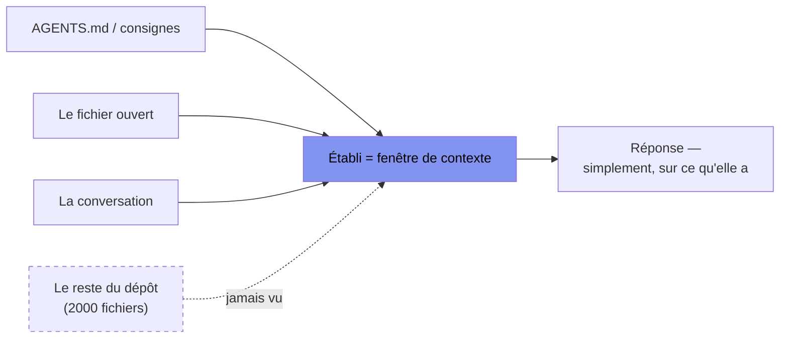

[Sommaire](Readme.md) · [Chapitre suivant →](02-spec-gherkin.md)

# Chapitre 01 — L'IA dans la chaîne de développement : modèle mental

**Accroche (sondage) :** « L'IA affirme que cette fonction existe. En combien de secondes pouvez-vous le vérifier — et comment ? »

---

## L'idée qui tient tout le cours

Un grand modèle de langage (LLM, *large language model* — ChatGPT, Claude, Gemini et leurs cousins) est **un junior d'une énergie infinie et d'une mémoire de poisson rouge**. Il code vite, il code beaucoup, il ne se plaint jamais, il ne demande pas d'augmentation. Mais il ne se souvient pas de ce que vous lui avez dit il y a quarante minutes, il ignore tout de *votre* projet, et surtout : **quand il ne sait pas, il ne le dit pas — il invente quelque chose de plausible.**

On ne manage pas un junior comme ça en espérant qu'il devienne senior du jour au lendemain. On le manage avec les outils que la profession a inventés pour les juniors depuis quarante ans : une spec claire, des tests qui savent dire non, un projet lisible, une revue, et un pipeline qui vérifie à votre place.

> **Tout ce cours tient dans une phrase : environnement > prompt.**
> Ce qui fait la différence n'est pas la formulation magique qu'on tape dans la case, mais le cadre qu'on construit autour — et qu'un capteur, lui, ne peut pas inventer.

Ce chapitre pose le modèle mental sur lequel les huit suivants s'appuient. On ne va pas « mieux prompter » : on va comprendre *ce que la machine est*, pour savoir quoi lui demander et surtout quoi **vérifier**.

## 1.1 Panorama : les IA pour développeurs, en trois familles

| Famille | Exemples | Ce que c'est, concrètement |
|---|---|---|
| **Le chat** | ChatGPT, Claude, Gemini | On colle un bout de code / une question, on reçoit une réponse. Rien ne connaît votre projet sauf ce que vous collez. |
| **L'assistant dans l'éditeur** | Copilot, Cursor | Branché sur vos fichiers ouverts ; il complète et propose dans le contexte *de l'onglet actif*. |
| **L'agent en ligne de commande (CLI)** | opencode, Claude Code, Codex CLI, OpenHands | Il lit le dépôt, lance des commandes, modifie des fichiers, relance les tests — en boucle. Les modes (complétion → agent → autonome) sont détaillés au **chapitre 07**. |

Tous les outils cités ici existent **sans licence payante** pour la formation (les offres gratuites et leurs limites sont listées dans le `Readme.md`). C'est un choix assumé : l'écologie des IA de dev bouge trop vite pour bâtir un cours sur un outil précis — on enseigne un **geste qui survit au changement d'outil**.

## 1.2 Ce qu'un LLM fait bien, ce qu'il fait mal

Avant de déléguer, il faut savoir à qui. Retenez la colonne de droite : c'est elle qui coûte cher.

| ✅ Il fait bien (délégez large) | ⚠️ Il fait mal (vérifiez toujours) |
|---|---|
| Le code courant : CRUD, glue, requêtes, regex, conversions de format | Se **souvenir** : hors de sa fenêtre de contexte, ça n'existe pas |
| Traduire entre langages, entre formats, entre « besoin » et « code » | Connaître **votre** projet sans qu'on le lui donne noir sur blanc |
| Expliquer du code, résumer, commenter | Dire « je ne sais pas » : il préfère une réponse plausible à un aveu |
| Proposer plusieurs approches avec leurs compromis | **Calculer sans exécuter** (arrondis, dates, marges, flottants) |
| Écrire des tests *à partir d'une spec claire* | Garantir la **véracité** d'une API, d'un nom de paquet, d'un numéro de version |
| Repérer un bug évident dans un extrait qu'on lui montre | Résister à une consigne contradictoire ou à une injection dans un fichier |

Le point commun de la colonne de droite : **chaque fois, la machine produit quelque chose qui a l'air juste.** Le piège n'est pas l'erreur visible, c'est l'erreur *crédible*.

## 1.3 La fenêtre de contexte, expliquée à un développeur

Un LLM ne « voit » pas votre projet. Il voit un **établi** — la fenêtre de contexte — sur lequel on ne pose que ce qu'on y met explicitement. Ce qui n'est pas sur l'établi n'existe pas pour lui, et il ne « l'oublie » pas : il ne l'a jamais eu.



Trois conséquences directes, qui reviennent tout le cours :

1. **La mémoire est un budget, pas un réservoir.** Plus on entasse de contexte « au cas où », moins la machine traite ce qui compte (et plus ça coûte). On injecte juste, on résume, on délègue — c'est le chapitre 04.
2. **Une conversation qui traîne s'enfonce.** Les hypothèses du début, périmées depuis, restent sur l'établi et contaminent la suite. Repartir d'une session propre est souvent le bon réflexe.
3. **Ce qu'on ne lui dit pas, il l'invente.** D'où la section suivante.

## 1.4 Déterminisme contre probabilité : la CI est l'arbitre

Un compilateur est **déterministe** : même entrée, même sortie, toujours. Un LLM est **probabiliste** : même question, deux réponses différentes. Ce n'est pas un bug, c'est son fonctionnement — il tire une réponse *vraisemblable*, pas *la* réponse.

Conséquence, à graver : **« ça a l'air bon » ne vaut rien.** La seule autorité qui dise si le code est juste, c'est un **capteur exécutable** — un test, un type, une règle de lint — lancé par une **intégration continue** (CI : le pipeline qui compile et teste à chaque modification). Vous ne jugez pas la sortie de l'IA à l'œil ; vous la jugez à ce que la CI renvoie.

> Démo (on la refait au chapitre 05) : la *même* consigne, deux lancements, deux implémentations différentes. Les deux « ont l'air bien ». Une seule passe les tests. C'est la CI qui tranche, jamais l'impression.

**Le TDD change alors de statut.** Le développement piloté par les tests — écrire *d'abord* un test qui échoue, puis le code qui le fait passer — s'est toujours vu reprocher d'être lent. Avec une IA, ce reproche tombe : la machine écrit les tests en secondes, presque gratis. On les écrit donc **en premier**, et ils deviennent le **harnais** — la barrière qui dit à l'agent *quand il a fini*, et qui l'empêche de casser demain ce qui marche aujourd'hui (les régressions). Ce qui était une discipline de moine devient le réflexe naturel quand on délègue à une machine qu'on ne peut pas croire sur parole. Un détail, qui est tout le chapitre 03 : le harnais ne protège que si les tests **assertent vraiment** — pas un `toBeDefined()` qui passe quoi qu'il arrive (voir l'exercice de fin de chapitre).

## 1.5 Les hallucinations côté développeur

C'est la partie qui vous coûtera le moins cher à lire que dans la vraie vie. Quatre familles, toutes mortellement plausibles — et, à chaque fois, **la commande qui démasque**.

**1. L'API inventée.** L'IA écrit `const plats = _.flattenDeepSafe(menu);`. Ce nom *sonne* juste — Lodash a bien un `flattenDeep`. Mais `flattenDeepSafe` n'existe pas. Sans vérification, on perd une heure à déboguer une fonction qui n'a jamais existé.

```ts
const plats = _.flattenDeepSafe(menu);   // proposé par l'IA
```

La commande qui l'attrape — le compilateur TypeScript en mode vérification seule :

```bash
$ npx tsc --noEmit
app.ts:1:20 - error TS2339: Property 'flattenDeepSafe' does not exist on type 'LoDashStatic'.
```

Dix secondes, et le plausible tombe. **Le capteur ne se fait pas avoir.**

**2. La dépendance fantôme et le slopsquatting.** L'IA suggère `npm install react-icon-pack`. Le vrai paquet s'appelle `react-icons` ; le nom proposé est *voisin*. Publier sur npm un nom à un caractère près d'un paquet populaire, c'est le **slopsquatting** : celui qui l'installe exécute le code de n'importe qui. Le réflexe : **on ne vérifie pas un paquet en l'installant** — on le cherche sur le registre npm.

```bash
$ npm view react-icon-pack     # ce que l'IA propose d'installer
npm error code E404            # 'react-icon-pack' n'existe pas (ou est un squat)
$ npm view react-icons version
5.4.0                          # le vrai paquet, lui, est bien là
```

(Un outil d'audit, chapitre 03, automatise cette vigilance.)

**3. Le correctif faux mais plausible.** Le grand classique, et il reviendra au chapitre 05. Demandez à convertir des euros en centimes :

```ts
function eurosVersCents(euros: number): number {
  return Math.floor(euros * 100);   // « évident », non ?
}
```

Ça a l'air juste. Sauf qu'en binaire flottant, `19.99 * 100` vaut `1998.9999…`, et `Math.floor` donne **1998**, pas 1999. Un humain relit et laisse passer ; seul un test avec un **chiffre concret** l'attrape :

```ts
expect(eurosVersCents(19.99)).toBe(1999);   // échoue → révèle le bug
```

La commande qui le fume :

```bash
$ npx vitest run
FAIL  eurosVersCents(19.99)
      attendu 1999 · reçu 1998
```

**4. Le test qui n'assert rien.** L'IA écrit volontiers un test qui « passe » sans rien vérifier (`expect(x).toBeDefined()` sur un objet qu'on vient de créer — toujours vrai). La CI passe au vert, et le vert est **faux**.

```ts
test("le panier contient l'article", () => {
  const p = new Panier();
  p.ajouter({ id: 1, prix: 10 });
  expect(p).toBeDefined();   // toujours vrai — n'assert rien
});
```

La commande ? Elle passe. Et c'est bien le problème :

```bash
$ npx vitest run
PASS  le panier contient l'article     # vert… qui ment
```

Le seul capteur ici, c'est la revue : *ce test échouerait-il si le code était cassé ?* Non — donc il ne protège rien. (Chapitre 08 : la couverture de code n'est pas le nombre d'assertions utiles.)

Le tronc commun de ces quatre pièges : **la machine ment avec assurance.** La parade n'est pas de mieux lire — c'est de ne jamais avoir à lire tout seul, et de laisser des capteurs parler à votre place.

## 1.6 Le fil du cours, posé ici

On ouvre le pipeline qui structure les deux journées. Chaque chapitre en pose un maillon :

```
conception  →  spec  →  portes  →  boucle  →  revue  →  cadre
   (02)       (02)     (03-04)     (05-07)    (08)     (09)
```

- **Spec** — ce qu'on veut, écrit si clair qu'un robot peut le vérifier (ch. 02).
- **Portes** — les capteurs qui disent non : types, tests, lint, secrets (ch. 03-04).
- **Boucle** — la CI qui rend sa copie à l'IA jusqu'à ce que ce soit juste, sous garde-fous (ch. 05-07).
- **Revue** — ce que l'humain et un capteur exécutable valident, pas l'œil (ch. 08).
- **Cadre** — la responsabilité, la réglementation, les licences (ch. 09).

Le fil, encore : **on n'améliore pas le prompt, on construit l'environnement qui rend le prompt accessoire.**

---

### EX-01 — Repérez les mensonges (15 min)

Cinq productions signées « IA ». Pour chacune, **classez-la** parmi : *API inventée* / *dépendance fantôme* / *correctif faux mais plausible* / *test qui n'assert rien* / *correcte* — et **justifiez en une phrase** (ce qui cloche, ou ce qui la rend sûre).

🔧 **Vous pouvez exécuter pour trancher** plutôt que deviner : `npx tsc --noEmit` (les types), `npm view <paquet>` (une dépendance), `npx vitest run` (un test). Les commandes exactes sont au 1.5 ci-dessus.

**①**
```ts
const plats = _.flattenDeepSafe(carte);
```

**②**
```bash
npm install react-icon-pack   # proposé par l'IA pour mettre des icônes
```

**③**
```ts
function ttc(ht: number, taux = 0.2): number {
  return Math.floor(ht * (1 + taux));
}
```

**④**
```ts
test('le panier contient l article', () => {
  const p = new Panier();
  p.ajouter({ id: 1, prix: 10 });
  expect(p).toBeDefined();
});
```

**⑤**
```ts
test('remise de 20 % sur 100 € = 80 €', () => {
  expect(prixRemise(100, 0.2)).toBe(80);
});
```

🎯 **Avant de rendre, cochez :**
- [ ] J'ai classé les 5 productions.
- [ ] Pour chaque erreur, je peux dire *quel capteur* (tsc, test chiffré, registre npm, assertion réelle) l'aurait attrapée.
- [ ] Je sais expliquer pourquoi ④ est plus dangereux qu'un test rouge.

<details>
<summary>Voir la correction</summary>

- **① API inventée.** `flattenDeepSafe` n'existe pas chez Lodash (c'est `flattenDeep`). Capteur : `npx tsc --noEmit` (propriété inconnue).
- **② Dépendance fantôme / slopsquatting.** Le paquet réel est `react-icons` ; le nom proposé est voisin. Vérification `npm view react-icon-pack` (404) contre `npm view react-icons` (existe), **avant** d'installer — jamais en installant.
- **③ Correctif faux mais plausible.** `Math.floor` tronque au lieu d'arrondir : `ttc(19.99)` = `Math.floor(19.99 × 1,2)` = **23**, alors qu'un TTC s'arrondit (23,99). Vérif : `node -e "console.log(Math.floor(19.99 * 1.2))"` → 23. Il faut `Math.round`, et un test chiffré (`npx vitest run`) pour le prouver.
- **④ Test qui n'assert rien.** `toBeDefined()` sur un objet fraîchement construit est toujours vrai : le test passe sans vérifier le comportement. C'est le plus dangereux, parce qu'il produit un **vert faux** — la CI ment.
- **⑤ Correcte.** Entrée et sortie chiffrées, assertion sur la valeur réelle : c'est exactement le type de test où l'IA ne peut pas tricher.

</details>

---

[Sommaire](Readme.md) · [Chapitre suivant →](02-spec-gherkin.md)
