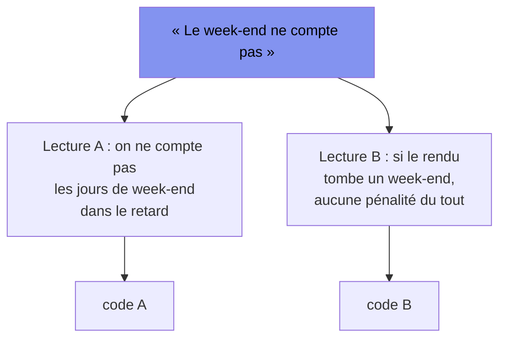

[← Chapitre précédent](01-modele-mental.md) · [Sommaire](Readme.md) · [Chapitre suivant →](03-portes-de-qualite.md)

# Chapitre 02 — Spec-first : Gherkin comme interface avec l'IA

> **Dans ce chapitre**, vous apprendrez à :
>
> - Formuler un comportement attendu en Given / When / Then à partir d'une demande floue ;
> - Écrire une feature Gherkin complète (`Feature`, `Scenario`, `Background`, `Scenario Outline` + `Examples`, tags) ;
> - Rendre un scénario exécutable par la machine en l'accrochant à des step definitions ;
> - Verrouiller une interprétation du métier par des chiffres concrets, un résultat explicite et un cas négatif ;
> - Utiliser le vert de tous les scénarios comme critère d'arrêt.

**Accroche :** « Quelle est la différence entre cette phrase d'un client et un bug ? »

---

On ne donne pas une phrase floue à un junior : il va « faire au mieux » et vous livrer quelque chose de plausible qui ne répond pas au besoin. On ne la donne pas à une IA non plus — sauf qu'avec elle, c'est pire : **elle ne lève jamais la main pour demander ce que vous vouliez dire. Elle choisit, en silence, une interprétation, et code dessus.**

La parade est la même que pour le junior, mais elle devient ici une pièce mécanique : **écrire ce qu'on veut si clair qu'un robot peut le vérifier.** C'est la *spec*. Et le langage qu'une IA lit sans ambiguïté, lisible par le client qui l'a dictée, exécutable par la CI, c'est **Gherkin**.

> Ce chapitre se vit en **TD** : on commence par un exercice *sans le cours*, on corrige ensemble (ce qui fait naître les mots), puis on formalise, puis on refait seul sur un autre cas. Les mains d'abord, le vocabulaire ensuite.

## Étape 1 — Découverte : le client a parlé (20 min, en binômes, sans le cours)

Voici la demande, telle qu'elle est arrivée au comptoir de prêt municipal (vélos et matériel), de la bouche du responsable :

> « Quand quelqu'un rend un vélo en retard, il doit payer une pénalité. Mais le week-end, ça ne compte pas. Et on ne veut pas que ça explose. »

**Votre tâche, sans ouvrir le cours :** écrivez **la liste des étapes qu'un ordinateur pourrait exécuter, sans vous relancer, pour vérifier ce comportement** — assez précises pour qu'on puisse les confier à une machine.

Un conseil : bloquez-vous sur chaque mot flou. « En retard », *retard par rapport à quoi, à partir de quelle heure ?* « Une pénalité », *combien ?* « Le week-end ne compte pas », *le week-end du rendu ? du retard ?* « Que ça explose », *à partir de combien, c'est « trop » ?* Chaque flou que vous levez est une décision — et c'est exactement là que l'IA, elle, ne vous demandera rien.

🎯 **Avant de rendre, cochez :**
- [ ] Ma liste se lit sans avoir à me reposer une question.
- [ ] J'ai noté, à côté, les décisions que j'ai prises « pour trancher » (et que le client devrait confirmer).
- [ ] Je pourrais confier cette liste à quelqu'un que je ne vois jamais.

## Étape 2 — Correction : les trois types de lignes (10 min, collectif)

Vos listes se ressemblent, et pour cause. Elles contiennent trois sortes de lignes, qu'on ne nomme pas encore :

| Ce que fait votre ligne | Le mot qu'on va lui donner |
|---|---|
| Poser la situation de départ (qui, quoi, à quelle date) | **Given** — *étant donné* |
| Déclencher l'événement qu'on teste | **When** — *quand* |
| Vérifier ce qui doit être vrai après | **Then** — *alors* |

Vous venez d'écrire du **Given / When / Then** sans le savoir. Ce n'est pas une syntaxe qu'on vous tombe dessus : c'est la forme naturelle d'une vérification, celle que vous avez produite à l'étape 1.

Et les décisions que vous avez notées « pour trancher » ? Gardez-les précieusement. **Elles sont le contrat.** Un scénario qui ne fixe pas ces chiffres laisse l'IA libre de tricher — pas par malveillance, mais parce qu'on ne lui a rien interdit.

## Étape 3 — Le cours (35 min)

### 2.1 La syntaxe, complète, sur un exemple vrai

On reprend la demande du comptoir, une fois le contrat fixé avec le client :

> **Contrat (f1 — retards).** La pénalité est de **1,50 € par jour de retard**, où un « jour de retard » est un **jour ouvré (lundi–vendredi) écoulé entre la date de retour attendue et la date de rendu, les deux bornes exclues** — donc le week-end ne compte jamais. **Plafond : 15 € par prêt.**

En Gherkin, ça s'écrit dans un fichier `.feature` :

```gherkin
# features/retards.feature
Feature: Pénalité de retard au comptoir de prêt

  Background:
    Given un adhérent identifié "A-42"

  Scenario: Un jour de retard en semaine coûte 1,50 €
    Given un vélo dû le lundi 2026-11-02
    When l'adhérent le rend le mercredi 2026-11-04
    Then 1 jour de retard est compté (le mardi)
    And la pénalité est de 1.50 €

  Scenario: Le week-end n'est pas compté dans le retard
    Given un vélo dû le jeudi 2026-11-05
    When l'adhérent le rend le lundi 2026-11-09
    Then 1 jour de retard est compté (le vendredi)
    And la pénalité est de 1.50 €
```

- **`Feature`** — le bloc métier, un par fichier.
- **`Scenario`** — un cas concret, vérifiable. Un scénario = une décision du contrat, chiffrée.
- **`Background`** — ce qui est vrai pour *tous* les scénarios du fichier (ici : il y a un adhérent). On ne le répète pas vingt fois.
- **`And`** — pour empiler sans répéter le mot-clé.

Un scénario qui répète la même forme avec des chiffres différents devient un **`Scenario Outline`** + une table **`Examples`** — une seule écriture, autant de cas :

```gherkin
  Scenario Outline: Pénalité selon les jours de retard ouvrés
    Given un vélo rendu avec <jours> jours de retard ouvré
    When je calcule la pénalité
    Then la pénalité est de <montant> €

    Examples:
      | jours | montant |
      | 0     | 0.00    |
      | 1     | 1.50    |
      | 4     | 6.00    |
      | 12    | 15.00   |   # 12 × 1,50 = 18 € → plafonné à 15 €
```

Enfin les **tags**, pour trier ce qu'on exécute (`@regle-metier`, `@cas-limite`, `@wip`…) :

```gherkin
  @regle-metier @cas-limite
  Scenario: Un retard chevauchant un week-end ne compte que les jours ouvrés
    Given un vélo dû le vendredi 2026-11-06
    When l'adhérent le rend le lundi 2026-11-09
    Then 0 jour de retard est compté
    And la pénalité est de 0.00 €
```

### 2.2 De la phrase à l'exécution : `@cucumber/cucumber`

Un `.feature` n'est pas un document : c'est un **programme**. Le chaînon entre la phrase lisible et le code qui calcule, c'est une *step definition* — une fonction TypeScript accrochée à chaque ligne Given/When/Then.

```
features/retards.feature        ← ce que lit le client
step_definitions/retards.ts     ← ce que lit la machine (l'accroche)
src/penalite.ts                 ← le code qui calcule (ce que l'IA va écrire)
```

```ts
// step_definitions/retards.ts
import { Given, When, Then } from '@cucumber/cucumber';
import assert from 'node:assert/strict';
import { penalite } from '../src/penalite.js';

Then('la pénalité est de {float} €', (attendu: number) => {
  assert.equal(penalite(), attendu);
});
```

Et on lance — c'est ça, la commande qui compte :

```bash
$ npx cucumber-js
1 scenario (1 failed)
expected 1.5 but got undefined      # rouge : src/penalite.ts n'existe pas encore
```

**Ce rouge est normal, et voulu.** Vous venez de rendre le comportement *exécutable* avant même d'écrire le code. C'est le harnais du chapitre 01, version spec : la machine sait maintenant dire « non » avant que l'IA n'arrive, et « oui » seulement quand c'est vrai.

### 2.3 Le scénario-contrat : là où l'IA ne peut pas tricher

Revenons sur la phrase du client. « Le week-end ne compte pas » admet (au moins) deux lectures, toutes deux défendables :



Face à la phrase brute, l'IA **choisit une lecture et vous livre un code qui « marche »**. Les deux codes passent un test vague. Le seul truc qui les départage, c'est un scénario qui **fixe la lecture par des dates concrètes** :

```gherkin
  # Ce scénario tranche : c'est la lecture A.
  Scenario: Rendu un lundi après une échéance du jeudi
    Given un vélo dû le jeudi 2026-11-05
    When l'adhérent le rend le lundi 2026-11-09
    Then la pénalité est de 1.50 €     # pas 0.00 € : la lecture B est écartée
```

La règle d'écriture, à retenir : **un scénario où l'IA ne peut pas tricher a (1) des chiffres concrets, (2) un résultat explicite, (3) au moins un cas négatif** (« ça ne doit *pas* se passer »). Une spec sans cas négatif laisse toujours une porte ouverte.

### 2.4 La spec est le critère d'arrêt de la boucle

Au chapitre 05, on branchera l'IA en boucle : elle code, la CI la corrige, elle recode… **Mais quand s'arrête-t-elle ?** Sans spec, le seul signal d'arrêt est votre œil — « ça a l'air bon » — et c'est un mauvais arbitre. Avec des scénarios, le signal d'arrêt est net : **quand tout est vert, on a fini ; tant qu'un scénario rouge subsiste, on n'a pas répondu au besoin.** La spec n'est pas un document qu'on rédige pour la forme : c'est le frein de la machine.

## Étape 4 — Application : la f2, le prêt de matériel avec caution (20 min, individuel)

Autre fonctionnalité du même comptoir, autre contrat. **Lisez le contrat, puis écrivez la feature.**

> **Contrat (f2 — prêt de matériel avec caution).** Un matériel (ex. un appareil photo) est prêté contre une **caution de 30 €**. À la restitution, la caution est rendue **intégralement** si le matériel est rendu à l'heure. En cas de retard, la pénalité (même règle que la f1 : **1,50 € par jour ouvré de retard**, week-end non compté, **plafond 15 €**) est retenue sur la caution, **et la caution n'est rendue qu'une fois la pénalité réglée**.

À écrire :

1. un **`Scenario Outline` chiffré** : le montant retenu selon les jours de retard ouvré (au moins : 0, 1, 4, et un cas qui touche le plafond) ;
2. un **scénario négatif** : retard non réglé → la caution n'est **pas** rendue ;
3. le **cas limite** : matériel dû le vendredi 2026-11-06, rendu le lundi 2026-11-09 → seul le week-end s'est écoulé.

🎯 **Avant de rendre, cochez :**
- [ ] Mon Outline a des montants **calculés depuis le contrat**, pas inventés.
- [ ] J'ai au moins un scénario négatif (un « ne doit pas »).
- [ ] Mon cas limite week-end dit explicitement combien de jours sont comptés.

<details>
<summary>Voir la correction</summary>

```gherkin
# features/caution.feature
Feature: Caution sur le prêt de matériel

  Background:
    Given un appareil photo prêté contre une caution de 30 €

  Scenario Outline: Retenue sur caution selon le retard
    Given un matériel rendu avec <jours> jours de retard ouvré
    When je liquide la caution
    Then <retenue> € sont retenus
    And <rendu> € sont restitués

    Examples:
      | jours | retenue | rendu |
      | 0     | 0.00    | 30.00 |
      | 1     | 1.50    | 28.50 |
      | 4     | 6.00    | 24.00 |
      | 12    | 15.00   | 15.00 |   # pénalité plafonnée à 15 €

  Scenario: La caution n'est pas rendue tant que la pénalité court
    Given un matériel rendu avec 2 jours de retard ouvré non réglés
    When je tente de restituer la caution
    Then la caution n'est pas rendue
    And la pénalité due est de 3.00 €

  @cas-limite
  Scenario: Un week-end écoulé ne retient rien
    Given un matériel dû le vendredi 2026-11-06
    When l'adhérent le rend le lundi 2026-11-09
    Then 0 jour de retard est compté
    And 30.00 € sont restitués
```

Le cas limite est la ligne à surveiller : vendredi → lundi, seuls samedi et dimanche se sont écoulés, **0 jour ouvré**, donc **0 € retenu** et caution rendue entière. Un code qui compterait les jours *calendaires* (2 jours) retiendrait 3 € — c'est exactement le bug qu'un scénario concret empêche l'IA de livrer.

</details>

---

L'amorce que vous venez d'écrire (f1 en TD, f2 en application) est l'ébauche de l'étape **E1** du TP-01 « Le comptoir de prêt » : vous ne repartirez pas de zéro.

---

## Vérifiez vos acquis

Six questions, non notées, à faire avec l'IA : elles servent à vous situer, pas à compter une note.

**1. On lance `npx cucumber-js` alors que `src/penalite.ts` n'existe pas encore : `1 scenario (1 failed)`, `expected 1.5 but got undefined`. Que dit ce résultat ?**
- A. Il est anormal : il faut écrire `src/penalite.ts` avant de lancer `npx cucumber-js`, sinon les résultats sont faux.
- B. Il est normal et voulu : le comportement est vérifiable avant que le code existe.
- C. Il signale une accroche défectueuse : la step definition de `step_definitions/retards.ts` ne correspond à aucune ligne du fichier.
- D. Il montre que la spec reste ambiguë : sans montant décidé avec le client, aucun scénario ne peut être exécuté par le moteur.

**2. Dans le trio du chapitre — `features/retards.feature`, `step_definitions/retards.ts`, `src/penalite.ts` — quel fichier est « l'accroche », ce que lit la machine ?**
- A. `features/retards.feature`, puisque c'est lui que le moteur déroule ligne par ligne à partir du premier Given.
- B. `src/penalite.ts`, car c'est le code qui calcule et donc le point d'entrée de toute l'exécution du scénario.
- C. `step_definitions/retards.ts`, une fonction TypeScript accrochée à chaque ligne Given/When/Then.
- D. Le moteur `npx cucumber-js` lui-même, qui traduit les phrases Gherkin en assertions sans fichier intermédiaire.

**3. Contrat f1 : un jour de retard est un jour ouvré écoulé entre la date de retour attendue et la date de rendu, *les deux bornes exclues*. Un matériel est dû le vendredi 2026-11-06, rendu le lundi 2026-11-09. Combien de jours de retard sont comptés ?**
- A. 0 jour : entre les deux bornes, seuls samedi et dimanche se sont écoulés.
- B. 2 jours : le décompte calendrier retient le samedi et le dimanche écoulés entre les deux dates.
- C. 1 jour : le lundi du rendu est le premier jour ouvré qui suit l'échéance du vendredi.
- D. 3 jours : la période vécue couvre le vendredi, le samedi et le dimanche avant le rendu du lundi.

**4. Contrat f2 : caution de 30 €, pénalité de 1,50 € par jour ouvré de retard, plafond de 15 € par prêt. Un matériel est rendu avec 12 jours de retard ouvré. Que donne la liquidation de la caution ?**
- A. 18,00 € sont retenus sur la caution et 12,00 € sont restitués à l'adhérent.
- B. 30,00 € sont retenus sur la caution et 0,00 € sont restitués à l'adhérent.
- C. 6,00 € sont retenus sur la caution et 24,00 € sont restitués à l'adhérent.
- D. 15,00 € sont retenus sur la caution et 15,00 € sont restitués.

**5. D'après la règle d'écriture du chapitre 02, que doit comporter un scénario pour que l'IA ne puisse pas y tricher ?**
- A. Des étapes rédigées dans l'ordre Given/When/Then, avec un Background commun à tous les scénarios du fichier.
- B. Des chiffres concrets, un résultat explicite et au moins un cas négatif.
- C. Des commentaires Gherkin expliquant la lecture retenue par le client, relus et validés avant la première exécution.
- D. Des tags de tri, par exemple `@regle-metier` et `@cas-limite`, pour que la CI les exécute avant les autres.

**6. Le chapitre 02 annonce la boucle du chapitre 05 : l'IA code, la CI la corrige, elle recode. D'après ce chapitre, qu'est-ce qui arrête la boucle ?**
- A. La relecture de l'apprenant, seul capable de juger si le résultat rendu « a l'air bon » sur l'ensemble.
- B. La borne d'itérations fixée avant de démarrer, qui clôt la séance lorsqu'elle est atteinte.
- C. Le vert de tous les scénarios : la spec est le frein de la machine.
- D. La déclaration de fin de l'agent, qui récapitule ce qu'il estime conforme à la demande qu'il a reçue.

<details>
<summary>Vérifier ses réponses</summary>

**1 — Réponse : B.** C'est le harnais du chapitre 01, version spec : la machine sait désormais dire « non » avant que l'IA n'arrive, et « oui » seulement quand c'est vrai.

Pourquoi pas les autres : écrire le code d'abord rend la vérification dépendante de ce qu'elle est censée juger ; les étapes sont bien reconnues, sinon Cucumber les signalerait comme indéfinies ; et le montant, lui, est décidé (contrat f1).

**2 — Réponse : C.** La step definition est le chaînon entre la phrase lisible et le code qui calcule : sans elle, le `.feature` reste un document.

Pourquoi pas les autres : le `.feature` est ce que lit le client ; `src/penalite.ts` est ce que l'IA va écrire ; `cucumber-js` exécute, il ne traduit pas le métier.

**3 — Réponse : A.** Les bornes sont exclues, donc ni le vendredi ni le lundi ne comptent, et le week-end n'est pas ouvré : 0 jour, 0,00 € retenu, caution rendue entière.

Pourquoi pas les autres : retenir les jours calendaires est très exactement le bug que le scénario concret empêche l'IA de livrer (3 € à tort) ; et les deux bornes — échéance comme rendu — sont exclues par le contrat.

**4 — Réponse : D.** 12 × 1,50 = 18 €, mais le plafond de 15 € s'applique : la ligne `12 | 15.00` des Examples est calculée depuis le contrat, jamais inventée.

Pourquoi pas les autres : 18,00 € est le produit sans le plafond ; 30,00 € ne correspond à rien dans le contrat ; 6,00 € est le montant de 4 jours de retard, pas de 12.

**5 — Réponse : B.** Le cas négatif (« ça ne doit *pas* se passer ») est ce qui ferme la porte : une spec sans cas négatif laisse toujours un espace d'interprétation.

Pourquoi pas les autres : la forme Given/When/Then ne tranche rien (un scénario bien ordonné et vague reste vague) ; un commentaire n'est pas vérifié par la machine ; les tags trient ce qu'on exécute, ils ne disent pas ce qui doit être vrai après.

**6 — Réponse : C.** « Quand tout est vert, on a fini ; tant qu'un scénario rouge subsiste, on n'a pas répondu au besoin » : la spec n'est pas un document pour la forme, c'est le critère d'arrêt.

Pourquoi pas les autres : le chapitre qualifie l'œil de « mauvais arbitre » ; une borne d'itérations plafonne la dépense, pas l'atteinte du besoin ; et l'IA n'arbitre pas son propre travail.

</details>

---

[← Chapitre précédent](01-modele-mental.md) · [Sommaire](Readme.md) · [Chapitre suivant →](03-portes-de-qualite.md)
