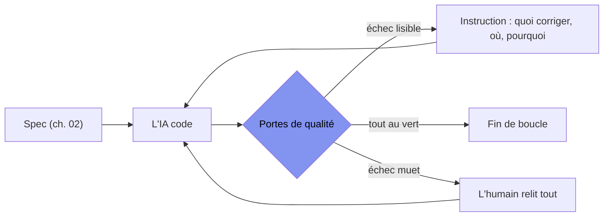
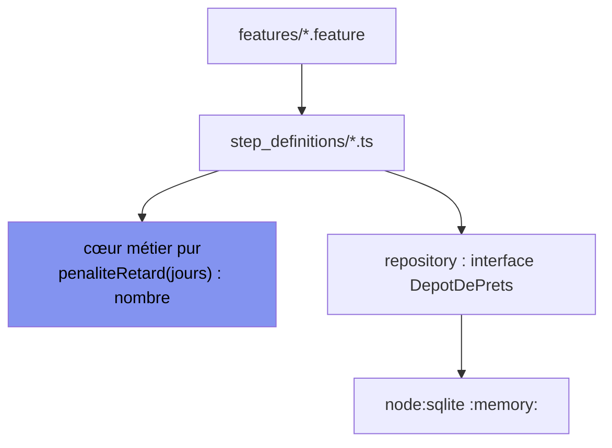

[← Chapitre précédent](02-spec-gherkin.md) · [Sommaire](Readme.md) · [Chapitre suivant →](04-contexte-projet.md)

# Chapitre 03 — Les portes de qualité : les capteurs de l'IA

> **Dans ce chapitre**, vous apprendrez à :
> - Reconnaître ce qu'une porte de qualité change quand une IA code à votre place, et pourquoi son premier client est la machine ;
> - Monter le panneau de capteurs JavaScript / TypeScript et dire, pour chacun, ce qu'il attrape ;
> - Rédiger un message d'échec qui instruit : ce qui était attendu, ce qui a été reçu, le contexte ;
> - Organiser le calcul en cœur pur et la persistance derrière une interface, pour que le verdict reste déterministe ;
> - Distinguer un vert crédible d'un vert décoratif, et vous prémunir de l'IA qui corrige le test au lieu du code.

**Accroche (sondage) :** « Votre CI est verte. Votre code est-il juste pour autant ? »

---

Le chapitre 02 nous a laissé avec quelque chose d'inconfortable : des scénarios qui passent au rouge *avant* même d'écrire le code. C'est voulu. Le chapitre 01, lui, promettait un **harnais** — la barrière qui dit à l'agent quand il a fini et qui l'empêche de casser demain ce qui marche aujourd'hui. Il manque maintenant la pièce autour : le panneau d'instruments qui fait tourner ces scénarios, et tout ce qui, à côté, empêche l'IA de nous rendre un travail qui **a l'air** fini.

Dans une équipe humaine, une porte de qualité sert à rattraper les distraits. Avec une IA, elle change de client : **le premier qu'elle instruit, c'est la machine.** Tout ce chapitre tient là.

## 3.1 Une porte de qualité, c'est un capteur qui parle le langage de l'IA

Retenez la définition en deux morceaux, parce que le second est celui qu'on oublie :

> **Une porte de qualité = un capteur exécutable + un message d'échec lisible.**

Un capteur exécutable, vous en avez déjà : un test, un scénario Gherkin, une vérification de types, une règle de lint. Le message d'échec, c'est la moitié que personne n'écrit soigneusement — et c'est pourtant elle qui travaille pour vous.

Pourquoi ? Parce qu'à partir du chapitre 05, l'IA code **en boucle** : elle propose, on lance les capteurs, on lui rend ce qu'ils ont dit, elle corrige. À ce moment-là, votre conversation avec la machine, ce n'est plus votre prompt : **c'est la sortie des capteurs.** Un échec bien écrit, c'est une instruction gratuite — vous ne la rédigez pas, vous ne la répétez pas, elle part toute seule dans la prochaine itération.



Regardez où atterrit la flèche « échec muet » : elle repasse par vous. Chiffrons ce que chaque forme coûte réellement :

| Ce que la porte renvoie | Ce que l'agent en fait | Ce que vous payez |
|---|---|---|
| `attendu 15.00 · reçu 18.00 — plafond f1` | une correction ciblée, une itération | rien |
| `exit code 1`, sans sortie | une nouvelle tentative au hasard | six itérations et votre attention |
| rien du tout (test qui n'assert rien) | **déclare la tâche terminée** | le bug, plus tard, en production |

C'est la version outillée du refrain du cours : **environnement > prompt**. Un excellent prompt explique ce que vous voulez ; un bon capteur, lui, dit ce qui est faux — et il le dit à chaque coup, sans se fatiguer.

## 3.2 La panoplie JavaScript / TypeScript

Sept capteurs, un ordre. Le tableau d'abord — on le reprend un par un, avec **la commande** et, pour chacun, un échec qui instruit face à un échec qui tait.

| Capteur | Ce qu'il attrape | La commande | Coût |
|---|---|---|---|
| `tsc --noEmit` (strict) | API inventée, `undefined` non traité, type qui ment | `npx tsc --noEmit` | secondes |
| ESLint | pièges du langage, promesses oubliées, code mort | `npx eslint .` | secondes |
| Prettier | le formatage, donc le bruit dans les diffs | `npx prettier --check .` | secondes |
| Vitest | le comportement chiffré | `npx vitest run` | secondes |
| `@cucumber/cucumber` | le contrat métier (f1, f2) | `npx cucumber-js` | secondes |
| gitleaks | une clé qui s'apprête à partir dans le dépôt | `npx gitleaks detect` | secondes |
| `npm audit` + Semgrep | dépendance vulnérable ; faille dans *votre* code | `npm audit` · `semgrep --config p/default src/` | minutes |

Semgrep fait de l'**analyse statique applicative** (SAST, *static application security testing*) : il lit la source sans l'exécuter, et cherche des formes dangereuses — un `eval`, une commande shell construite avec une entrée utilisateur, une requête SQL concaténée.

### 3.2.1 Vitest, et sa couverture V8

```ts
// src/frais.test.ts
import { expect, test } from 'vitest';
import { penaliteRetard } from './frais.js';

test('f1 · 12 jours ouvrés de retard → pénalité plafonnée', () => {
  expect(penaliteRetard(12)).toBe(15.00);
});
```

```bash
$ npx vitest run
 FAIL  src/frais.test.ts > f1 · 12 jours ouvrés de retard → pénalité plafonnée
AssertionError: expected 18 to be 15
  Expected: 15
  Received: 18
```

Ce texte-là est déjà une consigne : *18 contre 15, sur le plafond*. Un agent le lit et corrige le plafond. Un humain le lit et gagne dix minutes.

Une fois le plafond corrigé, la couverture se branche dessus :

```bash
$ npx vitest run --coverage
      Tests  1 passed (1)
 % Coverage report from v8
 File        | % Stmts | % Lines |
 src/frais.ts|  100.00 |  100.00 |
```

Provider **V8** : c'est le moteur d'exécution de Node qui dit quelles lignes ont été touchées. Gardez ce chiffre en tête, on va le casser en 3.5.

### 3.2.2 `@cucumber/cucumber` : un SQLite `:memory:` propre par scénario

Les `.feature` du chapitre 02 sont là. Ce qui les rend exploitables en série, c'est l'hygiène de la base :

```ts
// features/support/hygiene.ts
import { After, Before } from '@cucumber/cucumber';
import { readFileSync } from 'node:fs';
import { DatabaseSync } from 'node:sqlite';

const schema = readFileSync('schema.sql', 'utf8');

Before(function () {
  this.bdd = new DatabaseSync(':memory:');   // une base neuve
  this.bdd.exec(schema);                     // schéma vierge
});

After(function () {
  this.bdd.close();
});
```

```bash
$ npx cucumber-js
Failures:

1) Scenario: Un jour de retard en semaine coûte 1,50 €
   ✔ Given un adhérent identifié "A-42"
   ✔ Given un vélo dû le 2026-11-02
   ✖ When l'adhérent le rend le 2026-11-03
       AssertionError: expected 0 to be 1.5
1 scenario (1 failed)
```

Trois gains, tous décisifs quand une machine travaille : **rapide** (pas de disque, pas de service à démarrer), **isole** (chaque scénario repart d'une base vide, donc l'ordre d'exécution ne change rien), **déterministe** (deux lancements, même verdict). `node:sqlite` est intégré à Node 24 : pas de module natif à compiler, pas de conteneur de base de données dans la CI — le capteur tourne à l'identique sur un portable ARM, un poste Windows et un runner GitHub.

### 3.2.3 ESLint + Prettier : le piège que l'IA adore

ESLint n'est pas un outil de style : c'est un détecteur de **pièges du langage**. Et il en existe un que les IA écrivent tout le temps — l'appel `async` sans `await` :

```ts
// src/routes.ts — proposé par l'IA
app.post('/pret', async (req, res) => {
  cloturerCaution(req.body.id);        // async : ni await, ni .catch()
  res.json({ ok: true });
});
```

```bash
$ npx eslint src/routes.ts
src/routes.ts
  4:3  error  Expected the result of a floating promise to be used by an await expression  @typescript-eslint/no-floating-promises
```

Lisez ce que le code promet au client : « ok ». Alors que la caution n'est pas encore clôturée, et que si elle échoue personne ne le saura. Aucun test n'est nécessaire pour l'attraper — ESLint ne fait que lire. **Et le capteur donne le nom de la règle**, donc la correction.

Prettier, à côté, n'est pas un capteur : c'est un balayeur. Utile, mais qu'on ne discute pas :

```bash
$ npx prettier --check .
Checking formatting...
[warn] src/frais.ts
[warn] Code style issues found in the above file.
```

Sans lui, votre revue d'IA ressemble à 300 lignes de diff pour 3 lignes de fond. Avec lui, le diff ne montre que le fond. Automatisation, pas débat — voir 3.2.7.

### 3.2.4 `tsc --noEmit` en mode strict

`--noEmit` : vérifier les types sans produire de build. C'est la porte la moins chère du panneau, et celle du chapitre 01 (`_.flattenDeepSafe`). Mais elle ne parle bien qu'en **strict** :

```json
{
  "compilerOptions": {
    "strict": true,
    "noUncheckedIndexedAccess": true,
    "exactOptionalPropertyTypes": true
  }
}
```

```ts
// src/frais.ts — l'IA manipule une ligne lue en base
const compteurs = new Map<string, { jours: number }>();
const jours = compteurs.get(pret.id).jours;   // et si la clé est absente ?
```

```bash
$ npx tsc --noEmit
src/frais.ts:3:38 - error TS2532: Object is possibly 'undefined'.
```

En mode souple, le compilateur hausse les épaules et vous payerez cette ligne à 2 h du matin. Le `strict` n'est pas une perfection stylistique : c'est ce qui fait du capteur un capteur.

### 3.2.5 gitleaks : la porte qui vous évite l'irréparable

```bash
$ npx gitleaks detect
1 commits scanned.
1 leaks found (1 unique)

  File:    src/config.ts
  Line:    7
  RuleID:  generic-api-key
  Match:   CLE_API_PARTENAIRE = "sk-…"
```

Deux choses à comprendre ici, et elles valent un incident réel :

1. **gitleaks balaie l'historique, pas seulement les fichiers de travail.** Supprimer la ligne ne supprime pas le secret : il reste dans le commit d'hier, et n'importe qui qui clone le dépôt le retrouve. Le seul vrai remède est la **rotation** de la clé, puis la purge de l'historique.
2. Un dépôt qu'on branche sur un outil d'IA, c'est un dépôt dont le contenu **voyage** jusqu'au fournisseur du modèle. Le secret parti dans l'établi (chapitre 01) est un secret partagé. C'est aussi pourquoi `AGENTS.md` et le `.gitignore` tiennent les secrets loin du contexte — chapitre 04.

### 3.2.6 `npm audit` + Semgrep : la chaîne et votre code

`npm audit` répond à une question que l'IA ne se pose pas : *est-ce que je viens d'apporter une dépendance connue pour être trouée ?*

```bash
$ npm audit
high    Prototype pollution in minimist        GHSA-…
        minimist  <1.2.6
        fix available: 1.2.6
```

L'identifiant `GHSA-…` est un *GitHub Security Advisory* : l'avis public qui décrit la faille et la version corrigée. Le réflexe du chapitre 01 (`npm view <paquet>` **avant** d'installer) reste le premier rempart ; `npm audit` est le filet, et il court dans la CI parce que les verrous de dépendances bougent sans que personne ne le décide.

Semgrep, lui, ne regarde pas les paquets mais **votre** code :

```bash
$ semgrep --config p/default src/
src/export.ts
  ❱ High   Potential command injection
     42┆ exec(`csvexport ${req.query.chemin}`);
     rule: javascript.lang.security.detect-child-process
```

Encore une fois : le nom de la règle est une instruction. « `detect-child-process` sur la ligne 42 » se corrige tout seul ; « ça a l'air moche » non.

### 3.2.7 husky + lint-staged : la boucle locale

Tout ce qui précède, lancé **avant le commit**, sur les seuls fichiers modifiés :

```json
{
  "scripts": { "prepare": "husky" },
  "lint-staged": {
    "*.{ts,tsx}": ["eslint --fix", "prettier --write", "vitest related --run"]
  }
}
```

```bash
$ npx husky init
$ echo "npx lint-staged" > .husky/pre-commit
$ git commit -m "frais : plafond de la pénalité"
✔ eslint --fix
✔ prettier --write
✔ vitest related --run
✖ tsc --noEmit — 1 error
```

`vitest related --run` ne lance que les tests liés aux fichiers en cours de commit : deux secondes au lieu de deux minutes. La boucle locale, c'est la **même porte, quatre minutes plus tôt et sans réseau** — règle d'or : *n'envoyez jamais à la CI ce que vous pouvez savoir en deux secondes chez vous.*

Nuance à graver, parce qu'elle fonde le chapitre 05 : un hook local se contourne avec `git commit --no-verify`. **husky est une politesse, la CI est une loi.** La porte qui compte est celle qu'on ne peut pas sauter.

## 3.3 Le bon réflexe d'architecture : le calcul de frais est une fonction

Voici à quoi ressemble un dépôt où les capteurs mentent :

```ts
// step_definitions/retards.ts — l'anti-modèle
Then('la pénalité est de {float} €', async function (attendu) {
  const bdd = new DatabaseSync('comptoir.db');            // un seul fichier, partagé
  const l = await bdd.prepare('SELECT total FROM vue_pret WHERE id = ?').get(this.pretId);
  assert.equal(l.total, attendu);
});
```

Ça marche une fois. Puis : le scénario 7 dépend de ce que le scénario 3 a laissé en base ; les tests ne peuvent pas tourner en parallèle ; un lancement sur deux tombe sur « database is locked ». Et surtout, **le message d'échec ne parle plus du métier**.

> **Un capteur instable est pire qu'un capteur absent** : l'agent passe son temps à réparer ce qui n'est pas cassé, et vous finissez par ignorer le rouge.

La forme qui tient, c'est un cœur **pur** et une persistance **derrière un repository** :



```ts
// src/frais.ts — pas d'import de base, pas d'horloge système, pas d'asynchrone
export function penaliteRetard(joursOuvres: number): number {
  return Math.min(15.00, joursOuvres * 1.50);
}
```

```ts
// src/depot.ts — la seule porte vers SQLite
export interface DepotDePrets {
  joursOuvresRetard(pretId: string): Promise<number>;
  enregistrerRendu(pretId: string, dateRendu: Date): Promise<void>;
}
```

```bash
$ npx vitest run        # le test de penaliteRetard ne touche aucune base
$ npx cucumber-js       # les scénarios, eux, prennent un :memory: neuf
```

Trois bénéfices, et les trois sont pour l'IA :

- **Un cœur pur tient sur l'établi.** Une fonction de six lignes, l'agent la voit en entier ; un module qui mélange SQL, HTTP et dates, il le devine.
- **Déterministe veut dire que le vert veut dire quelque chose.** C'est la condition de tout le reste du cours.
- **La base devient interchangeable.** Le choix `node:sqlite` (built-in, pas de natif, pas de réseau) a été tranché pour que le capteur tourne pareil partout ; tant que l'accès passe par une interface, changer de base est une classe à écrire, pas un chantier.

## 3.4 Écrire des messages d'échec qui nourrissent la boucle

Un message d'échec utile a trois parties : **ce qui était attendu**, **ce qui a été reçu**, **le contexte** (quelle règle, quel identifiant, quelle date). Sans les trois, l'agent repart à l'aveugle.

| Échec muet | Pourquoi c'est muet | La version qui nourrit |
|---|---|---|
| `exit code 1` sans sortie | le script avale stdout (ou `--silent`) | garder le diff complet, jamais de mode silencieux |
| `expect(x).toBeTruthy()` | ne dit pas ce qui était attendu | `expect(montant, "plafond f1 : 15,00 €").toBe(15.00)` |
| `assert.ok(lignes.length > 0)` | la longueur réelle reste cachée | `assert.equal(lignes.length, 3, "3 prêts attendus")` |
| `test('frais')` | le nom ne porte aucune règle | `test('f1 · 12 j ouvrés → 15,00 €')` |
| `try { … } catch { }` dans un test | l'erreur est avalée, le test passe | laisser fuser ; n'attraper que ce qu'on nomme |

Vitest accepte un message d'assertion en second argument ; avec `node:assert` (celui des step definitions du chapitre 02), c'est le troisième :

```ts
expect(penaliteRetard(12), "plafond f1 : 15,00 €").toBe(15.00);
assert.equal(penaliteRetard(12), 15.00, "plafond f1 : 15,00 €");
```

```bash
$ npx vitest run
 FAIL  f1 · 12 j ouvrés → 15,00 €
AssertionError: plafond f1 : 15,00 € — expected 18 to be 15
```

Écrivez ce texte comme vous écririez une consigne à un junior : court, chiffré, sans ambiguïté. À partir du chapitre 05, **ce texte est le prompt de la prochaine itération.**

### EX-03 — Rendez cet échec comestible (10 min)

Le test suivant est passé par toutes les CI du monde. Voilà ce qu'il produit :

```ts
// src/frais.test.ts — tel que livré par l'IA
test('frais', () => {
  const f = calculerFrais({ type: 'velo', joursOuvres: 12 });
  expect(f.ok).toBe(true);
});
```

```bash
$ npx vitest run
 FAIL  src/frais.test.ts > frais
AssertionError: expected false to be true
```

Rappel du contrat f1 (chapitre 02) : **1,50 € par jour ouvré de retard, plafond 15 € par prêt.** On vous dit que `calculerFrais` renvoie un objet contenant notamment `penalite` (le montant dû, en euros) et `ok`.

**Votre tâche :** réécrivez ce test pour qu'un agent qui lit sa sortie sache **quelle règle** a échoué, **quel montant** était attendu et **quel montant** a été rendu. Trois contraintes : ne changez pas le comportement testé, gardez les mêmes données d'entrée, et ne mettez aucun chiffre que l'énoncé ne contient pas.

🔧 Pour vérifier votre version : `npx vitest run` — lancez-la et lisez votre propre sortie à voix haute. Est-ce qu'elle se suffit à elle-même ?

🎯 **Avant de rendre, cochez :**
- [ ] Le nom du test porte la règle et le cas, pas « frais ».
- [ ] La sortie contient à la fois le montant attendu et le montant reçu.
- [ ] Un collègue qui n'a pas lu le code peut dire ce qui est cassé.
- [ ] Si je casse `calculerFrais` (par exemple en retirant le plafond), ce test vire au rouge.

<details>
<summary>Voir la correction</summary>

```ts
// src/frais.test.ts
import { expect, test } from 'vitest';
import { calculerFrais } from './frais.js';

test('f1 · 12 jours ouvrés de retard → pénalité plafonnée à 15,00 €', () => {
  const { penalite } = calculerFrais({ type: 'velo', joursOuvres: 12 });
  expect(penalite, "plafond f1 : 15,00 €").toBe(15.00);
});
```

Ce qui a changé, et pourquoi ça compte :

- **Le nom** porte la règle (f1), le cas (12 jours ouvrés) et l'attendu (15,00 €) : la ligne du `FAIL` est déjà à moitié la correction.
- **L'assertion porte sur la valeur métier** (`penalite`), pas sur un booléen de confort (`ok`) — un booléen ne dit jamais *combien*.
- **Le message** nomme la règle, donc la prochaine itération de l'agent est ciblée.
- **Dernier point de la checklist** : c'est le vrai test de qualité du test. Un test qui ne rougit pas quand on casse le code n'est pas un capteur, c'est une décoration (promesse tenue au chapitre 08).

</details>

## 3.5 Le piège du « tout au vert »

Revenons à notre couverture à 100 %.

```bash
$ npx vitest run --coverage
      Tests  14 passed (14)
 % Coverage report from v8
 File         | % Stmts | % Lines |
 src/frais.ts |  100.00 |  100.00 |
```

Beau panneau. Maintenant regardez les 14 tests :

```ts
test('frais', () => {
  const f = calculerFrais({ type: 'velo', joursOuvres: 3 });
  expect(f).toBeDefined();       // toujours vrai
});
```

La couverture mesure **ce qui a été exécuté**, pas **ce qui a été vérifié**. Ces 14 tests touchent toutes les lignes et n'en conteste aucune. C'est exactement le vert faux du chapitre 01 (§ 1.5, le test qui n'assert rien) — sauf qu'ici il est décoré d'un pourcentage.

> **Couverture ≠ assertions.** 100 % de lignes exécutées peut vouloir dire 0 propriété vérifiée.

Et il y a un second piège, propre à l'ère des agents. Quand on demande à une IA de « faire passer la CI », elle a deux chemins : corriger le code, ou **corriger le test**. Elle prend parfois le second, et le diff est court, et la CI passe :

```diff
-    expect(penaliteRetard(12)).toBe(15.00);
+    expect(penaliteRetard(12)).toBe(18);
```

Trois garde-fous, à mettre en place maintenant et à durcir au chapitre 05 :

1. **Le contrat n'est pas négociable par celui qui code.** Les `.feature` viennent du métier ; un agent ne les modifie pas sans accord humain.
2. **La CI signale les modifications de tests** (`features/`, `*.test.ts`) dans un job rouge ou un commentaire dédié — pour que le vert soit lu avec le diff sous les yeux.
3. **La revue commence par le diff des tests**, pas par celui du code. C'est là que se cache le mensonge.

**Alors, réponse au sondage.** Votre CI est verte : votre code est-il juste ? **Non — pas automatiquement.** Le vert prouve l'exécution, pas la justesse. Ce qui rend un vert crédible, c'est trois choses : une assertion qui nomme un chiffre, un scénario qui vient du contrat et non du code, et un capteur que vous auriez vu rougir si le code était faux. Tenez ces trois-là, et le vert devient une autorité.

## Démo — la même tâche, deux dépôts

Même consigne, deux états du dépôt « Comptoir de prêt », même agent : *« Ajoute la pénalité de retard au comptoir. »*

| | Dépôt nu | Dépôt équipé |
|---|---|---|
| Ce que l'agent écrit | `frais.ts` **plus** un `frais.test.ts` à sa façon | le code, et rien d'autre |
| Ce qui le contredit | rien | `npx cucumber-js` : 2 scénarios rouges (cas week-end, plafond) |
| Ses itérations | 6, à deviner votre intention | 2, en lisant attendu / reçu |
| Votre temps | 45 min, dont l'essentiel à relire du code qui « a l'air bien » | 10 min, dont presque rien à relire |
| Verdict rendu | « les tests passent » — 14 tests, 0 assertion utile | vert, et ce vert veut dire quelque chose |

Le détail qui fâche, sur le dépôt nu : l'agent n'a **pas** échoué. Il a **terminé**. Sans capteur, « terminé » est la seule réponse qu'il puisse produire — il n'a aucun moyen de savoir qu'il a tort.

C'est la démonstration la plus rentable des deux journées. Le gain ne s'achète pas dans la formulation du prompt : il s'achète dans les vingt minutes de réglage du dépôt. **Environnement > prompt.**

### EX-A — Équiper le dépôt nu (45 min, binômes en sous-groupes)

Vous recevez le dépôt « Comptoir de prêt » **livré nu** : service Node/TypeScript (Node 24), couche SQLite **fournie** (`db.ts`, `schema.sql`, connexion `:memory:`), les `.feature` du chapitre 02 dans `features/`. Aucun test, aucune config, aucun pipeline. Et **un secret planqué** quelque part.

Le but n'est pas d'écrire le métier : c'est de monter le panneau de capteurs autour.

**Checkpoint A1 — les capteurs qui parlent (25 min)**

1. Vitest : `npm install --save-dev vitest @vitest/coverage-v8`, puis un script `test`. Écrivez **un** test chiffré sur la pénalité (f1). Vérifiez : `npx vitest run`.
2. Cucumber : `npm install --save-dev @cucumber/cucumber tsx` (la config de chargement TypeScript est fournie). Vérifiez : `npx cucumber-js`.
3. Le trio de lecture : ESLint, Prettier, `tsc --noEmit` en strict. Vérifiez : `npx eslint .`, `npx prettier --check .`, `npx tsc --noEmit`.

> **Contrôle A1 :** les scénarios du TD doivent tourner **rouges** — c'est le point de contrôle, pas un problème. Mais ce rouge doit être **exploitable** : attendu, reçu, règle. Un rouge muet = l'étape n'est pas finie.

**Checkpoint A2 — la porte qui ne se saute pas (20 min)**

4. gitleaks : `npx gitleaks detect`. Le dépôt nu contient une clé API planquée (elle est fictive). Trouvez **quel fichier, quelle ligne**, et dites ce qu'on fait d'une clé trouvée.
5. Boucle locale : `npm install --save-dev husky lint-staged`, `npx husky init`, hook `pre-commit` qui passe par lint-staged.
6. Pipeline GitHub Actions : `.github/workflows/ci.yml` avec **4 jobs séparés** — `tests`, `lint-types`, `audit`, `secrets` — aux noms explicites.

> **Contrôle A2 :** la CI passe, **sauf** les scénarios non implémentés, listés comme « dette » dans le job. Et sur un job rouge, vous devez pouvoir dire **en un coup d'œil quelle famille a cassé** sans ouvrir le log.

**Interdits :** ne réécrivez pas la plomberie SQLite fournie ; ne modifiez **aucun** `.feature` — le contrat ne se négocie pas par celui qui code.

🎯 **Avant de rendre, cochez :**
- [ ] A1 : `npx cucumber-js` affiche au moins un rouge avec attendu / reçu.
- [ ] A1 : `npx tsc --noEmit` et `npx eslint .` sortent propres, ou avec une liste que je sais expliquer.
- [ ] A2 : je sais dire où était le secret, et pourquoi gitleaks l'a vu même si le code ne s'en sert plus.
- [ ] A2 : je peux nommer les 4 jobs et dire ce que chacun attrape.
- [ ] Aucun `.feature` n'a été modifié par mon binôme ni par moi.

**Débrief (5 min, en reprise de pause) :** chaque sous-groupe donne *le* message d'échec dont il est le plus fier, et *le* muet qu'il n'a pas su corriger.

> 📍 **Le Comptoir après EX-A.** Il est *équipé* : les portes parlent (Vitest, Cucumber, ESLint, Prettier, `tsc`), gitleaks a débusqué le secret planqué, husky et la CI à 4 jobs veillent au grain. Le métier, lui, n'est pas écrit — et c'est voulu. Prochaine brique : **EX-B** (chapitre 04), vos règles dans un `AGENTS.md`.

<details>
<summary>Voir la correction</summary>

Configuration de référence — c'est *une* façon correcte de monter le panneau, pas la seule.

```json
{
  "type": "module",
  "engines": { "node": ">=24" },
  "scripts": {
    "test": "vitest run",
    "test:cov": "vitest run --coverage",
    "bdd": "cucumber-js",
    "lint": "eslint .",
    "fmt": "prettier --check .",
    "types": "tsc --noEmit",
    "prepare": "husky"
  },
  "lint-staged": {
    "*.{ts,tsx}": ["eslint --fix", "prettier --write", "vitest related --run"]
  }
}
```

```ts
// vitest.config.ts
import { defineConfig } from 'vitest/config';

export default defineConfig({
  test: {
    include: ['src/**/*.test.ts'],
    coverage: { provider: 'v8', reporter: ['text'] }
  }
});
```

`cucumber.json`, pour que les step definitions TypeScript soient chargés (par `tsx`) :

```json
{
  "paths": ["features/**/*.feature"],
  "import": ["features/support/**/*.ts", "features/step_definitions/**/*.ts"],
  "requireModule": ["tsx/cjs"]
}
```

```js
// eslint.config.js — ESLint 9, config plate, type-aware (requise par no-floating-promises)
import tseslint from 'typescript-eslint';

export default tseslint.config(
  { ignores: ['dist/', 'coverage/'] },
  ...tseslint.configs.recommendedTypeChecked,
  { languageOptions: { parserOptions: { projectService: true } } }
);
```

```bash
# .husky/pre-commit
npx lint-staged
```

```yaml
# .github/workflows/ci.yml — quatre jobs séparés, des noms qui se lisent
name: ci
on: [push, pull_request]

jobs:
  lint-types:
    name: lint-types (prettier, eslint, tsc --noEmit)
    runs-on: ubuntu-latest
    steps:
      - uses: actions/checkout@v4
      - uses: actions/setup-node@v4
        with: { node-version: 24 }
      - run: npm ci
      - run: npx prettier --check .
      - run: npx eslint .
      - run: npx tsc --noEmit

  tests:
    name: tests (vitest + cucumber — dette : scénarios f2 non implémentés)
    runs-on: ubuntu-latest
    steps:
      - uses: actions/checkout@v4
      - uses: actions/setup-node@v4
        with: { node-version: 24 }
      - run: npm ci
      - run: npx vitest run
      - run: npx cucumber-js

  audit:
    name: audit (dépendances npm)
    runs-on: ubuntu-latest
    steps:
      - uses: actions/checkout@v4
      - uses: actions/setup-node@v4
        with: { node-version: 24 }
      - run: npm ci
      - run: npm audit --audit-level=high

  secrets:
    name: secrets (gitleaks, historique compris)
    runs-on: ubuntu-latest
    steps:
      - uses: actions/checkout@v4
        with: { fetch-depth: 0 }
      - uses: gitleaks/gitleaks-action@v2
        env:
          GITHUB_TOKEN: ${{ secrets.GITHUB_TOKEN }}
```

**Pourquoi quatre jobs et pas un seul « tout »** : quand un job échoue, son **nom** classe le problème avant même d'ouvrir le log. C'est lisible par un humain (quatre pastilles) et par une machine (un agent qui lit `gh run view` sait s'il doit toucher au code, aux dépendances ou à rien). Un job unique vous rend un `exit code 1` — le muet de 3.4, version pipeline.

**Le secret** : une fois trouvé, on ne « supprime pas la ligne ». On **fait tourner** la clé (elle est fictive ici, réelle dans la vie), on la sort du code (variable d'environnement, `.env` tenu hors du dépôt et dans `.gitignore`), puis on purge l'historique si le dépôt a été poussé. `fetch-depth: 0` dans le job `secrets` sert exactement à ça : sans l'historique complet, gitleaks ne voit pas les commits d'avant.

**Et le job `audit` qui rouge** : c'est une décision, pas un bruit. Soit on lève la version, soit on assume et on le trace — jamais on ne le passe en `continue-on-error` pour avoir la paix, sinon on a remplacé un capteur par une décoration.

</details>

---

**Le dépôt équipé par votre binôme n'est pas un jouet jetable** : c'est le point de départ de ceux qui prendront le module d'extension TP-01. Ce que vous venez de régler ici, personne n'aura à le régler deux fois.

---

## Vérifiez vos acquis

Six questions, non notées, à faire avec l'IA : elles servent à vous situer, pas à compter une note.

**1. Le chapitre écrit : « Un échec bien écrit, c'est une instruction gratuite. » Que veut dire *gratuite* ici ?**
- A. Elle ne coûte rien à installer, puisque tous les capteurs du panneau sont des outils libres et gratuits.
- B. Elle remplace le prompt initial, ce qui dispense d'écrire une spec Gherkin avant de laisser l'IA coder.
- C. Elle se rédige toute seule et repart dans la prochaine itération sans qu'on la répète.
- D. Elle s'adresse d'abord à l'humain, car l'agent, lui, ne lit que les consignes du fichier AGENTS.md.

**2. Dans `src/routes.ts`, l'IA écrit `cloturerCaution(req.body.id);` sans `await` dans un handler `async`, puis `res.json({ ok: true })`. Le chapitre affirme qu'aucun test n'est nécessaire pour l'attraper. Pourquoi ?**
- A. ESLint exécute le handler avec une fausse requête et remarque que la promesse reste en suspens à la fin.
- B. Prettier réécrit la ligne en y ajoutant l'`await` manquant, ce qui règle le problème avant le commit.
- C. La règle n'intervient qu'à l'exécution, au moment où Node émet un avertissement pour promesse non attendue.
- D. ESLint lit le code sans l'exécuter, et la règle qui tombe nomme le défaut donc la correction.

**3. gitleaks a signalé `CLE_API_PARTENAIRE` ligne 7 de `src/config.ts`. Un développeur supprime la ligne, committe, et propose de clore l'incident. Que répond le chapitre ?**
- A. C'est clos dès lors que le job secrets de la CI est repassé au vert sur le dernier commit poussé.
- B. Ce n'est pas clos : la clé vit encore dans le commit d'hier, il faut la faire tourner.
- C. C'est clos si le fichier est ajouté au `.gitignore`, ce qui empêche ensuite gitleaks de le rescanner.
- D. Ce n'est pas clos, mais il suffit d'amender le commit pour que la ligne disparaisse de l'historique.

**4. Un apprenant saute le hook `pre-commit` avec `git commit --no-verify` et pousse un commit rouge. Quelle leçon le chapitre en tire-t-il ?**
- A. husky est une politesse, la CI est une loi : la porte qui compte est celle qu'on ne saute pas.
- B. Il faut multiplier les hooks déclarés dans plusieurs fichiers de config pour le rendre impossible à contourner.
- C. Il faut écrire l'interdiction de `--no-verify` dans `AGENTS.md` pour que l'agent s'y tienne.
- D. Le hook a joué son rôle, puisque l'erreur finit par apparaître dans le message du commit suivant.

**5. Les step definitions ouvrent toutes le même fichier `comptoir.db`, et le verdict tombe un lancement sur deux avec « database is locked ». Quel est, selon le chapitre, le vrai dommage ?**
- A. Le dommage est d'abord technique : il faut remplacer SQLite par un conteneur de base de données dédié.
- B. Le dommage est d'abord temporel : la suite tourne plus lentement et la boucle de correction s'en trouve ralentie.
- C. Un capteur instable vaut pire qu'un capteur absent : on finit par ignorer le rouge.
- D. Le dommage est marginal, pourvu que les scénarios s'exécutent chaque fois dans le même ordre.

**6. Sur le dépôt nu, l'agent livre `frais.ts` plus 14 tests sans assertion utile, puis annonce « les tests passent ». Comment le chapitre qualifie-t-il ce rendu ?**
- A. Il a échoué, et c'est la preuve qu'il aurait fallu lui confier une tâche plus petite, mieux découpée.
- B. Il a triché volontairement en affaiblissant les tests pour rendre la tâche plus vite qu'on ne l'attendait.
- C. Il a réussi sur le fond, puisque 14 tests exécutés à 100 % de couverture forment le panneau attendu.
- D. Il n'a pas échoué, il a terminé : sans capteur, « terminé » est sa seule réponse possible.

<details>
<summary>Voir les réponses</summary>

**1 — Réponse : C.** À partir du chapitre 05, votre conversation avec la machine, ce n'est plus votre prompt : c'est la sortie des capteurs. Vous n'écrivez pas l'instruction et vous ne la répétez pas : elle part toute seule dans la prochaine itération.

Pourquoi pas les autres : « gratuite » ne parle pas du prix (les outils sont gratuits, mais ce n'est pas l'argument) ; l'échec ne remplace pas la spec, les `.feature` du chapitre 02 restent le contrat ; et c'est l'inverse — « le premier qu'une porte de qualité instruit, c'est la machine ».

**2 — Réponse : D.** `@typescript-eslint/no-floating-promises` est une règle type-aware qui se contente de lire : elle attrape le « ok » promis au client alors que la caution n'est pas clôturée et que son échec ne sera jamais su. Et comme elle donne le nom de la règle, la correction est déjà écrite.

Pourquoi pas les autres : ESLint n'exécute rien du tout, c'est un analyseur statique ; Prettier ne touche pas la sémantique, il formate ; et Node n'avertit pas — la promesse flottante échoue en silence, le client a déjà reçu « ok ».

**3 — Réponse : B.** gitleaks balaie l'historique, pas seulement les fichiers de travail : quiconque clone le dépôt retrouve la ligne d'avant. Le seul vrai remède est la rotation de la clé, puis la purge de l'historique si le dépôt a été poussé — d'où `fetch-depth: 0` dans le job `secrets`.

Pourquoi pas les autres : un vert sur le dernier commit ne dit rien de ce qui précède ; `.gitignore` agit sur ce qui n'est pas encore suivi, jamais sur ce qui est déjà commité ; et amender ne suffit pas dès que le dépôt a été poussé — un secret parti dans l'établi est un secret partagé, on le révoque.

**4 — Réponse : A.** « Un hook local se contourne avec `git commit --no-verify` » : la boucle locale rend le même verdict quatre minutes plus tôt et sans réseau, mais elle n'a aucune autorité. La porte qui compte est celle qu'on ne peut pas sauter — nuance à graver, parce qu'elle fonde le chapitre 05.

Pourquoi pas les autres : aucun empilement de hooks locaux ne devient obligatoire, tous se contournent depuis le poste ; `AGENTS.md` documente un contexte, il n'applique rien ; et le hook sauté n'a rien vu passer du tout.

**5 — Réponse : C.** L'agent passe son temps à réparer ce qui n'est pas cassé, et vous finissez par ne plus croire au rouge — or c'est la condition de tout le reste du cours : il faut que le vert veuille dire quelque chose. La forme qui tient est un cœur pur avec la persistance derrière une interface, et une base `:memory:` neuve par scénario.

Pourquoi pas les autres : pas besoin de remplacer SQLite par un conteneur, `node:sqlite` est intégré à Node 24 ; la lenteur est un désagrément mineur face à la perte de déterminisme ; et fixer l'ordre ne répare ni la dépendance entre scénarios, ni l'impossibilité du parallèle, ni le message d'échec qui ne parle plus du métier.

**6 — Réponse : D.** Il n'a aucun moyen de savoir qu'il a tort. Sur le dépôt équipé, la même consigne prend deux itérations et dix minutes, parce que `npx cucumber-js` le contredit avec attendu et reçus : le gain ne s'achète pas dans la formulation du prompt mais dans les vingt minutes de réglage du dépôt. Environnement > prompt.

Pourquoi pas les autres : la consigne était claire et la tâche à sa taille, c'est le dépôt qui manquait de capteurs ; il n'y a pas d'intention là-dedans, l'agent écrit simplement des tests à sa façon ; et la couverture mesure ce qui a été exécuté, pas ce qui a été vérifié — `expect(f).toBeDefined()` est toujours vrai.

</details>

---

[← Chapitre précédent](02-spec-gherkin.md) · [Sommaire](Readme.md) · [Chapitre suivant →](04-contexte-projet.md)
