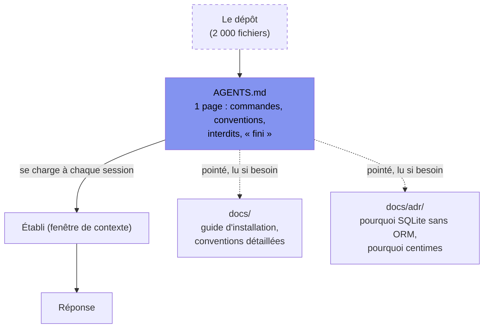

[← Chapitre précédent](03-portes-de-qualite.md) · [Sommaire](Readme.md) · [Chapitre suivant →](05-boucle-ci.md)

# Chapitre 04 — Ingénierie du contexte : rendre le projet lisible par l'IA

> **Dans ce chapitre**, vous apprendrez à :
> - Écrire un fichier d'instructions `AGENTS.md` d'une page, en cinq rubriques ;
> - Juger l'utilité d'une ligne : ne garder que celles qu'un agent peut enfreindre ;
> - Alléger le contexte en pointant `docs/` et les ADR au lieu de tout recopier ;
> - Repérer une session encombrée et repartir propre avec une passation de dix lignes ;
> - Exclure de l'établi secrets, données personnelles et fichiers ignorés par git.

**Accroche (sondage) :** « Combien coûte un fichier ouvert "au cas où" dans la fenêtre de contexte ? »

---

Le chapitre 01 a laissé une image : l'IA ne voit pas votre projet, elle voit un **établi** — la fenêtre de contexte — et rien d'autre. Le chapitre 03 a équipé le dépôt de capteurs qui savent dire non. Il manque une pièce, et c'est la moins glorieuse de toutes : **un fichier texte à la racine**, dans lequel vous écrivez une fois ce que vous répétez sinon tous les jours.

Un junior bien géré a une fiche de poste, un README d'onboarding et une page wiki. Un junior mal géré a un chef qui lui crie « non, pas ça » toutes les vingt minutes. Avec l'IA, la deuxième méthode a un nom : *prompt engineering au jugé*, et elle épuise celui qui la pratique. Le refrain du cours tient ici mieux qu'ailleurs : **environnement > prompt**. Un prompt meurt avec la session ; un fichier d'instructions travaille à chaque session, y compris celles que vous n'avez pas encore ouvertes.

## 4.1 Les fichiers d'instructions : qui lit quoi

Presque tous les outils ont inventé le leur. Quatre noms, une seule idée : **un fichier du dépôt que l'outil injecte tout seul au démarrage de la session**, sans que vous colliez rien.

| Fichier | Outil concerné | Statut |
|---|---|---|
| `AGENTS.md` | opencode, Codex CLI, Claude Code, OpenHands… | **standard émergent**, ouvert et indépendant de l'éditeur — c'est **celui qu'on écrit** |
| `CLAUDE.md` | Claude Code | spécifique à un outil |
| `.cursorrules` | Cursor (le mécanisme a depuis bougé vers un dossier `.cursor/rules/`, même fonction) | spécifique à un outil |
| `.github/copilot-instructions.md` | GitHub Copilot | spécifique à un outil, lu sur tout le dépôt |

Trois remarques qui vous éviteront des heures de debugging de consignes :

1. **Écrivez `AGENTS.md`, et faites des autres un pointeur.** Un fichier d'une ligne qui dit « voir `AGENTS.md` » suffit. Deux fichiers qui disent des choses différentes, c'est l'agent qui choisit lequel obéit — et il ne vous le dira pas.
2. **Cela se lit au démarrage, pas à la demande.** Le contenu est posé sur l'établi à chaque session, qu'il serve ou non. C'est pour ça que la règle de la section suivante est une page, pas dix.
3. **Certains outils lisent aussi un fichier dans le sous-dossier le plus proche** : en monorepo, un `packages/api/AGENTS.md` complète celui de la racine. Utile, et dangereux si personne ne sait lequel a parlé.

## 4.2 Anatomie d'un `AGENTS.md` qui tient la route

Cinq rubriques. Pas six, pas huit — cinq, parce que chaque rubrique en trop est du contexte payé et jamais lu.

| Rubrique | Ce qu'elle répond | Exemple |
|---|---|---|
| **Commandes** | comment on lance, comment on vérifie | `npm test`, `npx tsc --noEmit`, `npm run check` |
| **Conventions** | comment on écrit ici, pas « en général » | l'argent se calcule en centimes |
| **Arborescence commentée** | où vit quoi, et où on ne touche pas | `src/repo/` = seul endroit qui parle à SQLite |
| **Interdits** | ce qui est défendu même si ça fait gagner du temps | pas de nouvelle dépendance |
| **Définition de « fini »** | à quelle condition l'agent a le droit de dire « c'est bon » | `npm run check` vert + liste des scénarios encore rouges |

Et le test d'utilité d'une ligne, à appliquer sans pitié : **est-ce qu'un agent pourrait en dévier ?** « Sois rigoureux et écris du code propre » ne peut pas échouer, donc ne sert à rien — c'est de la place sur l'établi perdue pour toujours. « Pas de `any`, pas de `@ts-ignore` » peut échouer, donc travaille.

**Ce qu'on n'y met pas** : l'histoire du projet, la formation à Node, la doc complète (elle est dans `docs/`, voir 4.3), les goûts subjectifs non vérifiables, les secrets (jamais), et **les chiffres du contrat métier recopiés depuis les `.feature`** — deux sources d'un même montant finissent toujours par diverger, et c'est l'agent qui arbitre.

### L'exemple complet : le dépôt « Comptoir de prêt »

Voici à quoi ressemble le fichier, une fois le dépôt équipé au chapitre 03. Il tient sur une page, et chaque ligne est une ligne qu'un agent peut enfreindre.

```markdown
# Comptoir de prêt — consignes agent

Service de prêt municipal (vélos et matériel). Node 24, TypeScript strict,
SQLite via `node:sqlite` (built-in : ne pas ajouter de dépendance SQLite).

Le contrat métier (retards, caution) est écrit dans `features/*.feature`.
C'est la seule source des montants : ne les recopie nulle part, ne les
inventer jamais. Si un chiffre manque, demande-le.

## Commandes
    npm install
    npm test                     # vitest run
    npx cucumber-js              # scénarios Gherkin
    npx tsc --noEmit             # types seuls, ne produit pas de JS
    npx eslint . --max-warnings 0
    npm run format               # prettier --write
    npx gitleaks detect          # secrets
    npm run check                # les portes d'un coup : à lancer avant de dire « fini »

## Conventions
- Cœur métier pur : `src/domaine/` n'importe ni SQLite ni HTTP. Le calcul de
  pénalité est une fonction pure, testable sans base.
- Persistance derrière un repository : `node:sqlite` n'est importé que dans `src/repo/`.
- Argent : on calcule en centimes (entiers), jamais en flottants.
  Conversion dans `src/domaine/monnaie.ts`.
- Un test asserte une valeur concrète. Un `expect(x).toBeDefined()` seul est refusé.

## Arborescence
    src/domaine/penalite.ts    calcul des retards — pur
    src/domaine/monnaie.ts     euros <-> centimes
    src/repo/                  accès SQLite (seul autorisé)
    src/http/                  routes
    features/                  le contrat : ne se réécrit pas seul
    step_definitions/          accroches Gherkin
    db/schema.sql              schéma : la migration est humaine

## Interdits
- Ne pas modifier `db/schema.sql`, n'écrire aucune migration.
- Ne pas ajouter ni changer une dépendance (`package.json`) : demande d'abord.
- Ne pas modifier un `.feature`. Un scénario te semble faux ? Dis-le, ne le corrige pas.
- Pas de `any`, pas de `@ts-ignore`, pas de test passé en `.skip` pour verdir.
- Ne rien committer, ne rien pousser.
- Ne pas lire `data/` ni `.env`.

## Definition of done
`npm run check` vert et `npx gitleaks detect` sans remontée.
Aucun fichier hors du périmètre demandé n'est modifié.
Les scénarios encore rouges sont listés à la fin, avec la raison de chacun.
```

Le script agrégé qu'il invoque se déclare une fois dans `package.json` :

```json
"scripts": {
  "check": "npm test && npx cucumber-js && npx tsc --noEmit && npx eslint . --max-warnings 0"
}
```

Et la commande qui vérifie que le fichier lui-même ne salit pas le dépôt :

```bash
$ npx gitleaks detect
● no leaks found in the current directory        # un AGENTS.md ne contient jamais de clé
```

**Comment on teste un `AGENTS.md` ?** Pas en le relisant — en ouvrant une session fraîche et en donnant une vraie tâche. C'est la démo 4.6, et c'est l'exercice EX-B.

## 4.3 Progressive disclosure : le fichier est une carte, pas le territoire

Un `AGENTS.md` qui contient tout ne contient rien : noyé dans trois pages d'explications, l'interdit important ne pèse plus. La technique est celle d'un bon README : **le fichier indexe, les documents détaillent.**



Les pointeurs qui comptent le plus :

- **`docs/`** — l'installation qui marche, le format des journaux, la nomenclature des routes. L'agent y va quand la tâche l'exige, pas quand il démarre.
- **`docs/adr/`** — les *Architecture Decision Records* (ADR) : une demi-page par décision, avec son **pourquoi** (`0001-sqlite-sans-orm.md`, `0002-argent-en-centimes.md`). C'est la rubrique qu'un agent lit le plus volontiers et qu'un humain relit le plus utilement, parce qu'elle empêche la casse la plus coûteuse : **l'agent qui « améliore » une décision que vous aviez prise pour une bonne raison.** Sans ADR, il ne voit que le code, et le code ne dit pas pourquoi.

Le geste de tri, quand le fichier grossit : une ligne devient-elle une explication ? Elle part dans `docs/` et laisse une ligne de pointeur. Une ligne devient-elle une discussion sur un choix ? Elle devient un ADR.

## 4.4 Optimiser à l'exécution : injecter, résumer, déléguer

Le fichier ne règle que ce qui est permanent. Sur une session en cours, il y a trois leviers, et c'est de la gestion, pas de la technique.

| Levier | Geste concret | Quand |
|---|---|---|
| **Injecter** | ne poser sur l'établi que le fichier d'instructions + les 2-3 fichiers concernés, pas le dossier ouvert « pour voir » | à l'ouverture de la session |
| **Résumer** | écrire une passation de dix lignes, puis repartir d'une session fraîche | quand la session a vécu |
| **Déléguer** | envoyer une sous-session travailler un point isolé, qui ne rend qu'un résultat | quand une sous-tâche est grosse et autonome |

**Le coût du contexte périmé** est ce qui rend le deuxième levier non négociable. Une conversation qui traîne garde sur l'établi les hypothèses du début : la première interprétation du besoin, l'API qu'on a essayée puis abandonnée, la contrainte qu'on a levée depuis. Rien de tout ça n'est effacé — c'est juste devenu faux, et ça continue de peser sur la réponse. Les modèles dégradent aussi de façon mesurable quand la fenêtre est saturée : on paie plus, on obtient moins.

Les symptômes, et le geste qui va avec :

| Vous voyez ça | Ce que ça veut dire | Le geste |
|---|---|---|
| Il contredit ce qu'il a écrit dix messages plus tôt | l'établi est encombré, il ne « relit » plus sa propre conclusion | passation + session fraîche |
| Il reparle d'une piste abandonnée | l'hypothèse périmée est toujours sur l'établi | passation + session fraîche |
| Il refait un fichier que vous avez déjà validé | il n'a plus la définition de « fini » en vue | la remettre dans `AGENTS.md`, pas dans le chat |
| Il vous demande ce que fait `src/repo/` | votre arborescence n'est pas commentée | une ligne dans `AGENTS.md` |

La passation qui permet de repartir propre tient en dix lignes, et elle s'écrit **à la main** (ou dictée à l'agent qui la rédige, puis relue) :

```markdown
## Passation — tâche en cours
Objectif : ajouter joursOuvresEntre() et son test.
Décidé : jours ouvrés = lundi-vendredi, bornes exclues (contrat f1).
Faites : src/domaine/penalite.ts créé, 3 tests verts.
À faire : cas limite week-end, test chiffré de eurosVersCents.
Interdits : pas de dépendance, pas de migration, pas de .skip.
Fichiers en jeu : src/domaine/penalite.ts, tests/domaine/penalite.test.ts
```

Dix lignes, une session fraîche, et l'agent repart avec un établi propre. C'est infiniment moins cher que de corriger une conversation de quatre-vingts messages.

## 4.5 Les exclusions : ce qui ne doit jamais se retrouver sur l'établi

Trois familles, trois raisons différentes.

**Les secrets.** Une clé d'API n'a rien à faire dans `AGENTS.md`, dans un commentaire, ni dans le dépôt — un fichier d'instructions est lu par un outil tiers, et il est souvent public. La porte, c'est gitleaks (chapitre 03), et la valeur vit dans un gestionnaire de secrets ou une variable d'environnement.

**Les données personnelles.** Le comptoir de prêt du cours est volontairement **non nominatif** : un identifiant d'adhérent comme `A-42`, pas de nom. Gardez-le : dès qu'un jeu de données réelles traîne dans le dépôt, il part dans la fenêtre de contexte, donc chez un fournisseur d'IA — et c'est un traitement de données personnelles, avec ce que ça implique (RGPD, le règlement européen, au chapitre 09). En attendant : `data/` hors du dépôt, hors de l'index, et hors des sessions.

**Ce que `.gitignore` doit couvrir**, et pas seulement pour la propreté de `git status` :

```gitignore
node_modules/
.env
*.db
data/
```

- `node_modules/` : des dizaines de milliers de fichiers. Laissés dans l'index, ils transforment chaque recherche de l'agent en bruit, et chaque « je regarde le projet » en gaspillage.
- `.env` : les secrets, précisément là où ils sont.
- `*.db` : la base SQLite locale est de l'**état**, pas du code. Elle grossit, elle change sans arrêt, et dans un vrai projet elle contient des lignes personnelles.
- `data/` : idem, côté jeux de données.

La commande qui vérifie que la règle frappe bien, au lieu de faire confiance :

```bash
$ git check-ignore -v node_modules/.bin/vitest .env comptoir.db
.gitignore:1:node_modules/     node_modules/.bin/vitest
.gitignore:2:.env              .env
.gitignore:3:*.db              comptoir.db
```

Une nuance honnête, parce qu'elle coûte cher quand on l'ignore : **`.gitignore` protège le commit et l'index, pas le disque.** Un agent qui a le droit de lire des fichiers peut très bien ouvrir `.env` s'il traîne sur le poste. Contre ça, trois choses, pas une : l'interdit écrit dans `AGENTS.md` (« ne pas lire `data/` ni `.env` »), la **laisse** de l'agent — la liste des outils et des chemins qu'il n'a pas le droit de toucher, chapitre 07 — et gitleaks en porte, qui attrape la fuite après coup.

## 4.6 Démo : la même tâche, sans puis avec

On la joue ensemble, deux sessions fraîches sur le même dépôt, la même consigne tapée mot pour mot : *« Ajoute le calcul des jours ouvrés de retard et son test. »*

| | Session **sans** `AGENTS.md` | Session **avec** |
|---|---|---|
| Dépendance | installe un ORM SQLite « pour faire propre » | n'importe pas, reste sur `node:sqlite` |
| Où | met le calcul dans la route HTTP | écrit dans `src/domaine/penalite.ts` |
| Argent | réécrit une conversion en flottants | réutilise `src/domaine/monnaie.ts` |
| Tâche finie | annonce « terminé » sans rien exécuter | lance `npm run check`, liste les scénarios encore rouges |
| Temps humain | vous relisez tout, à la main | vous lisez la liste des rouges |

Même modèle, même consigne. La seule différence est sur l'établi avant la première frappe — et c'est exactement le refrain : **environnement > prompt**.

Deux réserves, pour que la démo ne devienne pas une croyance. D'abord, sans les capteurs du chapitre 03, ce fichier n'est qu'une affiche : dire « lance les tests » ne sert à rien s'il n'y a pas de tests à lancer. Ensuite, un `AGENTS.md` mal écrit **coûte** : trois pages de contexte permanent, c'est moins de place pour la tâche, et une consigne noyée n'est plus une consigne.

## Retour sur la question d'ouverture

Un fichier ouvert « au cas où » coûte deux fois : une fois en tokens (la fenêtre se remplit, et au-delà d'un certain remplissage la qualité baisse pendant que la facture monte), et une fois en **attention** — tout ce qui est sur l'établi concurrence ce qui compte. Le vrai bon réglage n'est donc pas « la plus grande fenêtre possible », c'est **le plus petit établi qui suffit**.

Et c'est pour ça qu'un `AGENTS.md` d'une page est la seule exception à la règle : il est sur l'établi à chaque session, mais il **remplace mille prompts**, et chacun de ses lignes travaille même quand vous ne regardez pas.

---

### EX-B — L'`AGENTS.md` du comptoir, écrit puis testé pour de vrai (30 min, en binômes)

Votre dépôt est équipé depuis EX-A (les portes tournent). Il ne connaît pas encore vos règles. Vous allez écrire son `AGENTS.md`, puis **le faire valider par une machine qui ne sait rien**.

**1. Rédigez le fichier (15 min).** Les cinq rubriques de 4.2, une page maximum. Vous pouvez vous inspirer de l'exemple de 4.2, mais pas le recopier : il doit décrire *votre* dépôt, celui que vous avez équipé.

**2. Validez en conditions réelles (15 min).** Ouvrez une session d'IA **fraîche** sur le dépôt — aucune conversation reprenant le cours, aucun historique. Vous ne collez **que** la tâche, pas d'explication. Tâche au choix :

- **T1** — écrivez `joursOuvresEntre(debut, fin)` dans `src/domaine/penalite.ts` (jours ouvrés lundi-vendredi, **bornes exclues**) et son test.
- **T2** — réparez `eurosVersCents` (le bug `Math.floor` du chapitre 01) et écrivez le test chiffré qui l'attrape : `eurosVersCents(19.99)` doit rendre `1999`.

**Critère de réussite : l'agent y arrive sans aide humaine.** Chaque fois que vous intervenez, vous avez échoué — et c'est une information, pas une punition. Notez chaque dérapage : mauvaise commande, dépendance ajoutée, fichier hors périmètre touché, montant inventé, `any`, « c'est fini » sans lancer les portes.

**3. Itérez.** Corrigez le fichier — une ligne de plus, une ligne coupée, une ligne reformulée en interdit. Puis **rejouez la même tâche dans une autre session fraîche**. Le fichier qui a fait la différence entre les deux sessions, c'est celui que vous cherchiez.

🔧 Pour trancher ce que l'agent a laissé derrière lui : `npm run check`, `npx gitleaks detect`, `git status --short`.

🎯 **Avant de rendre, cochez :**
- [ ] Mon fichier tient sur une page (sinon j'ai coupé, ou pointé vers `docs/`).
- [ ] Il a les 5 rubriques : commandes, conventions, arborescence commentée, interdits, définition de « fini ».
- [ ] Il ne contient ni secret, ni donnée personnelle, ni montant recopié depuis un `.feature`.
- [ ] J'ai lancé au moins une session fraîche sur une tâche réelle, **sans intervenir**.
- [ ] Je sais dire quelle ligne exacte de mon fichier a évité quel dérapage — ou j'ai constaté qu'aucune ne l'a évité, et j'ai itéré.

**Débrief (5 min, collectif) :** quelles lignes ont sauvé la session, lesquelles n'ont rien changé, et lesquelles on coupe.

<details>
<summary>Voir la correction</summary>

**Une session réussie ressemble à ça** : l'agent lit le fichier, écrit la fonction dans `src/domaine/penalite.ts` (pas dans la route), n'ajoute aucune dépendance, lance `npm run check`, et rend une réponse qui contient **la liste des scénarios encore rouges avec la raison**. Ce dernier point est le plus discriminant : un agent qui énumère ce qui échoue encore a compris la définition de « fini » ; un agent qui dit « terminé » ne l'a pas lue.

Les dérapages classiques, et la ligne qui les ferme :

| Dérapage observé | Ce qui manquait | La ligne à écrire |
|---|---|---|
| Installe un ORM ou un paquet SQLite | interdits | « Ne pas ajouter ni changer une dépendance : demande d'abord. » |
| Met le calcul dans `src/http/` | arborescence | « `src/domaine/` ne connaît ni HTTP ni SQLite. » |
| Réinvente un montant de pénalité | source unique | « Les montants sont dans `features/*.feature`, ne les invente pas. » |
| Dit « terminé » sans rien lancer | définition de fini | « `npm run check` vert, et liste des scénarios rouges. » |
| Verdit en sautant un test | interdits | « Pas de test en `.skip` pour passer au vert. » |
| Ouvre `.env` | exclusions + laisse | « Ne pas lire `data/` ni `.env`. » — et la laisse du chapitre 07 |

**Sur l'itération, qui est la vraie leçon** : un `AGENTS.md` écrit du premier coup ne marche pas. On ne peut pas prévoir ce qu'un agent va rater ; on peut seulement le constater, écrire la ligne, et revérifier. C'est exactement le geste de la boucle du chapitre 05, appliqué au contexte au lieu du code — et c'est pour ça que l'exercice vous a fait ouvrir **deux** sessions et non une.

</details>

---

**Cross-refs.** Le chapitre 01 (l'établi, la fenêtre de contexte) ; le chapitre 03 (les portes que le fichier donne à lancer — sans elles, le fichier est une affiche) ; le chapitre 05 (la boucle, dont l'itération d'EX-B est le même geste) ; le chapitre 07 (la laisse, seule vraie protection contre la lecture d'un fichier ignoré par git) ; le chapitre 09 (RGPD, dès qu'une donnée personnelle approche une session). Le fichier que vous écrivez à EX-B est celui qui servira au module d'extension TP-01.

---

## Vérifiez vos acquis

Six questions, non notées, à faire avec l'IA : elles servent à vous situer, pas à compter une note.

**1. Un même dépôt est utilisé par des collègues sous Cursor et par des collègues sous opencode. Que prescrit le chapitre pour les fichiers d'instructions ?**
- A. Rédiger le même contenu dans `AGENTS.md` et dans `.cursorrules`, pour que chaque outil trouve sa consigne.
- B. Écrire `AGENTS.md`, et faire des autres fichiers un pointeur d'une ligne.
- C. Écrire seulement `.github/copilot-instructions.md`, puisqu'il est lu sur tout le dépôt et convient aux deux outils.
- D. Écrire dans `.cursor/rules/`, le dossier qui a remplacé `.cursorrules`, et laisser opencode le lire aussi.

**2. Vous relisez votre `AGENTS.md`. Selon le test d'utilité du chapitre, quelle ligne faut-il y laisser ?**
- A. Celle qui donne l'esprit du projet : « sois rigoureux et écris du code propre ».
- B. Celle qui forme l'agent à la stack : ce qu'est Node 24 et comment il résout ses modules.
- C. Celle qui raconte l'historique : pourquoi le projet est passé de MongoDB à SQLite en 2024.
- D. Celle qu'un agent pourrait enfreindre, par exemple « pas de `@ts-ignore` ».

**3. Dans l'exemple du comptoir de prêt, l'`AGENTS.md` interdit de recopier les montants de pénalité depuis les `.feature`. Pourquoi ?**
- A. Parce que les montants sont une donnée commerciale : un fichier d'instructions est souvent public.
- B. Parce que la syntaxe Gherkin interdit de reprendre un montant du contrat en dehors du fichier `.feature`.
- C. Deux sources d'un même montant finissent toujours par diverger, et c'est l'agent qui arbitre.
- D. Parce que l'agent doit les lire dans le code : les montants vivent en constantes dans `src/domaine/`.

**4. Le chapitre recommande de pointer un `docs/adr/` depuis l'`AGENTS.md`. Quelle casse coûteuse cela évite-t-il ?**
- A. Que l'agent recopie un montant du contrat dans un second fichier et crée une divergence.
- B. Que l'agent « améliore » une décision que vous aviez prise pour une bonne raison.
- C. Que l'agent ajoute une dépendance sans demander, en lisant un `package.json` mal commenté.
- D. Que l'agent relise tout `docs/` à chaque session et sature l'établi avec de l'explication.

**5. En pleine session, l'agent refait un fichier que vous aviez déjà validé. Quel geste le chapitre associe à ce symptôme ?**
- A. Remettre la définition de « fini » dans l'`AGENTS.md`, pas dans le chat.
- B. Écrire une passation de dix lignes et repartir d'une session fraîche.
- C. Ajouter ce fichier aux exclusions du `.gitignore` pour le retirer de l'établi.
- D. Résumer la conversation en une phrase et lui demander de ne plus toucher ce fichier.

**6. L'agent ouvre et cite le contenu de `.env`, alors que `.env` figure bien dans le `.gitignore`. Que conclut le chapitre ?**
- A. Que `.gitignore` ne couvre que les fichiers déjà suivis par git : `.env` n'était donc pas indexé.
- B. Que `.gitignore` filtre les recherches de l'agent, mais pas un éditeur ouvert directement sur le fichier.
- C. Que `.gitignore` est une porte de qualité comme une autre : gitleaks contrôle son contenu à chaque `npm run check`.
- D. Que `.gitignore` protège le commit et l'index, mais pas le disque.

<details>
<summary>Voir les réponses</summary>

**1 — Réponse : B.** Un seul fichier fait foi : deux fichiers qui disent des choses différentes, c'est l'agent qui choisit lequel obéit — et il ne vous le dira pas.

Pourquoi pas les autres : la duplication est le piège, les deux copies divergent tôt et rien ne les arbitre (A) ; `.github/copilot-instructions.md` est spécifique à Copilot, opencode ne le lit pas (C) ; `.cursor/rules/` ne parle qu'à Cursor (D).

**2 — Réponse : D.** La question à poser sans pitié est « est-ce qu'un agent pourrait en dévier ? ». Une ligne qui peut échouer travaille, même quand vous ne regardez pas.

Pourquoi pas les autres : une phrase qui ne peut pas échouer est de la place sur l'établi perdue pour toujours (A) ; la formation à la stack a sa place dans `docs/`, que le fichier se borne à pointer (B) ; une discussion sur un choix devient un ADR dans `docs/adr/` (C).

**3 — Réponse : C.** `features/*.feature` est posé comme la seule source des montants. La consigne qui va avec : « si un chiffre manque, demande-le » — ne l'invente pas.

Pourquoi pas les autres : la publicité du fichier est la raison des secrets, pas celle des montants (A) ; Gherkin n'interdit rien de tel, c'est une règle d'ingénierie du contexte (B) ; la source désignée est le `.feature`, pas le code (D).

**4 — Réponse : B.** Sans ADR, l'agent ne voit que le code, et le code ne dit pas pourquoi. Une demi-page par décision, avec son pourquoi — `0001-sqlite-sans-orm.md`, `0002-argent-en-centimes.md`.

Pourquoi pas les autres : la divergence de montants se ferme par la règle de source unique (A) ; une dépendance ajoutée sans demander se ferme par la rubrique « interdits » (C) ; `docs/` est pointé et lu seulement si la tâche l'exige, c'est l'inverse (D).

**5 — Réponse : A.** Ce symptôme veut dire qu'il n'a plus la définition de « fini » en vue. Écrite dans le fichier, elle revient à chaque session ; dans le chat, elle meurt avec elle.

Pourquoi pas les autres : la passation et la session fraîche sont le geste quand l'agent se contredit ou reparle d'une piste abandonnée (B) ; `.gitignore` n'a jamais tenu un fichier hors de l'établi (C) ; résumer en une phrase, c'est injecter du contexte périmé au lieu de le corriger à la source (D).

**6 — Réponse : D.** Un agent qui a le droit de lire des fichiers ouvre `.env` s'il traîne sur le poste. Contre ça, trois choses et pas une : l'interdit écrit dans l'`AGENTS.md`, la laisse de l'agent (chapitre 07), et gitleaks en porte.

Pourquoi pas les autres : une règle d'exclusion s'applique que le fichier soit suivi ou non, `git check-ignore -v` sert à le vérifier (A) ; rien dans `.gitignore` n'empêche une lecture sur le disque (B) ; gitleaks attrape la fuite après coup en scannant le dépôt, il ne bloque aucune lecture (C).

</details>

---

[← Chapitre précédent](03-portes-de-qualite.md) · [Sommaire](Readme.md) · [Chapitre suivant →](05-boucle-ci.md)
