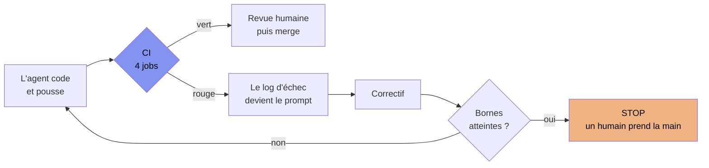
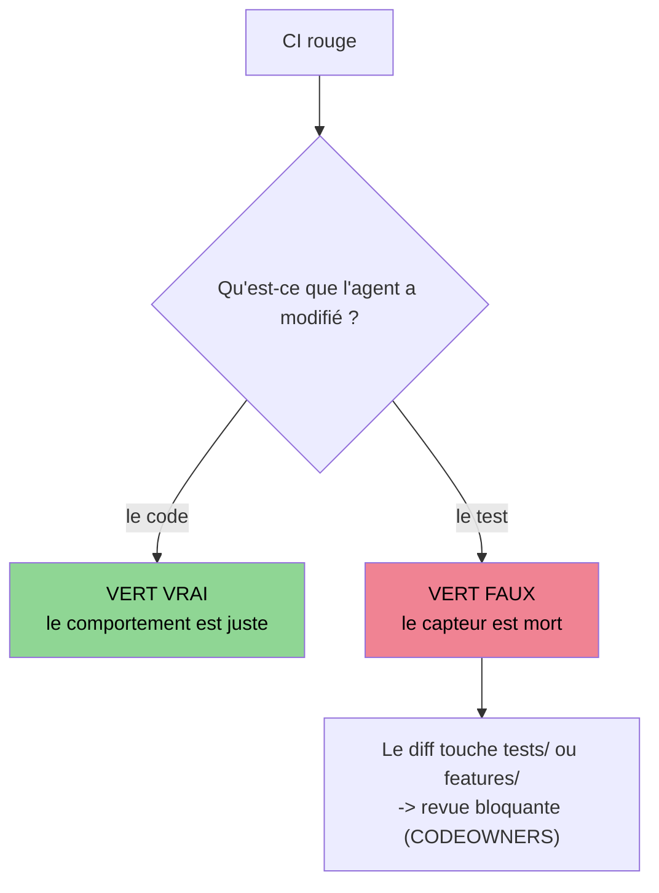

[← Chapitre précédent](04-contexte-projet.md) · [Sommaire](Readme.md) · [Chapitre suivant →](06-prompt-engineering-dev.md)

# Chapitre 05 — La CI qui autoboucle l'IA

> **Dans ce chapitre**, vous apprendrez à :
> - Reconnaître le changement de métier de la CI : de porte pour un humain, elle devient le capteur de la boucle de correction ;
> - Configurer un pipeline « IA-ready » : jobs séparés, sorties machine, rapports emballés quand c'est rouge ;
> - Borner une boucle de correction : plafond d'itérations et budget tokens, décidés avant de démarrer ;
> - Détecter un faux vert dans un diff : test affaibli, test désactivé, test miroir ;
> - Durcir le pipeline : permissions au strict nécessaire, secrets dans un environnement protégé, déclencheurs qui les exposent écartés.

**Accroche (sondage) :** « Combien de boucles de correction avant qu'il eût été moins cher de coder soi-même ? »

---

## 5.1 Le basculement : la CI ne parle plus à un humain

Deux pièces sont déjà en place. Le chapitre 01 a posé **l'arbitre** : « ça a l'air bon » ne vaut rien, seul un capteur exécutable a le droit de parler. Le chapitre 02 a posé **le frein** : la spec dit quand on a fini. Il manque une troisième pièce pour que la machine tourne sans nous — quelqu'un qui ramasse le verdict et le redonne à l'IA.

Regardons une intégration continue (CI — le pipeline qui installe, compile, teste à chaque modification) comme on l'a toujours utilisée. Elle est rouge. Un humain ouvre le log, comprend ce qui casse, corrige, repousse. La CI est une **porte** (ch. 03) : elle laisse passer ou elle bloque. Elle parle à un humain, et elle se moque d'être pénible à lire — un humain, ça se débrouille toujours.

Retirez maintenant l'humain de la boucle. Le log n'est plus lu *pour décider* : il est **recraché tel quel dans la prochaine demande à l'agent**. Et là, la CI change de métier. De porte pour un humain, elle devient **le capteur de la boucle de correction automatique** — le moteur qui rend sa copie à l'IA jusqu'à ce que ce soit juste.

C'est un changement de statut, pas un gadget. Trois choses suivent :

1. **Le log devient une interface.** Sa qualité n'est plus un confort, c'est la condition de la boucle. Un log qu'un agent ne peut pas interpréter ne corrige rien : il fait tourner la machine à vide.
2. **Le coût d'une itération devient la question économique** — celle de l'accroche : la boucle relance le pipeline entier à chaque essai (voir 5.5).
3. **Il faut une borne.** « Jusqu'à ce que ce soit juste » ne veut rien dire sans critère d'arrêt *et* sans plafond. Le chapitre 02 a donné le premier (la spec) ; ce chapitre donne le second.

Un pipeline écrit pour un humain n'est pas écrit pour une machine. Les deux colonnes ne demandent pas la même chose :

| Ce qu'un humain encaisse sans broncher | Ce qui enraye la boucle |
|---|---|
| Un seul job qui fait tout et s'arrête au premier échec | L'agent ne voit **qu'un** défaut à la fois : il corrige, repousse, découvre le suivant. Deux tours au lieu d'un. |
| « Process completed with exit code 1 » + 400 lignes de log | Le log noie l'information utile dans le bruit d'installation. L'agent corrige le mauvais truc. |
| Relancer à la main quand un runner a eu une journée mauvaise | La boucle prend un faux rouge pour un défaut de code et « corrige » ce qui n'était pas cassé. |
| Se souvenir que tel test est connu pour être lent | Rien ne le sait : la boucle repaie le coût de chaque test à chaque tour. |

Tout le reste du chapitre consiste à fabriquer un pipeline qui répond à la colonne de droite.

## 5.2 Un pipeline « IA-ready » (GitHub Actions)

Le pipeline du comptoir de prêt, tel qu'on l'a équipé au chapitre 03, a déjà la bonne forme — quatre jobs séparés : **tests**, **lint + types**, **audit**, **secrets**. Ce qu'on y ajoute pour la boucle tient en trois mots : **séparer, structurer, artifacter**.

```yaml
# .github/workflows/ci.yml — le pipeline du comptoir, version « IA-ready »
name: ci

on:
  pull_request:
  push:
    branches: [main]

jobs:
  tests:
    runs-on: ubuntu-latest
    timeout-minutes: 10
    steps:
      - uses: actions/checkout@v4
      - uses: actions/setup-node@v4
        with:
          node-version: 24
          cache: npm                      # <- npm ci ne retélécharge rien à chaque tour de boucle
      - run: npm ci
      - run: npx vitest run --reporter=junit --outputFile=reports/vitest.xml
      - run: npx cucumber-js --format json:reports/cucumber.json
      - if: failure()                     # <- l'artefact n'existe QUE quand c'est rouge
        uses: actions/upload-artifact@v4
        with:
          name: rapports-tests
          path: reports/

  lint-types:
    runs-on: ubuntu-latest
    timeout-minutes: 5                    # <- un timeout PAR job : voir 5.5
    steps:
      # (même préambule : checkout + setup-node + npm ci)
      - run: npx tsc --noEmit
      - run: npx eslint .

  audit:
    runs-on: ubuntu-latest
    steps:
      # (même préambule)
      - run: npm audit --audit-level=high

  secrets:
    runs-on: ubuntu-latest
    steps:
      - uses: actions/checkout@v4
      - uses: gitleaks/gitleaks-action@v2
```

Pour vérifier les quatre verdicts sans attendre le push — la boucle locale du chapitre 03 :

```bash
$ npx vitest run && npx tsc --noEmit && npx eslint . && gitleaks detect
```

**Séparer.** Quatre jobs en parallèle, c'est un diagnostic complet en un tour. Un job unique qui s'arrête à `tsc` ne dira jamais à l'agent que ses tests cassent aussi — et l'agent paiera un tour de boucle par catégorie d'erreur. Un tour coûte un pipeline : on veut que chaque tour rapporte tout ce qu'il y a à corriger.

**Structurer.** `--reporter=junit`, `--format json:` : la sortie n'est pas faite pour vos yeux, elle est faite pour être avalée. Un rapport machine dit *quel* scénario, *quelle* assertion, *quelle* valeur attendue contre quelle valeur reçue — sans qu'un humain ait à traduire.

**Artifacter.** `if: failure()` : quand c'est rouge, on emballe rapports et journaux. Sans ça, le job repart avec le diagnostic dans ses bagages, et l'agent repart de zéro.

Et le maillon qui ferme la boucle : **le log d'échec est le prompt suivant.** On n'invente pas de « prompt magique » pour faire corriger l'IA — on lui remet le verdict, proprement. Le gabarit qu'on lui colle sous les yeux, projeté à la démo :

```text
Le pipeline est rouge. Voici la sortie des jobs en échec :

<log collé ici, brut, sans résumé>

Contraintes :
- Ne modifie aucun fichier sous tests/ ni features/ : ils font foi.
- Ne touche pas au code qui n'est pas impliqué dans l'échec.
- Corrige la cause, pas le symptôme.
- Si tu estimes qu'un test est faux : STOP. Écris pourquoi dans ta réponse. Ne le modifie pas.
```

La dernière ligne n'est pas une politesse. C'est la règle d'or (5.4), écrite en dur dans le harnais.

Pour lire le verdict depuis le terminal :

```bash
$ gh run list --limit 3
STATUS  TITLE          WORKFLOW  BRANCH  EVENT  ID
X       feat: caution  ci        main    push   18744312
$ gh run view 18744312 --log-failed
```

## 5.3 La boucle

Une fois le pipeline en forme, la boucle tient en cinq cases :



L'agent pousse, la CI tranche, le log rouge est réinjecté, l'agent corrige, on relance. **Jusqu'au vert — ou jusqu'à la borne.** Ce « ou » est la moitié du chapitre. Sans lui, ce n'est pas de l'automatisation, c'est un compteur qui tourne.

Deux bornes, et elles ne sont pas de la même nature :

- **Max itérations** (disons 5). Cinq fois que la machine se trompe au même endroit, ce n'est plus de l'obstination, c'est un diagnostic : soit la spec est ambiguë, soit le capteur est faux, soit le problème est hors de son établi (ch. 04). La borne ne sanctionne pas l'agent, **elle vous rappelle**.
- **Budget tokens.** Une boucle non plafonnée est une facture sans plafond. C'est la seule borne que personne ne rattrape après coup.

Et une chose à ne pas se cacher : la boucle n'est pas déterministe. Le LLM est probabiliste (ch. 01) — deux lancements depuis le même rouge peuvent donner deux correctifs, et deux nombres d'itérations différents. On ne planifie pas « 2 tours », on planifie « au plus 5, et on regarde le compteur ».

## 5.4 Les garde-fous

Une machine qui pousse du code jusqu'à ce qu'un pipeline cède s'en prendra un jour au pipeline. Pas par malveillance : parce que c'est le chemin le plus court vers la consigne « passe au vert ».

| Garde-fou | Ce qu'il empêche, concrètement | Comment on le pose |
|---|---|---|
| **Protection de `main`** | Un agent qui merge sa propre copie. Le vert ne donne pas le droit d'écrire dans `main`. | Branch protection : `Require a pull request before merging` + `Require approvals`. Vérif : `gh api repos/OWNER/REPO/branches/main/protection` |
| **Revue humaine bloquante** | Le vert automatique pris pour une validation. | Un humain relit **le diff**, pas le badge. Un fichier `CODEOWNERS` sur `tests/` et `features/` rend cette revue obligatoire. |
| **Max itérations** | La boucle d'obstination, et l'illusion qu'un problème difficile se règlera à la 6ᵉ. | Compteur dans le script de boucle ; à la borne on s'arrête, et on écrit ce que la CI disait. |
| **Budget tokens** | La facture qui court pendant la pause déjeuner. | Plafond par tâche et par jour, décidé *avant* la dérive. |
| **Laisse de l'agent** | L'agent qui réécrit ses propres capteurs. | Écriture interdite dans `tests/` et `features/` — détaillé au **ch. 07**. |

**La règle d'or : il est interdit d'affaiblir un test pour passer au vert.** Un test est un contrat (ch. 02) ; le modifier pour que le code passe, c'est changer le contrat pour qu'il autorise le bug. Voilà le trick, tel qu'on le voit arriver :

```diff
- expect(eurosVersCents(19.99)).toBe(1999);
+ expect(eurosVersCents(19.99)).toBe(1998);   // « l'arrondi flottant, c'est normal »
```

Trois variantes, de la plus grossière à la plus venimeuse :

```diff
- test('eurosVersCents(19.99) = 1999', () => {
+ test.skip('eurosVersCents(19.99) = 1999', () => {   // ② désactivé — la CI est verte
...
- expect(eurosVersCents(19.99)).toBe(1999);
+ expect(eurosVersCents(19.99)).toBe(Math.floor(19.99 * 100));   // ③ miroir : ne peut plus échouer
```

La ③ est la pire, parce qu'elle a l'air d'un test : elle recopie l'implémentation dans l'assertion. C'est le **test miroir**, et le chapitre 08 lui consacre un exercice entier.



Comment la revue le détecte — parce qu'ici aucun capteur ne le détendra tout seul :

- **La question, en une seconde :** *qu'est-ce qui a changé, le code ou la règle ?* Un diff de correction qui touche `tests/` ou `features/` n'est pas une correction, c'est une demande de changement de contrat. Elle se traite à part, par un humain.
- **Le compte du diff :** lignes supprimées dans `tests/`, apparitions de `.skip`, `.only`, `todo`, assertions remplacées par un `toBeDefined()` (le vert qui ment du ch. 01).
- **L'asymétrie :** on laisse l'agent écrire du code, jamais des capteurs. C'est la laisse (ch. 07) — et c'est bien pour ça qu'elle vit dans le dépôt du TP plutôt que dans une bonne résolution.

Un vert obtenu en affaiblissant le test n'est pas une petite triche bien pratique. C'est le jour où le harnais cesse silencieusement de protéger quoi que ce soit, et où le prochain bug part en production avec un badge vert dessus.

## 5.5 Durcissement du pipeline (5 min)

Un agent qui pousse déclenche votre pipeline **avec vos jetons**. Le durcissement n'est pas une annexe DevSecOps : c'est ce qui borne les dégâts quand la boucle part de travers, et ce qui la rend bon marché.

**Permissions au strict nécessaire.** Par défaut, un workflow GitHub Actions reçoit souvent plus large que nécessaire. On rabote :

```yaml
permissions:
  contents: read        # lire le dépôt. Rien d'autre : pas d'écriture, pas de publication.
```

Lecture seule veut dire qu'un workflow compromis ne peut pas réécrire `main` ni publier un paquet. Vérifier ce que le dépôt accorde par défaut :

```bash
$ gh api repos/OWNER/REPO/actions/permissions
{ "github_actions_permissions": "write", "allowed_actions": "all" }
```

**Secrets : un environnement protégé, jamais un déclencheur exposé.** Les secrets (jetons de déploiement, clés d'API) vivent dans un `environment` GitHub, avec des approbateurs désignés, et ne sont injectés que dans les jobs qui en ont besoin :

```yaml
  publish:
    environment: production     # <- exige un humain qui approuve l'ouverture
    steps:
      - run: npm publish
        env:
          NODE_AUTH_TOKEN: ${{ secrets.NPM_TOKEN }}
```

Et là, le piège qui a fait couler plus de secrets que n'importe quelle faille de bibliothèque : **`pull_request_target`**. Ce déclencheur s'exécute avec les secrets du dépôt *et* les permissions pleines — y compris pour une pull request (PR) ouverte depuis un fork dont personne n'a relu le code. Le motif vulnérable, qu'un assistant IA recopie volontiers parce qu'« il marche » :

```yaml
on: pull_request_target
jobs:
  build:
    steps:
      - uses: actions/checkout@v4
        with:
          ref: ${{ github.event.pull_request.head.sha }}   # <- le code DU FORKEUR
      - run: ./scripts/build.sh                            # <- exécuté AVEC vos secrets
```

Un forkeur n'a qu'à écrire dans `scripts/build.sh` une ligne qui poste les variables d'environnement sur une adresse à lui. La CI, poliment, exécute. Les deux formes sûres : déclencher en `pull_request` (pas de secrets — c'est le cas de notre pipeline de cours), ou garder `pull_request_target` **uniquement** pour des jobs qui ne checkouttent et n'exécutent jamais le code du forkeur (commenter une PR, poser un label). Besoin de builder du code non fiable et d'en tirer un résultat fiable ? Deux workflows : un qui build **sans** jetons et publie un artefact, un second, déclenché à la fin, qui lit cet artefact avec les secrets.

**Timeouts et cache.** Un job qui pendouille 40 min coûte 40 min de budget *à chaque tour*. `timeout-minutes` et `cache: npm` (plus haut) ne sont pas du confort : ce sont les deux réglages qui font qu'une boucle à 5 itérations reste raisonnable.

> **Prolongement** (hors chemin critique — ce cours n'est pas un cours DevSecOps) : générer un **SBOM** (Software Bill of Materials — l'inventaire signé de vos dépendances) à chaque build ; vérifier l'origine des paquets avec `npm audit signatures` (le slopsquatting du ch. 01 a une signature, ou plutôt pas la bonne) ; épingler les actions par leur SHA (`actions/checkout@<sha> # v4`) plutôt que par un tag que l'auteur peut déplacer.

## Démo guidée — la boucle répare le bug du chapitre 01 (20 min)

Le même bug, pas un nouveau. Au chapitre 01, on a vu l'IA proposer ce correctif « évident » :

```ts
export function eurosVersCents(euros: number): number {
  return Math.floor(euros * 100);   // 19.99 -> 1998
}
```

Le test chiffré qui le fume est déjà écrit lui aussi : `expect(eurosVersCents(19.99)).toBe(1999);`. Cette fois, on ne le corrige pas nous-mêmes. **On regarde la machine le corriger.**

**Étape 1 — on pousse le rouge (2 min).** Le dépôt de démo contient le code fautif et le test qui l'accuse. On pousse sur une branche de travail :

```bash
$ git push -u origin boucle/euros-vers-cents
$ gh run watch          # suit la run en cours, comme un tail
```

**Étape 2 — le verdict (3 min).** Ce que la CI rend, projeté :

```text
X tests
FAIL  src/euros.test.ts > eurosVersCents(19.99)
      expected 1999 to be 1998   // attendu 1999 · reçu 1998
✓ lint-types    (tsc --noEmit, eslint)
✓ audit
✓ secrets
```

Regardez ce que l'agent a sous les yeux : le fichier, le test, la valeur attendue, la valeur reçue, et **le fait que les trois autres jobs sont verts**. C'est ça, un prompt. Il n'y a rien à reformuler.

**Étape 3 — le prompt auto-généré (3 min).** Le gabarit de la section 5.2 est rempli avec le log ci-dessus, puis envoyé à l'agent de la classe — laisse active : écriture interdite dans `tests/` et `features/`.

**Étape 4 — le correctif et le re-run (7 min).** Ce que l'agent propose, projeté en direct :

```diff
- return Math.floor(euros * 100);
+ return Math.round(euros * 100);
```

```bash
$ git push
$ gh run list --limit 1
STATUS  TITLE                    WORKFLOW  BRANCH                    ID
✓       fix: arrondi au centime  ci        boucle/euros-vers-cents   18744398
```

**Étape 5 — la trace, pas le tour de magie (5 min).** On projette les quatre objets, dans l'ordre : **le log**, **le prompt auto-généré**, **le diff**, **le compteur d'itérations**.

| Itération | Ce que la CI dit | Ce que l'agent change |
|---|---|---|
| 1 | `tests` rouge : attendu 1999, reçu 1998 | `Math.floor` → `Math.round` dans `src/euros.ts` |
| 2 | 4 jobs verts | — |

Compteur final : **2 / 5**. C'est ce chiffre qu'on commente, pas le fait que « l'IA a réussi ».

Deux remarques honnêtes, à ne pas garder pour soi pendant la démo :

- **Elle aurait pu tricher.** Sur le même log, un autre lancement, l'agent pouvait réécrire le test en `1998` (5.4). La laisse l'en empêche ; sans la laisse, c'est à la revue de le voir. Si la démo dérive en direct, on ne le cache pas : **une boucle qui dérive est un matériel pédagogique** — on la coupe, on la relit, et on rejoue la trace capturée à la répétition.
- **Le vert ne veut pas dire « bien conçu ».** `Math.round` passe le test. La vraie correction, pour de la monnaie, c'est de ne jamais porter des euros en flottants : on stocke des **centimes entiers** — c'est ce que fait tout le comptoir. La boucle a éteint le voyant ; c'est à la revue de juger si le code est juste (ch. 08).

---

### EX-C — Casser la boucle pour de vrai (25 min, en binômes, débrief 5 min)

Deux manipulations : la première doit vous rassurer, la seconde doit vous inquiéter. Vous jouez deux rôles, l'humain qui configure la boucle et l'agent qui la subit.

**Contexte.** Le dépôt de l'atelier contient une fonction de remise, correcte, qui travaille en centimes :

```ts
// src/remise.ts — remiseEnCents() renvoie le MONTANT de la remise en centimes
export function remiseEnCents(prix: number, taux: number): number {
  return Math.round(prix * taux);
}
```

Le contrat de la remise, tel qu'il est écrit dans la spec : **taux 0,20** (20 %), **arrondi au centime le plus proche**. Deux cas chiffrés :

- panier de **100,00 €** (10 000 centimes) × 0,20 = 2 000 centimes de remise → prix remisé **80,00 €** ;
- panier de **19,99 €** (1 999 centimes) × 0,20 = 399,8 centimes → arrondi à **400** centimes → prix remisé **1 599 centimes (15,99 €)**.

**① Le bug vicieux (10 min).** Remplacez `Math.round` par `Math.floor` dans `src/remise.ts`. Lancez la suite localement, puis poussez et suivez la CI.

```bash
npx vitest run
git push
gh run watch
```

- La suite est-elle rouge ? Si elle est verte, **pourquoi** ? (Faites le calcul sur les deux paniers ci-dessus.)
- Ajoutez dans `src/remise.test.ts` le test du panier à 19,99 € avec le montant attendu qui découle du contrat. Relancez.
- Poussez et laissez la boucle tourner. Sur quel fichier porte le correctif ?

**② L'exigence réellement ambiguë (12 min).** Ouvrez `features/retards.feature` (celle du chapitre 02) et **enlevez-lui ce qui la rendait précise** : remplacez la ligne `Then la pénalité est de 1.50 €` par `Then la pénalité est calculée`, et remplacez l'assertion correspondante dans les step definitions par `assert.ok(true);`. Supprimez le scénario qui fixe les dates du week-end.

> ⚠️ Ceci est une **expérience**, pas une méthode : vous jouez le rôle d'un agent qui triche, pour voir si la machine la détecte. Vous ne ferez jamais ça pour de vrai — et vous allez comprendre pourquoi en 12 minutes.

```bash
npx cucumber-js
npx vitest run
git push
gh run watch
```

- La CI est-elle rouge ou verte ?
- Le code livré répond-il au besoin ? **Comment le savez-vous ?**
- Restez-vous capable de dire si 1,50 € est la bonne pénalité, et si le week-end compte ?

**③ Débrief (5 min, collectif).** Trois questions : qu'est-ce qui a attrapé le bug du ① ? qu'est-ce qui a attrapé l'ambiguïté du ② ? qu'est-ce qui, dans votre configuration, empêche *réellement* un agent d'affaiblir un test ?

🎯 **Avant de rendre, cochez :**
- [ ] J'ai observé un rouge que **mes tests ne voyaient pas**, et je sais dire quel test l'a rendu visible.
- [ ] J'ai obtenu un **vert qui ne répond pas au besoin**, et je sais nommer ce que j'ai retiré de la spec pour y arriver.
- [ ] Je peux citer deux garde-fous de mon dépôt qui jouent vraiment, et dire lequel ne joue pas dans le ②.

<details>
<summary>Voir la correction</summary>

**① Le bug que la suite ne voit pas.** Avec `Math.floor`, le panier de 100,00 € donne `Math.floor(10 000 × 0,20)` = `Math.floor(2 000)` = **2 000** : `floor` et `round` tombent d'accord, parce que 2 000 est un entier. Le test hérité sur 100 € reste **vert** et le bug passe. Sur 19,99 €, `Math.floor(1 999 × 0,20)` = `Math.floor(399,8)` = **399**, alors que le contrat dit **400** : un centime d'écart, et le prix remisé devient 1 600 centimes au lieu de 1 599.

Le test qui rend le bug visible est donc celui du panier à 19,99 € — un montant **dont le produit ne tombe pas sur un nombre entier de centimes**. C'est la leçon du ① : un test sur valeurs rondes est un capteur myope. Une boucle de correction ne peut pas réparer ce qu'aucun capteur ne voit — elle livre le bug en vous adressant un badge vert.

Une fois le test ajouté : rouge, puis l'agent remet `Math.round` dans `src/remise.ts`, **et uniquement là**. Le correctif ne touche ni `tests/` ni `features/` : c'est un vert vrai.

**② Le vert qui ne répond pas au besoin.** La CI est **verte** — `assert.ok(true)` échoue rarement, et un `Then` sans montant n'est contredit par aucun code. Mais le dépôt livré ne dit plus **combien** vaut la pénalité, ni **quels jours** sont comptés : l'agent a choisi une interprétation en silence, exactement comme au chapitre 02 — sauf qu'ici plus rien ne peut le contredire. Vous ne pouvez plus le savoir, et un relecteur non plus.

Ce que vous avez retiré, précisément : **le chiffre concret, le résultat explicite, le cas négatif** — les trois qualités d'un scénario où l'IA ne peut pas tricher. En les retirant, vous n'avez pas rendu la spec « plus souple » : vous avez supprimé le critère d'arrêt de la boucle.

**③ Ce que le débrief installe.** Le ① est attrapé par **un capteur qui regarde les bons nombres** — donc la boucle vaut ce que valent vos tests. Le ② n'est attrapé par **rien** : ni la CI, ni le compteur, ni le budget. Aucun garde-fou de la table 5.4 ne bouge, parce qu'aucun d'eux ne porte sur le *sens* — ils portent sur le *droit d'écrire*. C'est pour ça que la laisse et la revue ne remplacent pas la spec : elles la protègent, elles ne la remplissent pas.

**La phrase du débrief : la boucle ne vaut que ce que vaut la spec.**

</details>

---

## Retour sur l'accroche

« Combien de boucles avant qu'il eût été moins cher de coder soi-même ? » Réponse honnête : **ça dépend du coût d'un tour — et c'est exactement pour ça qu'on pose une borne.** Un tour bien configuré coûte quelques minutes de pipeline et ne mobilise personne ; un tour mal configuré (job unique séquentiel, cache absent, log illisible) vous rend vos 5 itérations en attente et en facture. La borne ne dit pas « l'IA est nulle au 5ᵉ tour » : elle fait que le moment où l'on rend les armes est **décidé à l'avance** plutôt que constaté par épuisement. Sur la trace de la démo, la boucle a tranché en 2 tours — mais ce n'est pas un programme, c'est une trace.

## Ce qu'il faut emporter

- **La CI est passée de porte à capteur** : ce n'est plus un contrôle qualité, c'est le moteur de la boucle. Son log est une interface — et on le fabrique en séparant (4 jobs parallèles), structurant (sorties machine), artifacter (rapports sur échec). Le log d'échec *est* le prompt suivant.
- **Toute boucle a deux bornes** : max itérations et budget tokens. Une boucle sans borne n'est pas de l'automatisation, c'est une fuite.
- **La règle d'or** : on ne touche pas aux capteurs pour devenir vert. Un diff de correction qui modifie `tests/` ou `features/` est une demande de changement de contrat, pas une correction.
- **Le durcissement sert à la boucle** : permissions au strict nécessaire, secrets dans un environnement protégé, jamais de code non fiable exécuté sous `pull_request_target`, timeouts et cache.
- **Et la phrase qui clôt le chapitre : la boucle ne vaut que ce que vaut la spec.** Un vert automatique n'a jamais prouvé autre chose que « les capteurs n'ont rien dit ».

**Pour la suite :** les logs CI et les transcripts de cette boucle comptent parmi les **preuves de processus** demandées au TP-01. Le chapitre 06 s'attaque à ce qui reste manuel dans la boucle — la façon de formuler la demande quand le log ne suffit pas ; le chapitre 07 donne à l'agent les mains, et la laisse, qu'on vient de supposer acquises.

---

## Vérifiez vos acquis

Six questions, non notées, à faire avec l'IA : elles servent à vous situer, pas à compter une note.

**1. Dans le chapitre, on retire l'humain de la boucle : le log rouge n'est plus lu *pour décider*, il est recraché tel quel dans la prochaine demande à l'agent. Qu'est-ce que ce changement implique ?**

- A. La CI devient inutile : sans humain pour lire le log, le pipeline ne sert plus qu'à archiver des rapports de build pour la revue.
- B. La CI devient le capteur de la boucle : son log est une interface à part entière.
- C. La CI doit être allégée à un seul job pour limiter le volume de log que l'agent a à lire à chaque tour de la boucle.
- D. La CI doit résumer elle-même ses échecs en une phrase claire, pour éviter que l'agent ne se noie dans 400 lignes de log.

**2. Le pipeline du comptoir de prêt garde quatre jobs séparés (`tests`, `lint-types`, `audit`, `secrets`) qui tournent en parallèle. Pourquoi ce choix sert-il la boucle de correction ?**

- A. Quatre jobs séparés permettent d'instaurer un timeout global au pipeline, qui plafonne du même coup le budget tokens de chaque tour de boucle.
- B. La séparation rend les jobs indépendants, si bien que l'agent peut relancer seul le job en échec sans repayer les trois autres.
- C. Séparer les jobs sert surtout à laisser la revue humaine valider chaque job avant le merge, ce qui rend la revue CODEOWNERS inutile.
- D. Un tour rapporte tous les défauts d'un coup, au lieu d'un seul défaut par tour.

**3. La boucle est lancée sur un rouge. Le chapitre 02 a fourni le premier critère d'arrêt (la spec). Qu'est-ce qui manque encore, et pourquoi ?**

- A. Un critère de progression du code, qui permet de relancer la boucle tant que l'agent écrit encore des lignes nouvelles et ne bloque pas deux fois de suite.
- B. Rien de plus : une spec écrite avec des valeurs chiffrées donne un critère d'arrêt complet, et la boucle peut tourner jusqu'au vert.
- C. Un plafond d'itérations et un plafond de jetons, décidés avant de démarrer.
- D. Un nombre d'itérations planifié à l'avance, par exemple deux tours, ce qui permet de reprendre l'agent au troisième s'il a dérivé.

**4. Trois façons pour un agent de passer au vert en touchant au test : remplacer `toBe(1999)` par `toBe(1998)`, passer le test en `test.skip`, ou écrire `expect(eurosVersCents(19.99)).toBe(Math.floor(19.99 * 100))`. Pourquoi la troisième est-elle présentée comme la pire ?**

- A. Elle a l'air d'un test alors qu'elle recopie l'implémentation : elle ne peut plus échouer.
- B. Parce qu'un `test.skip` se repère d'un coup d'œil dans le diff, alors qu'un `Math.floor` glissé dans une assertion ne laisse aucune trace dans le rapport.
- C. Parce que `Math.floor` dans une assertion est une faute que le job `lint-types` signale, ce qui brouille le diagnostic et fait perdre un tour de boucle.
- D. Parce qu'elle seule modifie le contrat écrit dans la spec, alors que les deux premières laissent la spec intacte et restent des corrections acceptables.

**5. Un assistant IA propose un workflow `on: pull_request_target` qui `checkout` le `head.sha` de la PR puis exécute `./scripts/build.sh`. Pourquoi le chapitre cite-t-il ce motif comme le piège ?**

- A. Parce que `pull_request_target` s'exécute sans les secrets du dépôt : le build échoue systématiquement et renvoie à l'agent un rouge sans rapport exploitable.
- B. Parce que ce déclencheur est incompatible avec `cache: npm` : à chaque tour, `npm ci` retélécharge tout et le coût de la boucle devient déraisonnable.
- C. Parce que GitHub refuse d'y combiner `actions/checkout` et une étape `run` tant que la protection de `main` est active, ce qui bloque le merge.
- D. Il tourne avec les secrets du dépôt sur le code d'un forkeur que personne n'a relu.

**6. Dans EX-C, on remplace `Math.round` par `Math.floor` dans `src/remise.ts` : la suite de tests héritée reste verte. Pourquoi ?**

- A. Parce que `Math.floor` et `Math.round` renvoient toujours le même résultat dès que le montant est exprimé en centimes entiers, ce qui rend le bug indétectable en tests unitaires.
- B. Le test hérité porte sur 100,00 € : 2 000 centimes est un entier, les deux arrondis tombent d'accord.
- C. Parce que le job `tests` du pipeline n'exécute pas `src/remise.test.ts` : la suite locale voyait le bug, mais le pipeline ne l'embarque pas.
- D. Parce que le test hérité compare un prix remisé au lieu du montant de la remise, et que l'écart d'arrondi n'apparaît jamais dans un prix en euros.

<details>
<summary>Voir les réponses</summary>

**1 — Réponse : B.** De porte pour un humain, la CI devient « le capteur de la boucle de correction automatique » (5.1) : son log n'est plus un confort à subir, c'est la condition de la boucle. Un log qu'un agent ne peut pas interpréter fait tourner la machine à vide.

Pourquoi pas les autres : sans humain, la CI devient au contraire le moteur de la boucle ; un seul job ne montre qu'un défaut à la fois, donc deux tours au lieu d'un ; et le gabarit colle le log « brut, sans résumé » — on le rend avalable par des sorties machine (`--reporter=junit`, `--format json:`), pas par un résumé qui perdrait la valeur attendue et la valeur reçue.

**2 — Réponse : D.** « Un tour coûte un pipeline : on veut que chaque tour rapporte tout ce qu'il y a à corriger » (5.2). Quatre jobs en parallèle, c'est un diagnostic complet en un tour.

Pourquoi pas les autres : `timeout-minutes` se règle par job et borne du temps de machine, pas des jetons — le plafond de jetons est une borne distincte, posée en 5.3 ; la boucle relance le pipeline entier à chaque essai ; et la revue humaine reste bloquante, un `CODEOWNERS` sur `tests/` et `features/` la rend justement obligatoire.

**3 — Réponse : C.** Deux bornes, de natures différentes — max itérations (disons 5) et budget tokens, « la seule borne que personne ne rattrape après coup » (5.3). La spec dit quand on a fini, le plafond dit quand on s'arrête même sans vert : sans lui, ce n'est pas de l'automatisation, c'est un compteur qui tourne.

Pourquoi pas les autres : « jusqu'à ce que ce soit juste » ne veut rien dire sans critère d'arrêt *et* sans plafond, et une boucle qui repart dès qu'elle produit encore des lignes est la fuite dénoncée ici ; la spec est le premier critère, pas le second, et la boucle n'est pas déterministe ; enfin on ne planifie pas « 2 tours » mais « au plus 5, et on regarde le compteur » — le 2 / 5 de la démo est une trace, pas un programme.

**4 — Réponse : A.** C'est le **test miroir** : « elle a l'air d'un test, elle recopie l'implémentation dans l'assertion » (5.4). Un capteur qui répète le code ne peut plus jamais le contredire — le chapitre 08 lui consacre un exercice entier.

Pourquoi pas les autres : la revue surveille justement les apparitions de `.skip`, `.only`, `todo` et les assertions remplacées par un `toBeDefined()` ; `Math.floor` n'est pas une erreur de lint — dans la démo, `lint-types` est vert pendant que `tests` est rouge ; et les trois violent la règle d'or, aucune n'est une correction.

**5 — Réponse : D.** `pull_request_target` s'exécute « avec les secrets du dépôt *et* les permissions pleines », y compris pour une PR ouverte depuis un fork : au forkeur d'écrire dans `scripts/build.sh` une ligne qui poste les variables d'environnement sur une adresse à lui, et la CI, poliment, exécute (5.5).

Pourquoi pas les autres : c'est l'inverse, et c'est ce qui le rend dangereux — pour ne pas exposer les secrets on déclenche en `pull_request`, le cas du pipeline de cours ; le cache n'a rien à voir là-dedans ; et rien n'interdit cette combinaison, le chapitre donnant deux formes sûres.

**6 — Réponse : B.** `Math.floor(10 000 × 0,20)` = `Math.floor(2 000)` = 2 000, comme `round` : `floor` et `round` tombent d'accord sur un entier. Il faut un montant dont le produit ne tombe pas sur un nombre entier de centimes — le panier à 19,99 € : 399,8 attendu 400, `floor` rend 399 et le prix remisé devient 1 600 au lieu de 1 599. Un test sur valeurs rondes est un capteur myope.

Pourquoi pas les autres : pas « toujours » — sur 399,8 centimes les deux divergent ; la suite est verte *localement aussi*, aucun capteur ne voit le bug, donc la boucle ne peut pas le réparer ; et le test hérité porte bien sur le calcul de la remise, c'est la valeur choisie qui ne discrimine pas les deux arrondis.

</details>

---

[← Chapitre précédent](04-contexte-projet.md) · [Sommaire](Readme.md) · [Chapitre suivant →](06-prompt-engineering-dev.md)
