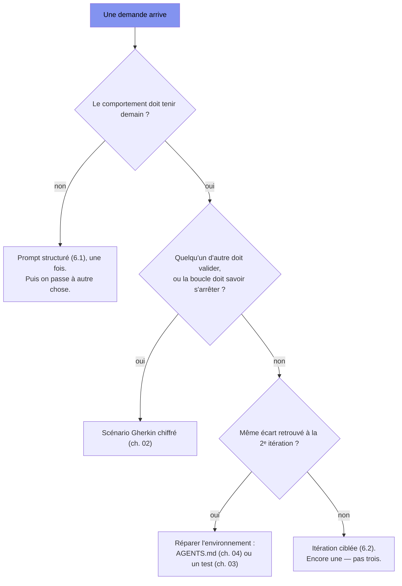

[← Chapitre précédent](05-boucle-ci.md) · [Sommaire](Readme.md) · [Chapitre suivant →](07-agents-et-leur-laisse.md)

# Chapitre 06 — Prompt engineering pour le développement

> **Dans ce chapitre**, vous apprendrez à :
> - Structurer une demande en cinq zones : rôle, contexte, tâche, contraintes, format ;
> - Conduire une itération ciblée : ce qui est bon, l'écart chiffré, la contrainte violée, le périmètre autorisé ;
> - Optimiser le contexte en puisant dans le dépôt plutôt que dans un exemple trouvé en ligne ;
> - Repérer les anti-patterns qui coûtent cher : rôle-placebo, devine-l'archi, consignes négatives ;
> - Décider quand arrêter de prompter, et écrire alors la spec ou le capteur qui manque.

**Accroche (sondage) :** « Entre "ajoute les remises, fais-le bien" et la fonctionnalité qui marche : combien d'itérations ? »

---

## Pourquoi un chapitre « prompt » dans un cours qui dit « environnement > prompt »

Le chapitre 01 l'a posé et n'y reviendra pas : **environnement > prompt**. Le voilà pourtant, le chapitre du prompt. Ce n'est pas une trahison, c'est une nuance, et elle tient en une phrase : **le prompt est la pièce la moins chère de l'environnement.**

Vous avez déjà payé les autres pièces : une spec (ch. 02), des capteurs (ch. 03), un dépôt lisible (ch. 04), une boucle qui renvoie sa copie (ch. 05). Le prompt, lui, ne coûte que le temps de le taper. Et son travail n'est pas celui qu'on croit : **un bon prompt ne rend pas la machine plus intelligente — il la branche.** Sur le fichier, sur le scénario, sur le log rouge. C'est un câble, pas un sortilège.

Gardez ce diagnostic en tête tout du long : **un prompt qu'on doit répéter n'est pas un mauvais prompt, c'est une spec qui demande à naître, ou un capteur qui manque.** C'est pour ça que ce chapitre se termine sur du Gherkin et non sur une formule magique.

## 6.1 Les cinq zones d'une demande

Une demande qui marche a cinq zones. Pas un style, pas une liturgie : cinq questions auxquelles la machine n'a pas accès toute seule.

| Zone | Ce qu'elle fixe | Ce qu'elle évite |
|---|---|---|
| **Rôle** | la posture de rédaction (le savoir, non — voir 6.4) | une réponse en mode tutoriel pour débutant |
| **Contexte** | les fichiers concernés, **la spec qui fait foi**, l'échec courant (le log rouge) | l'invention d'API et d'architecture |
| **Tâche** | **une** chose : verbe + objet | la réponse-pavé qui échoue sur six fronts |
| **Contraintes** | conventions du projet, périmètre, pas de dépendance nouvelle | le correctif qui touche trois fichiers |
| **Format** | ce que vous voulez recevoir : un diff, une fonction, trois options chiffrées | 200 lignes de prose et un fichier recopié en entier |

Appliquons ça au comptoir de prêt, qui veut une **remise de 20 %**.

**La demande vague**, telle qu'elle part dans le chat un mardi matin :

```text
ajoute les remises, fais-le bien, et fais gaffe aux arrondis
```

Voici ce qui revient, et c'est très poli :

```ts
// src/remise.ts — premier retour, sur la demande vague
export function remise(prix: number, taux: number): number {
  const cents = Math.floor(prix * 100);      // « prix » reçu en euros
  return Math.floor(cents * (1 - taux));     // …et on repart en centimes
}
```

Le test du chapitre 02, lui, ne discute pas :

```bash
$ npx vitest run
FAIL  src/remise.test.ts > remise de 20 % sur 19,99 € rend 1599 centimes
      attendu 1599 · reçu 1598
```

**C'est le bug du chapitre 01, rapatrié mot pour mot** : `Math.floor(19.99 × 100)` vaut 1998, pas 1999. La machine n'a pas « deviné » que le projet manipule des centimes : elle a choisi une lecture plausible, comme toujours. Vous ne lui aviez rien dit.

Maintenant la même demande, en cinq zones :

```text
RÔLE        Développeur TypeScript sur le comptoir de prêt (Node 24, TypeScript strict).
CONTEXTE    Convention projet : tous les montants sont des CENTIMES ENTIERS, jamais de flottant.
            Contrat : features/remises.feature, scénario « remise de 20 % sur 19,99 € ».
            Échec courant : FAIL attendu 1599 · reçu 1598 (src/remise.test.ts).
TÂCHE       Corriger remise() pour passer ce scénario, sans changer sa signature.
CONTRAINTES Aucune dépendance nouvelle. Ne modifier que src/remise.ts.
            Arrondi : Math.round, appliqué sur des centimes entiers.
FORMAT      Le diff de src/remise.ts, puis la sortie de npx vitest run.
```

Ce qui revient :

```ts
export function remise(prix: number, taux: number): number {
  const cents = Math.round(prix * 100);      // 19,99 € -> 1999
  return Math.round(cents * (1 - taux));     // 1999 × 0,8 = 1599,2 -> 1599
}
```

```bash
$ npx vitest run
PASS  src/remise.test.ts > remise de 20 % sur 19,99 € rend 1599 centimes
```

Lisez maintenant ce qui a **vraiment** fait le travail dans la demande de droite. Ce ne sont pas les mots en majuscules, ni la précision de la phrase, ni le ton. Ce sont trois choses : **la convention « centimes entiers »**, qui vivait dans votre tête ; **le chemin du scénario**, écrit au chapitre 02 ; **le log rouge**, produit par le capteur du chapitre 03. Le prompt a été excellent parce qu'il a *désigné des pièces qui existent déjà*.

Et c'est là que la thèse tient au lieu de se contredire : un prompt excellent dans un projet sans spec, sans convention écrite et sans test produit exactement le même résultat qu'un prompt vague. Il n'y a rien à brancher.

## 6.2 Itérer juste

Le premier jet arrive presque toujours. Ce qui coûte cher, ce n'est pas lui — c'est la correction qu'on lui demande.

| ❌ Ce qu'on tape | Ce que ça produit |
|---|---|
| « non, refais » | une réécriture complète : vous perdez ce qui était bon et retombez sur *une autre* lecture plausible |
| « c'est pas ça » | une nouvelle interprétation — la sienne, pas la vôtre |
| « optimise un peu » | trois fichiers touchés, dont deux que vous ne vouliez pas voir bouger |

Un message d'itération utile a quatre lignes : **ce qui est bon** (pour qu'il le garde), **l'écart précis et chiffré**, **la contrainte violée**, **le périmètre interdit**.

```text
CE QUI EST BON   signature, emplacement, nom : garde-les tels quels.
L'ÉCART          remise(19.99, 0.2) renvoie 1598 ; le scénario attend 1599.
CONTRAINT        montants en centimes entiers, arrondi avec Math.round, pas de flottant.
PÉRIMÈTRE        src/remise.ts uniquement ; ne touche ni au test ni aux autres fichiers.
```

```bash
$ npx vitest run
PASS  src/remise.test.ts > remise de 20 % sur 19,99 € rend 1599 centimes

$ git diff --stat
 src/remise.ts | 4 ++--
 1 file changed, 2 insertions(+), 2 deletions(-)
```

Le second command est le capteur du périmètre : il vérifie la dernière ligne du message à votre place. C'est la leçon du chapitre 01 appliquée à l'itération — **une consigne qu'aucun capteur ne vérifie est une consigne que la machine oublie**, poliment, à la troisième demande.

**Comptez vos itérations.** Pas pour la statistique : le nombre d'itérations est un capteur *de votre environnement*. Une demande qui exige trois allers-retours sur le **même** écart n'a pas un problème de formulation. Elle a un trou : une règle jamais écrite (→ `AGENTS.md`, ch. 04), un cas que personne n'a chiffré (→ un scénario, ch. 02), ou un comportement qu'aucun test ne regarde (→ ch. 03). À la troisième fois sur le même écart, on arrête de prompter et on répare l'environnement.

## 6.3 Optimiser le contexte

Trois gestes, dans l'ordre où ils rapportent.

**Le few-shot, c'est votre dépôt.** On a tous collé un exemple trouvé sur Internet pour « montrer le style ». Le meilleur exemple est un fichier de *votre* projet :

```text
Écris remise() comme src/penalite.ts : même style de signature, mêmes messages
d'erreur explicites, même forme de test chiffré.
```

Une ligne, gratuite, et la réponse revient dans le style de la maison — ce qu'un exemple générique ne fait jamais, parce qu'il ne connaît pas la maison (ch. 01).

**Des extraits courts.** La mémoire de la machine est un budget, pas un réservoir : ce que vous y entassez est traité moins bien, et payé plus cher.

| À coller | À laisser de côté |
|---|---|
| la fonction en cause + son test | le dossier entier |
| les 15 lignes du log rouge | les 400 lignes du log de la CI |
| le scénario qui fait foi | les 30 scénarios du fichier `.feature` |

**Des sous-contextes.** Une conversation qui traîne s'enfonce : les hypothèses du début, périmées, restent sur l'établi et contaminent la suite. Ouvrez une session par préoccupation — une pour la fonctionnalité, une pour le pipeline, une pour l'arbitrage de conception. Ce qui doit survivre d'une session à l'autre ne vit pas dans la conversation : **ça vit dans le dépôt.**

D'où la règle de migration, la plus rentable de tout ce chapitre :

> **Ce que vous tapez dans chaque prompt doit migrer dans le dépôt.**

La convention « centimes entiers » que vous venez de retaper pour la troisième fois a sa place dans `AGENTS.md` (ch. 04). Le prompt est un flux, le dépôt est un réservoir. Un projet bien tenu se reconnaît à un signe : **le prompt raccourcit avec le temps**, parce que tout ce qui est permanent a été déplacé ailleurs.

## 6.4 La galerie des anti-patterns

Cinq tics, tous gratuits à éviter, tous coûteux à entretenir.

| Anti-pattern | Ce que ça donne | Ce qui le remplace |
|---|---|---|
| **Le paveau** — 40 lignes, 6 questions d'un coup | vous ne savez pas laquelle a échoué ; la dérive est partout | une tâche par prompt ; les 6 questions deviennent 6 demandes, ou une spec |
| **Le négatif** — « ne fais pas X », « ne touche pas au reste » | une négation ne se vérifie pas ; « le reste », elle ne sait pas ce que c'est | un périmètre **positif** (« `src/remise.ts` uniquement ») + `git diff --stat` pour le vérifier |
| **La surcharge** — 800 lignes « au cas où » | moins de signal, plus de coût, réponse moyenne | l'extrait qui contient l'écart |
| **Le rôle-placebo** — « tu es un architecte senior de 20 ans d'expérience » | change le **ton**, pas le savoir | un fichier-modèle du projet, un scénario, un log rouge |
| **Le devine-l'archi** — « ajoute la remise », sans dire où | elle choisit un fichier, un étage, un nom — plausibles, et différents la fois d'après | nommer le fichier et l'étage ; cœur métier / repository (ch. 03), arborescence commentée (ch. 04) |

Deux méritent qu'on s'y attarde, parce qu'ils sont respectivement le plus répandu et le plus dangereux.

**Le rôle-placebo.** La formule est partout sur Internet, et elle est tenace parce qu'elle *donne l'impression* d'agir. Elle déplace la couleur de la réponse, pas sa justesse. Pire : un persona d'expert encourage la machine à parler comme quelqu'un qui sait — donc à inventer avec assurance, exactement le piège des hallucinations du chapitre 01. Ce qui change réellement la sortie, dans la demande de la 6.1, tenait en trois lignes de contexte et zéro ligne de costume.

**Le devine-l'archi, mesuré.** Vous vouliez une fonction :

```bash
$ git diff --stat          # après « ajoute les remises, fais-le bien »
 src/api/routes.ts      | 12 ++++++++++++
 src/db/schema.sql      |  3 +++
 src/domain/remise.ts   |  8 ++++++++
 src/ui/format.ts       |  5 +++++
 package.json           |  1 +
 5 files changed, 29 insertions(+)
```

Rien de tout cela n'est une erreur au sens où un compilateur vous la signalerait : c'est une **architecture que vous n'avez pas choisie**, et elle est passée au vert. La dépendance ajoutée dans `package.json` n'a rien que `npx tsc --noEmit` puisse reprocher non plus. Le seul capteur ici, c'est vous — ou `git diff --stat`, qui se regarde avant de lire le code.

## 6.5 Prompt ou spec : quand arrêter de prompter

Le prompt est l'outil du **one-shot** : comprendre du code, un refactor, un script jetable, comparer deux approches. Là-dessus il est imbattable et il ne coûte que le temps de la phrase. Il devient le mauvais outil dès que le comportement doit **tenir** — demain, sans vous, et vérifié par quelqu'un d'autre.

| Signal que ça tourne mal | Ce qui manque vraiment | Où le mettre |
|---|---|---|
| Troisième itération sur le même écart | une règle jamais écrite | `AGENTS.md` (ch. 04) |
| « ça a l'air bon » comme seul critère | un capteur | un test chiffré (ch. 03) |
| La machine hésite entre deux lectures | un cas chiffré | un scénario Gherkin (ch. 02) |
| Vous décrivez le comportement à chaque prompt | un contrat | `features/*.feature` (ch. 02) |
| Vous relisez à l'œil pour trouver l'écart | un arbitre | la CI (ch. 05) |



Le schéma ne dit pas « prompt = mal, spec = bien ». Il dit une chose plus utile : **le prompt est le détecteur de la spec qui manque.** Chaque fois qu'il coince deux fois sur le même point, il vient de vous montrer exactement quelle ligne de l'environnement n'existe pas encore.

**Réponse au sondage.** Avec « ajoute les remises, fais-le bien », le nombre d'itérations n'est pas trois, ni dix : il est **indéterminé**, et c'est ça le vrai coût. Une demande vague ne fournit pas de critère d'arrêt — vous semez quand la réponse *ressemble* à ce que vous aviez en tête, et vous appelez ça « c'est bon ». Avec l'environnement en place (contrat chiffré, capteurs, conventions écrites), le compte est d'une ou deux itérations, et le critère d'arrêt ne vous appartient plus : c'est le scénario. Le prompt le plus rentable de votre semaine ne sera pas le plus astucieux : ce sera celui qui vous fera écrire, une fois, la spec que vous n'aurez plus jamais à réexpliquer.

---

### EX-06 — Réécrire, repérer, optimiser (15 min)

Trois manches. Les deux premières se font seul, la troisième en binômes.

**① Réécriture (4 min).** Voici la demande d'un collègue, telle quelle :

```text
ajoute la remise de 20 % sur les factures, fais-le bien, et fais gaffe aux arrondis
```

Le dossier, lui, existe déjà dans le dépôt :

```ts
// src/remise.test.ts — le scénario du ch. 02 est écrit, le test est rouge
test('remise de 20 % sur 19,99 € rend 1599 centimes', () => {
  expect(remise(19.99, 0.2)).toBe(1599);
});
```

**Réécrivez cette demande en cinq zones** (rôle, contexte, tâche, contraintes, format). Vous n'écrivez aucun code — uniquement la demande.

**② Contexte manquant (4 min).** Cette demande a la bonne forme. Il lui manque trois choses. **Nommez-les**, et pour chacune donnez **la commande** que vous auriez ajoutée pour que la machine aille la chercher elle-même.

```text
RÔLE       Développeur TypeScript sur le comptoir de prêt.
CONTEXTE   Le projet est en Node 24 / TypeScript strict. J'ai un bug d'arrondi.
TÂCHE      Corrige le calcul de pénalité de retard.
CONTRAINTES Ne rien casser.
FORMAT     Le code corrigé.
```

Rappel du contrat f1 (chapitre 02) : **1,50 € par jour ouvré de retard**, week-end non compté, **plafond 15 €**. Rappel de la convention projet : montants en centimes entiers.

**③ Challenge binômes (7 min) — « le moins d'itérations possible ».** L'IA vient de livrer ceci, et la CI est rouge :

```ts
// src/remise.ts — livré après « ajoute les remises, fais-le bien »
export function remise(prix: number, taux: number): number {
  return prix * (1 - taux);
}
```

```ts
// src/remise.test.ts
test('remise de 20 % sur 19,99 € rend 1599 centimes', () => {
  expect(remise(19.99, 0.2)).toBe(1599);
});
```

De quoi vérifier : `npx vitest run` (à lancer chez vous — le résultat vous appartient).

En binômes, produisez **deux** choses, pas une :

1. **le message d'itération** que vous enverriez, en quatre lignes (6.2) ;
2. **la ligne d'environnement** qui rend ce message inutile la prochaine fois — une ligne d'`AGENTS.md`, un scénario, ou un capteur.

Puis pariez à voix haute : **combien d'itérations** votre duo (1) + (2) réclame-t-il pour atteindre le vert ?

*Débrief collectif :* chaque binôme lit sa (2) à voix haute. On garde celles qui ne mentionnent **plus jamais** ce bug — parce que la prochaine fois, ce n'est plus la peine d'en parler.

🎯 **Avant de rendre, cochez :**
- [ ] Ma réécriture (①) tient en cinq zones et ne contient aucun code.
- [ ] Pour ②, je peux dire *où* chaque information manquante aurait dû vivre (le prompt, `AGENTS.md`, ou un `.feature`).
- [ ] Mon duo (③) contient une ligne d'environnement, pas seulement une plus belle phrase.
- [ ] Je sais dire pourquoi « ne rien casser » n'est pas une contrainte, et ce qui la remplace.

<details>
<summary>Voir la correction</summary>

**Partie ①**

```text
RÔLE        Développeur TypeScript sur le comptoir de prêt (Node 24, TypeScript strict).
CONTEXTE    Convention projet : montants en CENTIMES ENTIERS, jamais de flottant.
            Contrat : features/remises.feature — scénario « remise de 20 % sur 19,99 € ».
            Test rouge : src/remise.test.ts attend 1599 pour remise(19.99, 0.2).
TÂCHE       Implémenter remise(prix, taux) pour passer ce scénario.
CONTRAINTES Aucune dépendance nouvelle. Ne créer/modifier que src/remise.ts.
            Arrondi avec Math.round sur des centimes entiers.
FORMAT      Le diff de src/remise.ts, puis la sortie de npx vitest run.
```

Ce qui compte n'est pas la mise en page : c'est que **les trois informations qui manquaient** (la convention centimes, le chemin du contrat, la valeur attendue) y soient, et qu'aucune ne sorte de votre tête sans être écrite.

**Partie ②**

Trois manques, trois réparations :

1. **Où corriger.** « Le calcul de pénalité » ne dit ni le fichier ni l'étage : c'est le devine-l'archi. → nommer `src/penalite.ts` (et le test qui va avec), et vérifier le périmètre avec `git diff --stat`.
2. **Le contrat chiffré et son cas limite.** 1,50 € par jour ouvré, week-end non compté, plafond 15 € : sans ces chiffres et sans un cas daté, la machine choisit une lecture plausible. → pointer `features/retards.feature` et donner `npx cucumber-js`.
3. **L'échec courant et la convention d'arrondi.** « J'ai un bug d'arrondi » ne dit ni ce qui échoue ni la règle des centimes entiers. → coller le log rouge et donner `npx vitest run` ; `npx tsc --noEmit` attrape au passage les types.

Et « ne rien casser » ? Ce n'est pas une contrainte, c'est un souhait : aucun capteur ne vérifie une négation. On la remplace par un périmètre positif (`src/penalite.ts` et son test uniquement) plus `npx vitest run` et `git diff --stat`, qui, eux, savent dire non.

**Partie ③**

**Le message d'itération (quatre lignes) :**

```text
CE QUI EST BON   signature et emplacement : garde-les.
L'ÉCART          remise(19.99, 0.2) renvoie un prix en euros flottant ; le test attend 1599.
CONTRAINT        entrée en euros, calcul et retour en CENTIMES ENTIERS, arrondi Math.round.
PÉRIMÈTRE        src/remise.ts uniquement.
```

**La ligne d'environnement (celle qui compte) :**

```markdown
- Tous les montants sont des centimes entiers (`number`). Conversion euros → centimes
  avec `Math.round`, jamais `Math.floor` ni de flottant dans les calculs.
  Vérification : `npx vitest run`.
```

Une implémentation qui passe :

```ts
export function remise(prix: number, taux: number): number {
  return Math.round(Math.round(prix * 100) * (1 - taux));   // 1999 × 0,8 = 1599,2 -> 1599
}
```

À vérifier chez vous : `npx vitest run`, puis `git diff --stat` pour confirmer que seul `src/remise.ts` a bougé.

**Sur le pari.** Une itération suffit, et ce n'est pas de la chance : le message portait la valeur attendue *et* la convention, et le test chiffré était déjà là pour dire quand on s'arrête. Le binôme qui gagne n'est pas celui qui a la plus belle phrase — c'est celui dont la ligne d'`AGENTS.md` rend la phrase inutile la prochaine fois. **Le nombre d'itérations se pilote par le contexte initial et les capteurs, pas par la chance.**

</details>

---

## Vérifiez vos acquis

Six questions, non notées, à faire avec l'IA : elles servent à vous situer, pas à compter une note.

**1. Dans le chapitre, la demande en cinq zones fait passer le test `remise` au vert. Qu'est-ce qui a « vraiment » fait le travail, selon l'auteur ?**
- A. La mise en page en majuscules, qui structure la demande et empêche le modèle de s'égarer entre deux lectures.
- B. Trois pièces qui existaient déjà : la convention écrite, le chemin du scénario, le log rouge.
- C. La longueur de la demande, qui occupe la fenêtre de contexte et ferme les interprétations de trop.
- D. Le ton posé par la zone rôle, qui place le modèle en posture de développeur senior et corrige ses habitudes.

**2. Le premier jet arrive, vous répondez « non, refais ». D'après le 6.2, que produit ce message ?**
- A. Un correctif ciblé sur le point signalé, le reste du fichier restant intact puisque vous l'aviez validé.
- B. Une question de clarification du modèle, qui demande quelle partie précise de la réponse doit être reprise.
- C. Une réécriture complète : vous perdez ce qui était bon et retombez sur une autre lecture plausible.
- D. Une réponse plus courte et plus prudente, le modèle lisant la critique comme un signal de surcharge.

**3. Le message d'itération du chapitre se termine par « `src/remise.ts` uniquement ». À quoi sert `git diff --stat` dans ce duo ?**
- A. À vérifier le calcul : il compare les valeurs rendues par `remise()` avant et après le correctif.
- B. À valider le passage au vert : il relance les tests sur les fichiers effectivement modifiés par la correction.
- C. À journaliser la correction dans l'historique, pour que la reprise soit retrouvée à la session suivante.
- D. À vérifier le périmètre : il contrôle la dernière ligne du message à votre place.

**4. « Ce que vous tapez dans chaque prompt doit migrer dans le dépôt. » À quel signe reconnaît-on un projet bien tenu, selon le 6.3 ?**
- A. Le prompt raccourcit avec le temps, parce que le permanent a été déplacé ailleurs.
- B. Le prompt s'allonge avec le temps, à mesure qu'on y consigne toutes les exceptions rencontrées en séance.
- C. Le prompt devient identique d'une session à l'autre, ce qui prouve la stabilité des habitudes de l'équipe.
- D. Le prompt cède la place à un script de génération, qui évite de retaper la demande à chaque nouvelle tâche.

**5. « Tu es un architecte senior avec 20 ans d'expérience. » Que change réellement ce persona, d'après la galerie des anti-patterns ?**
- A. La justesse technique, le persona réactivant les exemples les plus fiables appris pendant l'entraînement.
- B. Rien sur le fond, mais beaucoup sur la longueur : la réponse devient plus détaillée et donc plus utile.
- C. Le ton de la réponse, pas son savoir : la couleur change, pas la justesse.
- D. La capacité à refuser une demande floue, l'expert signalant ce qu'il ne peut pas trancher seul.

**6. Le chapitre s'ouvre sur un sondage : « entre "ajoute les remises, fais-le bien" et la fonctionnalité qui marche, combien d'itérations ? » Quelle est la réponse de l'auteur ?**
- A. Trois en moyenne, à condition de relancer la même demande sans jamais la reformuler entre-temps.
- B. Un nombre indéterminé : la demande ne fournit aucun critère d'arrêt, on sème quand ça ressemble.
- C. Une seule, dès lors que le modèle choisi est assez fort pour une tâche aussi courante que celle-là.
- D. Environ dix, ce qui correspond au coût réel d'une fonctionnalité de remise dans un projet neuf.

<details>
<summary>Voir les réponses</summary>

**1 — Réponse : B.** « Le prompt a été excellent parce qu'il a désigné des pièces qui existent déjà » : la convention « centimes entiers », le contrat écrit au chapitre 02, le log rouge produit par le capteur du chapitre 03.

Pourquoi pas les autres : l'auteur écarte explicitement « les mots en majuscules » ; la longueur, c'est la surcharge (6.4) ; le ton de la zone rôle, c'est le rôle-placebo (6.4).

**2 — Réponse : C.** C'est le premier item du tableau du 6.2 : sans périmètre ni écart chiffré, tout est réécrit, et la machine retombe sur une autre lecture plausible. « C'est pas ça » produit une nouvelle interprétation — la sienne, pas la vôtre.

Pourquoi pas les autres : rien dans le message ne borne la réécriture, et le modèle comble le vide au lieu de le signaler — il ne lève pas la main.

**3 — Réponse : D.** C'est « le capteur du périmètre ». Leçon du chapitre 01 appliquée à l'itération : une consigne qu'aucun capteur ne vérifie est une consigne que la machine oublie.

Pourquoi pas les autres : la valeur attendue est dite par le test chiffré (`npx vitest run`) ; `git diff --stat` ne lance aucun test et ne committe rien — il dit seulement qui a bougé.

**4 — Réponse : A.** C'est le signe donné tel quel : la convention « centimes entiers » retapée trois fois a sa place dans `AGENTS.md` (chapitre 04). Le prompt est un flux, le dépôt est un réservoir.

Pourquoi pas les autres : un prompt qui grossit recopie ce qui devrait vivre dans le dépôt ; la stabilité n'est pas le critère ; et le prompt one-shot reste l'outil qu'il faut quand le comportement n'a pas à tenir (6.5).

**5 — Réponse : C.** Elle déplace la couleur de la réponse, pas sa justesse. Pire : un persona d'expert encourage la machine à parler comme quelqu'un qui sait, donc à inventer avec assurance — le piège des hallucinations du chapitre 01.

Pourquoi pas les autres : ce qui change vraiment la sortie, c'est un fichier-modèle du projet, un scénario ou un log rouge ; la longueur relève de la surcharge ou d'une zone format absente, pas du costume.

**6 — Réponse : B.** Vous semez quand la réponse *ressemble* à ce que vous aviez en tête, et vous appelez ça « c'est bon ». Avec l'environnement en place (contrat chiffré, capteurs, conventions écrites), le compte est d'une ou deux itérations, et le critère d'arrêt ne vous appartient plus : c'est le scénario.

Pourquoi pas les autres : aucun chiffre ne s'attache à la demande vague — c'est l'absence de borne qui est le vrai coût ; changer de modèle ne crée pas le critère d'arrêt qui manque.

</details>

---

[← Chapitre précédent](05-boucle-ci.md) · [Sommaire](Readme.md) · [Chapitre suivant →](07-agents-et-leur-laisse.md)
