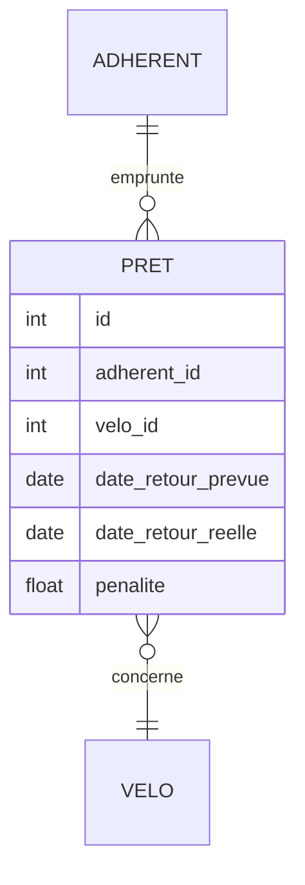
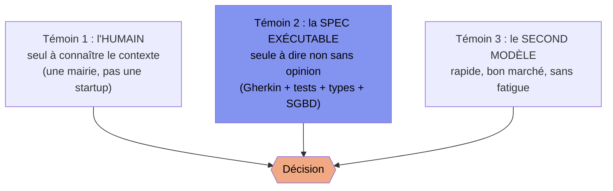

[← Chapitre précédent](07-agents-et-leur-laisse.md) · [Sommaire](Readme.md) · [Chapitre suivant →](09-reglementation-ia.md)

# Chapitre 08 — L'IA pour la conception, les tests et la documentation

> **Dans ce chapitre**, vous apprendrez à :
> - **Faire produire plusieurs options** à l'IA et trancher sur des critères écrits, pas sur son assurance ;
> - **Repérer les défauts d'un modèle de données, d'une maquette ou d'une décision écrits par l'IA**, et en réécrire ce qui engage ;
> - **Écrire les tests depuis le contrat** et non depuis le code : déléguer les entrées, jamais les valeurs attendues ;
> - **Vérifier une documentation générée** commande par commande, option par option, chiffre par chiffre ;
> - **Croiser les témoins** — humain, spécification exécutable, second modèle — et appliquer la règle de préséance.

**Accroche (sondage) :** « L'IA écrit le code et les tests. Qui vérifie, au final ? »

---

Nous avons délégué de plus en plus loin : des portes (ch. 03), un contexte (ch. 04), une boucle qui rend sa copie à l'IA (ch. 05), des agents (ch. 07). Le sondage pose la question qui reste, et il la pose mal : elle attend une réponse en un mot.

« L'humain » ? Faux, pour une raison simple : quiconque relit 400 lignes générées en trente secondes ne relit rien. Il confirme ce à quoi il s'attendait. La vraie réponse est une règle de partage :

> **L'IA propose, l'humain ou un capteur exécutable dispose.**

*Propose* : brouillon, options, premier jet — bon marché à produire, dangereux à croire. *Dispose* : tranche. Il n'y a que deux autorités pour trancher : un **capteur exécutable** (un test, un type, un compilateur, un SGBD — ce qui dit non sans opinion) ou un **humain qui assume** et signe. Ce que nous refuserons à l'IA dans ce chapitre se justifie toujours de la même façon : elle ne peut pas *disposer*, elle n'a pas de peau dans le jeu.

Un avertissement d'ouverture. Prenez un **ORM** (*object-relational mapping* — un outil qui génère le code d'accès aux données, Prisma par exemple) : vous gagnez un **nouveau terrain d'hallucination** (`prisma.pret.findMany`, des méthodes qui *sonnent* juste) et surtout **du code généré que plus personne ne relit**. Le piège est plus fin qu'il n'y paraît : le compilateur TypeScript qui vous protège est, lui aussi, généré par l'outil. Le témoin n'est plus indépendant de l'accusé. Toute la thèse du chapitre est là.

## 8.1 Conception : trois options, pas LA solution

### 8.1.1 Demander trois options

« Comment on gère les pénalités de retard au comptoir ? » Vous recevrez **une** solution, bien écrite, avec un « voici la meilleure approche ». Mauvais livrable — non qu'elle soit mauvaise, mais qu'elle est **seule** : vous jugez une solution sans avoir jugé le problème.

Demandez trois approches, leurs compromis, et **ce qui trancherait**. Le même modèle devient bien meilleur quand on lui demande de comparer plutôt que de connaître votre contexte.

| | A. Calcul à la demande | B. Montant figé au rendu | C. Journal d'événements |
|---|---|---|---|
| **Principe** | On ne stocke rien, on recalcule | Colonne `penalite_cents` écrite au rendu | On n'écrit que des faits, on additionne |
| **Ce qui casse** | Le ticket d'hier ne correspond plus si le barème bouge | Deux sources de vérité ; changer le barème = reprise d'historique | Plus de code ; l'IA inventera un événement qui n'existe pas |
| **Auditabilité** | Aucune | Moyenne | Bonne, historique rejouable |

Lisez la case C, dernière ligne : *rejouable pour qui ?* Pour un service public — des tickets que l'usager garde, un devoir de traçabilité. Ça, le modèle ne le sait pas : il l'a deviné parce que vous avez écrit « comptoir municipal ». Retirez ces trois mots et la colonne C s'évapore. Le chapitre 01 revient par la fenêtre : ce qui manque n'est pas de l'intelligence, c'est de l'établi.

Ce qui tranche n'est donc pas votre goût, mais deux questions écrites : *un ticket doit-il rester valable après coup ? le barème peut-il changer en cours d'année ?*

### 8.1.2 L'ADR : généré par l'IA, argumenté par vous

L'option choisie se trace dans un **ADR** (*Architecture Decision Record* : contexte, décision, conséquences — une page). Bonne délégation, à condition de couper la page en deux.

```markdown
# ADR-004 — Pénalités : journal d'événements, pas de colonne
Date : 2026-11-09 · Statut : accepté par <votre nom>

## Contexte      ← l'IA rédige bien (elle reformule ce qu'on lui donne)
## Décision      ← l'IA rédige bien (elle reformule ce qu'on a tranché)
## Conséquences  ← ICI C'EST VOUS. La seule partie que quelqu'un lira.
```

Les « conséquences » d'un ADR écrit par une IA sentent bon l'auto-congratulation : *cette approche améliore la maintenabilité et la scalabilité*. Pire que du vide : ça occupe la case où devait figurer le prix payé. La consigne qui marche — **« liste ce que cette décision rend impossible ou plus cher, et l'objection la plus forte »**. Vous relirez cette ligne, et vous la réécrirez. **L'IA rédige l'enveloppe, l'humain met le prix** : un ADR qu'on ne peut pas défendre à l'oral ne laisse que la signature.

### 8.1.3 La revue par IA, et ce qu'elle ne verra pas

Gratuite, donc systématique — avant la revue humaine, qui coûte. Mais sachez ce que vous achetez : une revue par IA excelle sur **les erreurs de la classe qu'elle a vues mille fois** (cardinalités incohérentes, clé étrangère orpheline, table de jointure manquante, date en texte, index absent). Elle rate :

- **Ce qui n'existe que chez vous.** Le preneur est une collectivité : règle de conservation des justificatifs ? Elle ne peut pas le savoir, et ne le demandera pas (ch. 02 : elle ne lève jamais la main).
- **Ce qui est faux sans forme.** Une règle métier mal comprise n'a pas de symptôme syntaxique.
- **Ce que vous n'avez pas écrit.** Un MCD muet sur le prêt multi-articles ne sera pas interrogé : l'IA complète l'absence au lieu de la signaler.

Deux réflexes : ne demandez jamais « est-ce que c'est bon ? » — la question est fabriquée pour obtenir un compliment — mais **« qu'est-ce qui rendrait cette conception fausse ? »** ; et faites relire **l'artefact**, pas votre jugement. Une IA critique mieux un diagramme qu'elle ne décide s'il faut un diagramme.

### 8.1.4 MCD généré contre MCD manuel

Voici le **MCD** (*modèle conceptuel de données*) du comptoir, sorti en trente secondes sur « modélise les prêts, les adhérents et les pénalités » :



Net, propre, ça a l'air juste. **Cerclons cinq choses** — le travail que nous ferons en direct sur les captures de l'E0 :

1. **`float penalite`** : de l'argent en flottant. Le bug `Math.floor(19.99 * 100) = 1998` du chapitre 01, promu colonne de base de données — donc persistant, donc partout.
2. **`penalite` stockée alors qu'elle est calculée** : deux sources de vérité, la règle (1,50 €/jour ouvré, plafond 15 €) et la colonne. Le jour où elles divergent, personne n'a raison.
3. **`PRET }o--|| VELO`** : un prêt porte **un** vélo. Or la f2 prête du matériel, et un sac de matériel, c'est plusieurs articles.
4. **Pas de table `CAUTION`**, alors que la f2 en a une avec sa vie propre (30 € versés, retenue partielle, restitution conditionnée). L'IA a « simplifié » : elle a oublié une exigence.
5. **`ADHERENT` au singulier** : inoffensif ici, moins quand le SQL généré écrira `adhérents` et le code `members`.

Le MCD manuel est laid, lent, et juste : une table `PRET_LIGNE` (plusieurs articles par prêt), une entité `CAUTION` avec `montant_cents` et `date_restitution`, et `penalite` **retirée** — elle se calcule, elle ne se stocke pas. Des centimes en entier, pas des euros en flottant : un humain a pris cette décision *parce qu'il se souvenait du chapitre 01*. Voilà la différence entre une conception générée et une conception conduite : la seconde a une mémoire.

### 8.1.5 La maquette : objet d'étude critique

Pour les écrans, nous utilisons **Stitch** (Google Labs) : on décrit un écran en langage courant, il sort l'interface et son HTML. Gratuit, spectaculaire — cinq écrans en une minute, ce qui est une après-midi à la main. Nous l'utilisons **comme objet d'étude**, pas comme outil à adopter, et voici les cinq faits à connaître avant d'y taper quoi que ce soit :

| Fait | Conséquence |
|---|---|
| **Beta, sans SLA** (SLA = engagement de service et de disponibilité) | Rien ne garantit que ça marchera demain, ni en direct. **Captures de secours obligatoires.** |
| **Quotas quotidiens** | Une classe entière le même matin peut épuiser le quota. Le secours n'est pas optionnel. |
| **Entraînement sur les données par défaut** | Ce que vous tapez sert à entraîner le modèle. **Jamais de données personnelles, jamais de données clients.** Le RGPD (*Règlement Général sur la Protection des Données*) n'est pas un chapitre 09 : c'est une consigne de saisie, aujourd'hui. |
| **Sortie = HTML statique** | Pas une interface : **une photo** d'interface (HTML : le langage des pages web). |
| **Export limité** | Ce qu'on récupère est jetable ; pour du code de production, on recommence. |

Et ce que le HTML rate, noir sur blanc : **les états** (vide, chargement, erreur — un écran plein de belles données ne dit rien du premier jour d'un usager) ; **la validation** (un champ date qui accepte `31/02/2027` — c'est le chapitre 02 qui devra le refuser) ; **l'accessibilité** (labels, focus visible, ordre de tabulation, contrastes : rien — inutilisable au clavier, donc exclu du service public, référentiel WCAG) ; **la persistance** (rafraîchir efface tout, il n'y a pas d'« après ») ; **le comportement** (le bouton « Enregistrer » ne soumet rien, il *ressemble* à un bouton).

C'est là que la maquette générée est **plus dangereuse qu'un croquis**. Un croquis au feutre annonce qu'il est un croquis : personne ne croit qu'un carré est un formulaire. Une maquette générée **a l'air finie**, et ça décourage la question — devant un rendu léché, un stagiaire ne dit pas « ça ne marche pas ? », il dit « c'est beau ». Méfiez-vous de tout livrable IA dont la finition excède la substance : c'est que la finition *est* la substance.

**Le secours, sans licence ni compte** : on dessine à la main sur **Excalidraw** (manuel — la génération par texte y est payante, donc hors de notre jeu « zéro licence »), puis **l'IA de la classe** passe le croquis en HTML. On garde le geste, on perd la magie, on ne donne rien à un tiers.

Pas de catalogue d'outils — il serait faux dans six mois. Cinq critères, qui répondent à n'importe quel outil qu'on vous présentera : **sortie** (jetable ou base du produit ?), **lock-in** (peut-on partir avec ses fichiers ?), **données** (entraîne-t-il sur ce que je tape, par défaut ?), **export** (quel format, que perd-on ?), **gratuité** (aujourd'hui, en classe entière, en entreprise ?).

### 8.1.6 Le SQL : l'usage où l'IA brille

Après tant de « vérifiez », une réhabilitation méritée. Générer du **SQL** depuis un modèle de données est exactement ce qu'une IA fait bien : mécanique, volumineux, bien documenté, et **vérifiable par une autorité sans avis**. Le **SGBD** (système de gestion de base de données) est le capteur le plus impitoyable de la filière : il ne flatte pas, il refuse.

```sql
-- db/schema.sql (extrait, généré depuis le MCD « cerclé » du 8.1.4)
CREATE TABLE pret (
  id                  INTEGER PRIMARY KEY,
  adherent_id         INTEGER NOT NULL REFERENCES adherent(id),
  date_retour_prevue  TEXT    NOT NULL,
  date_retour_reelle  TEXT
);
```

```bash
$ sqlite3 :memory: ".read db/schema.sql"        # aucune erreur : le schéma « passe »
$ sqlite3 :memory: ".read db/schema.sql" "PRAGMA foreign_keys = ON;" \
                 "INSERT INTO pret (adherent_id) VALUES (1);"
Error: no such table: main.adherent
```

Deux leçons, qui sont les deux leçons du chapitre :

1. **Le capteur ne parle que si on l'allume.** SQLite **n'applique pas les clés étrangères par défaut** : la première commande a accepté sans ciller une référence vers une table inexistante. Il a fallu `PRAGMA foreign_keys = ON`. *Environnement > prompt* : la vérification ne vit pas dans la consigne, elle vit dans la configuration du terrain.
2. **Elle s'exerce à l'écriture, pas à la création.** Le schéma est vert tout seul ; c'est le premier `INSERT` qui l'accuse. Un pipeline qui se borne à créer la base ne teste rien.

Dans le cours, la commande qui compte est donc `npx vitest run` : le dépôt applique `schema.sql` à chaque scénario, sur une base `:memory:` par scénario. Le SGBD est interrogé pour de vrai, sans service à démarrer.

## 8.2 Tests : depuis le code, ou depuis la spec

La partie la plus rentable du chapitre tient dans une distinction que presque personne ne fait consciemment : **une IA à qui l'on demande des tests prend sa source là où vous lui mettez sous les yeux.**

| | **Depuis le code** (le *test miroir*) | **Depuis la spec** (le test fécond) |
|---|---|---|
| Ce qu'on lui donne | L'implémentation | Les scénarios Gherkin (ch. 02) |
| Son oracle, ce qui définit « juste » | **Le code lui-même** | **Le contrat** |
| Au jour 1 | Vert, garanti | Rouge, souvent — et c'est voulu |
| Ce que ça protège | Ce que le code fait déjà | Ce que le code **doit** faire |
| Face à un bug | **Il le consacre** | Il le dénonce |
| Dans le temps | Décroît : il ne peut que confirmer | Constant : il est le contrat |

Le **test miroir** n'est pas un mauvais test, c'est un test **tautologique** : il affirme que le code fait ce que le code fait. Il passait avant-hier, passera demain, et passait déjà le jour où le bug est entré. Pire, il **inscrit le bug dans la documentation** sous l'étiquette « comportement attendu ».

Dans la boucle du chapitre 05, c'est **pire que pas de test**. L'agent code, la CI juge, l'agent corrige jusqu'au vert : branchez une suite miroir et vous obtenez une machine qui **converge avec conviction vers la conservation du bug**, ajoutant à chaque tour de quoi faire taire un test qui avait tort. Le critère d'arrêt doit être extérieur à ce qu'il évalue — le chapitre 02, section 2.4, l'avait posé : la spec est le frein.

**Promesse du chapitre 01, tenue ici** : *la couverture de code n'est pas le nombre d'assertions utiles*. Une suite miroir atteint 100 % de couverture lignes sans une assertion qui morde. La couverture mesure ce que vos tests **touchent**, pas ce qu'ils **interdisent** ; un test qui ne peut pas échouer ne protège rien, qu'il couvre trois lignes ou trois cents.

### 8.2.1 Déléguer les entrées, jamais les sorties

**Les données : déléguez large.** Vingt jeux de dates couvrant week-ends, chevauchements, bissextile, fins de mois : mécanique, pénible pour vous, gratis pour elle. Les cas limites qu'un humain n'énumère pas à 17 h 45, elle les énumère.

**Les valeurs attendues : jamais.** Dès qu'elle doit *inventer* le résultat, elle le déduit du code (miroir) ou le calcule plausiblement (`Math.floor`, encore lui). Le montant attendu vient du contrat — donc de vous, donc du fichier `.feature`. Une phrase : **l'IA propose les cas, le contrat propose les montants.**

### Prolongement (facultatif) — le capteur qui teste vos tests

Le **mutation testing** mesure une suite sans la lire : on casse le code *exprès*, une ligne à la fois (`15` devient `20`, `>` devient `>=`), et on relance. Mutant **tué** = un test a remarqué ; mutant **survécu** = votre suite n'a pas vu qu'on avait saboté le programme. C'est un test de test. L'outil de la maison est **StrykerJS**, et comme il rejoue la suite pour chaque mutant on l'emploie **ciblé** :

```bash
$ npx stryker run --mutate src/penalite.ts
```

C'est ce que nous ferons à l'exercice, sur un mutant préparé — pas une campagne complète.

## 8.3 Documentation : le miroir à haute résolution

README, spécification **OpenAPI** (le format qui décrit les routes, paramètres et codes de retour d'une API HTTP — une API étant une interface de programmation de service), guide utilisateur : la machine est excellente, rapide, et **personne ne l'exécute jamais**. C'est le problème. Un code faux est puni par la CI ; **une documentation fausse n'est punie par personne**. Elle reste, polie, bien mise en page, et elle guide les décisions des six mois suivants.

Trois défauts, dans l'ordre où vous les rencontrerez. **Les options documentées qui n'existent pas** : le README annonce `npm run seed`, `--format=csv`, une variable `COMPTEUR_API_URL` — le script n'existe pas, le drapeau est ignoré, la variable est lue nulle part ; c'est `flattenDeepSafe` en prose, sauf que personne ne lance `npx tsc` sur un paragraphe. **La doc du code d'hier** : elle décrit ce que le code *fait*, à l'instant où vous la générez ; trois commits plus tard elle est fausse avec la même assurance. **Le contrat mal raconté** : un OpenAPI qui annonce `201 Created` là où la route renvoie `200`, un champ `required` que le code n'a jamais vérifié — un client qui lit cette spec ne vous enverra pas la faute, il ne l'enverra jamais.

Checklist humaine sur toute doc générée, six questions, deux minutes :

1. **Chaque commande citée existe-t-elle ?** Copier-coller ; un `npm run seed` qui échoue est une réponse.
2. **Chaque option, drapeau, variable est-il lu dans le code ?** Rechercher le nom exact ; zéro résultat = option inventée.
3. **Les chiffres viennent-ils du contrat ?** Comparer au `.feature` : 1,50 €, plafond 15 €, caution 30 €.
4. **Codes de retour et types de l'OpenAPI sont-ils ceux du code ?** Un test d'intégration, ou `npx vitest run` sur la couche HTTP.
5. **La doc promet-elle un comportement non testé ?** Si aucun test ne l'asserte, la phrase est une intention, pas une garantie.
6. **Un nom de personne ou une donnée réelle dans un exemple ?** Supprimer ; un comptoir municipal se peuple d'identifiants anonymes.

Une doc générée est un **miroir à haute résolution** : fidèle, magnifique, et incapable de vous dire que vous avez une tache sur la chemise.

## 8.4 Dernier rempart : croiser les témoins

Alors, qui vérifie ? Pas un gardien : **trois témoins qui n'ont pas les mêmes angles morts**, et une règle de préséance.



**La spec exécutable est l'arbitre** : elle seule dit non de façon reproductible, sans humeur ni fatigue, et c'est elle qui clôt la boucle du chapitre 05. **Le second modèle est un relecteur, jamais l'arbitre** : il déniche ce que le premier a raté et ne se fatigue pas, mais deux modèles nourris aux mêmes corpus **convergent sur les mêmes erreurs plausibles** — leur accord n'est pas une preuve, c'est une coïncidence de bibliothèque ; demandez-lui une objection, pas un verdict. **L'humain tranche ce qui n'a pas de forme exécutable** : le contexte, la licéité, la décence, le « ça, on ne le fait pas à des usagers » ; seul des trois à avoir une responsabilité, donc seul à pouvoir signer.

La préséance tient en une phrase : **sur un fait, si un humain et un capteur divergent, le capteur a raison ; si un modèle et une spec divergent, la spec a raison ; si le contexte et le capteur divergent, c'est que le capteur mesure la mauvaise chose — et cela, seul un humain le sait.**

**Réponse au sondage.** Personne ne vérifie au sens de « tout relire, à l'œil ». **On construit le dispositif où vérifier n'est pas un effort de lecture mais un fait exécutable, et on garde les décisions qu'aucun capteur ne peut prendre.** L'IA propose ; un capteur ou un humain dispose. Si l'un des deux manque, ce n'est pas la qualité qui baisse : c'est la responsabilité qui change de colonne sans prévenir.

---

### EX-08 — Le test miroir (15 min)

Voici la fonction de pénalité du comptoir, **produite par une IA depuis la phrase du client** (« une pénalité par jour de retard, le week-end ne compte pas, et on ne veut pas que ça explose »), et **relue à la vite** :

```ts
// src/penalite.ts
export function joursOuvres(dû: Date, rendu: Date): number {
  return Math.round((rendu.getTime() - dû.getTime()) / 86_400_000);
}

export function penalite(jours: number): number {
  return Math.min(jours * 1.5, 15);
}
```

**Étape 1 — les tests générés depuis le code (4 min).** Même modèle, autre consigne : « écris des tests pour ce fichier ».

```ts
// src/penalite.test.ts — généré depuis le code
test('joursOuvres compte les jours entre deux dates', () => {
  expect(joursOuvres(new Date('2026-11-06'), new Date('2026-11-09'))).toBe(3);
});
test('pas de retard, pas de pénalité', () => {
  expect(penalite(0)).toBe(0);
});
test('un jour de retard = 1,50 €', () => {
  expect(penalite(1)).toBe(1.5);
});
test('trois jours de retard = 4,50 €', () => {
  expect(penalite(3)).toBe(4.5);
});
```

Lancez, avec le rapport de couverture :

```bash
npx vitest run --coverage
```

**Étape 2 — le sabotage (3 min).** Un seul caractère changé ligne 6 : le plafond `15` devient `20`. Même suite relancée :

```bash
npx vitest run
```

Pour ne pas faire tourner Stryker sur toute la classe, **cet extrait de rapport est distribué prêt à l'emploi** (mutant ciblé, obtenu par `npx stryker run --mutate src/penalite.ts`) :

```
src/penalite.ts:6:29   NumberLiteral   15 → 20   SURVIVED
  tests exécutés : penalite(0), penalite(1), penalite(3)
  mutants tués : 0/1 · couverture lignes : 100 %
```

**Étape 3 — régénérer depuis la spec (5 min).** Même modèle, même effort, **autre source** : on lui donne les scénarios du chapitre 02.

```gherkin
  Scenario: Le week-end n'est pas compté dans le retard
    Given un vélo dû le vendredi 2026-11-06
    When l'adhérent le rend le lundi 2026-11-09
    Then 0 jour de retard est compté
    And la pénalité est de 0.00 €

  Scenario Outline: Pénalité selon les jours de retard ouvrés
    Given un vélo rendu avec <jours> jours de retard ouvré
    When je calcule la pénalité
    Then la pénalité est de <montant> €

    Examples:
      | jours | montant |
      | 0     | 0.00    |
      | 1     | 1.50    |
      | 4     | 6.00    |
      | 12    | 15.00   |
```

**Questions.**

1. Que renvoie la commande de l'étape 1, et que vaut **d'après le contrat** du chapitre 02 la première assertion du test miroir ?
2. À l'étape 2, la suite est-elle encore verte ? Que dit le mot `SURVIVED` **sur la suite**, et quelle assertion précise aurait dû tuer ce mutant ?
3. À l'étape 3, combien de tests échouent **plafond remis à 15**, puis **sabotage en place** ? Que dénonce chacun ?
4. Réécrivez `joursOuvres` : un jour ouvré est un jour **lundi–vendredi écoulé entre les deux dates, les deux bornes exclues** (contrat f1, ch. 02).

🎯 **Avant de rendre, cochez :**
- [ ] Je sais dire en une phrase pourquoi un test généré depuis le code ne peut pas échouer le jour où on l'écrit.
- [ ] Je sais expliquer ce que `SURVIVED` apprend sur la **suite**, pas sur le code.
- [ ] Je montre, sur ce cas, en quoi 100 % de couverture n'a rien garanti (promesse du ch. 01).
- [ ] J'ai vérifié ma correction avec `npx vitest run`, et elle passe **sans** le sabotage.

<details>
<summary>Voir la correction</summary>

**1.** Elle passe : 4 tests sur 4, 100 % de couverture lignes. Et la première assertion est **fausse au regard du contrat**. Vendredi 2026-11-06 → lundi 2026-11-09 : entre les deux bornes exclues il y a samedi et dimanche, donc **0 jour ouvré**, donc 0,00 € — c'est le scénario week-end du chapitre 02, mot pour mot. Le code renvoie 3 (jours **calendaires**) et le test miroir **inscrit 3 comme comportement attendu**. Le bug n'a pas été raté : il a été **certifié**.

**2.** Oui, toujours verte — c'est le cœur de l'exercice. `SURVIVED` veut dire : *on a saboté le programme et votre suite n'a rien vu*. Ce mutant ne change le résultat que là où `jours * 1.5` dépasse 15, donc à partir de 11 jours (11 × 1,50 = 16,50 €). Les tests miroir s'arrêtent à 3 jours (4,50 €) : **aucune de leurs assertions n'atteint le plafond**, parce que le miroir n'a reproduit que les exemples que le code lui suggérait. L'assertion qui aurait dû le tuer est celle du contrat : `penalite(12)` doit valoir **15** (12 × 1,50 = 18 € → plafonné à 15 €). Ce que ce rapport mesure est la suite, pas le code : un capteur insensible à un sabotage n'est pas un capteur.

**3.** Plafond remis à 15, suite issue du Gherkin : **1 échec** — le week-end, `attendu 0 · reçu 3`. Le bug d'origine est dénoncé **sans avoir rien cassé** : c'est la différence de nature entre les deux sources. Sabotage en place : **2 échecs** — le week-end, plus la ligne `12 → 15.00` de l'`Examples`, qui reçoit 18 (18 < 20, le plafond ne s'applique plus) au lieu de 15. Le même jeu de tests tue le mutant **et** dénonce le bug, sans que personne l'ait écrit en connaissant l'un ou l'autre.

**4.** Une implémentation correcte :

```ts
export function joursOuvres(dû: Date, rendu: Date): number {
  let n = 0;
  const d = new Date(dû);
  d.setUTCDate(d.getUTCDate() + 1);          // borne de départ exclue
  while (d.getTime() < rendu.getTime()) {     // borne d'arrivée exclue
    const j = d.getUTCDay();
    if (j !== 0 && j !== 6) n++;              // ni dimanche, ni samedi
    d.setUTCDate(d.getUTCDate() + 1);
  }
  return n;
}
```

Vendredi 06 → lundi 09 : on part du 07, on s'arrête avant le 09 → samedi, dimanche → **0**. Jeudi 05 → lundi 09 : vendredi compté → **1**, soit 1,50 €. Deux dates, deux scénarios du chapitre 02, le contrat est verrouillé.

**La leçon n'est pas « les tests générés sont mauvais ».** Elle est : **la valeur d'un test ne dépend pas de qui l'a écrit, mais de la source de sa vérité.** Un test dont l'oracle est le code est un miroir, écrit par un humain ou par dix modèles. Un test dont l'oracle est le contrat est un capteur. Le chapitre 02 vous a fait écrire ce contrat pendant une journée : le voici qui paie.

</details>

---

## Vérifiez vos acquis

Six questions, non notées, à faire avec l'IA : elles servent à vous situer, pas à compter une note.

**1. Dans le MCD que l'IA sort en trente secondes pour le comptoir, la ligne `float penalite` est cerclée en premier. Pourquoi ?**
- A. Le flottant arrondit toujours à la hausse, ce qui fait sauter le plafond de 15 € dès le deuxième jour de retard.
- B. C'est de l'argent en flottant : le bug du chapitre 01, mais écrit en base, donc durable et partout.
- C. Rien à redire sur le type : le seul défaut cerclé est que la pénalité soit stockée alors qu'elle se calcule.
- D. Un flottant ne rend pas les décimales exactes en SQL : il fallait un DECIMAL pour coller au SGBD du comptoir.

**2. Dans le chapitre, `sqlite3 :memory: ".read db/schema.sql"` passe sans erreur alors que `pret` référence une table `adherent` absente. Que faut-il pour que le schéma soit vraiment vérifié ?**
- A. Rien : la commande a validé le schéma, et un SGBD contrôle ses clés étrangères dès la création des tables.
- B. Faire vérifier le fichier de schéma par `npx tsc --noEmit`, qui refuse toute référence vers une table inexistante.
- C. Le faire relire par un second modèle : son accord sur les références croisées valide le modèle de données.
- D. Allumer `PRAGMA foreign_keys = ON` et insérer une ligne : le capteur ne parle que si on l'allume.

**3. Dans EX-08, le rapport Stryker affiche `15 → 20 SURVIVED` avec 100 % de couverture lignes. Que signifie ce mot ?**
- A. On a saboté le code et la suite n'a rien vu : le défaut concerne les tests.
- B. Le mutant est infalsifiable : aucune assertion ne peut atteindre la ligne 6 sans réécrire toute la suite depuis le code.
- C. La couverture annoncée est fausse : Stryker signale que les 100 % de Vitest ne sont pas réellement atteints.
- D. Le plafond ne change aucun résultat dans la plage testée : le mutant est équivalent, la constante 15 est donc inutile.

**4. Une maquette générée montre l'écran de prêt, rempli de belles données. En quoi est-elle plus dangereuse qu'un croquis au feutre ?**
- A. Elle dépend d'un quota quotidien et d'un service en bêta sans SLA, ce qui rend toute démonstration hasardeuse.
- B. Elle est fausse sur les cardinalités : un modèle ne modélise jamais juste, il faut reprendre le schéma à la main.
- C. Elle a l'air finie : devant un rendu léché, on ne dit plus « ça ne marche pas ? », on dit « c'est beau ».
- D. Elle est exportée en HTML statique, donc il faut tout recoder à la main avant de la montrer à des utilisateurs.

**5. Un README généré annonce `npm run seed`, un drapeau `--format=csv` et une variable `COMPTEUR_API_URL`. Quel geste de la checklist humaine tranche ?**
- A. Demander au modèle de confirmer que ces trois éléments existent bien dans le projet, puis publier sa réponse.
- B. Copier la commande et chercher le nom exact dans le code : zéro résultat = option inventée.
- C. Régénérer le README après chaque commit pour que la doc reste collée à l'état du code à l'instant où on la produit.
- D. Compléter le README par un avertissement précisant que les options listées peuvent varier selon les versions.

**6. Un test passe au vert, mais un formateur affirme que la règle mesurée n'est pas celle d'un comptoir municipal. Que dit la règle de préséance du chapitre ?**
- A. Le capteur a raison : sur un fait, un test qui s'exprime passe avant l'avis d'un humain, quel que soit le sujet.
- B. On consulte un second modèle : reproductible et sans humeur, il arbitre entre le test et l'avis du formateur.
- C. Le capteur mesure la mauvaise chose, et cela, seul un humain le sait : il tranche.
- D. La spec exécutable est l'arbitre, donc le vert l'emporte : on aligne la règle métier sur ce qu'elle affirme.

<details>
<summary>Voir les réponses</summary>

**1 — Réponse : B.** `Math.floor(19.99 * 100)` donne 1998 (chapitre 01) : promu colonne, le bug devient persistant et se propage à toute la base. Le MCD manuel remet des centimes en entier.

Pourquoi pas les autres : `Math.floor` tronque, il n'arrondit jamais à la hausse — c'est la représentation binaire du nombre qui est approximative ; les deux défauts, le type et le stockage, sont cerclés séparément ; et le cours ne prescrit pas un type décimal mais une convention, des centimes en entier, la pénalité ne se stockant d'ailleurs pas du tout.

**2 — Réponse : D.** SQLite n'applique pas les clés étrangères par défaut : la commande a accepté sans ciller une référence vers une table inexistante. Il a fallu le PRAGMA, puis un `INSERT`. *Environnement > prompt* : la vérification vit dans la configuration du terrain.

Pourquoi pas les autres : SQLite laisse passer la référence tant que `foreign_keys` est éteint ; `tsc` ne lit pas du SQL ; un second modèle est un relecteur, jamais un arbitre — deux modèles nourris des mêmes corpus convergent sur les mêmes erreurs plausibles.

**3 — Réponse : A.** Un mutant survécu est un test de test raté : à 15 comme à 20, les quatre assertions miroir (0, 1 et 3 jours) passent pareil — aucune n'atteint le plafond.

Pourquoi pas les autres : le mutant était tuable, par `penalite(12)` qui doit valoir 15 au contrat ; la couverture est vraie, elle mesure ce que les tests touchent et non ce qu'ils interdisent ; le plafond change à partir de 11 jours (16,50 € ramené à 15) — c'est la suite miroir qui s'arrête à 3 jours, pas le code qui est indifférent.

**4 — Réponse : C.** Un croquis annonce qu'il est un croquis. Règle du chapitre : un livrable dont la finition excède la substance a la finition pour substance — et le HTML rate les états, la validation, l'accessibilité, la persistance et le comportement.

Pourquoi pas les autres : la bêta sans SLA et les quotas sont des faits réels, mais ils imposent des captures de secours ; le HTML statique est une photo d'interface au code jetable, pas une corvée de mise en forme ; les cardinalités, c'est le MCD du 8.1.4 — et sur ce genre d'erreur la revue par IA excelle.

**5 — Réponse : B.** « Chaque commande citée existe-t-elle ? » Un `npm run seed` qui échoue est une réponse. Une documentation fausse n'est punie par personne : c'est le seul artefact du cours que personne n'exécute.

Pourquoi pas les autres : le modèle réaffirme son invention avec le même aplomb ; régénérer souvent n'efface pas l'invention, et la doc du code d'hier reste fausse trois commits plus tard avec la même assurance ; un avertissement poli laisse le lecteur devant une porte fausse — la checklist retire l'option inventée, elle ne l'entoure pas d'une réserve.

**6 — Réponse : C.** La préséance a trois branches : humain contre capteur sur un fait, le capteur gagne ; modèle contre spec, la spec gagne ; contexte contre capteur, c'est que le capteur mesure à côté — et cela, aucun capteur ne le mesure.

Pourquoi pas les autres : la branche « le capteur a raison » suppose qu'il mesure bien le fait discuté, or le désaccord porte ici sur ce qui devait être mesuré ; la spec arbitre face à un modèle, pas face au contexte — un contrat écrit à côté de la plaque reste vert et reste faux ; le second modèle est un relecteur, on lui demande une objection, pas un verdict.

</details>

---

[← Chapitre précédent](07-agents-et-leur-laisse.md) · [Sommaire](Readme.md) · [Chapitre suivant →](09-reglementation-ia.md)
