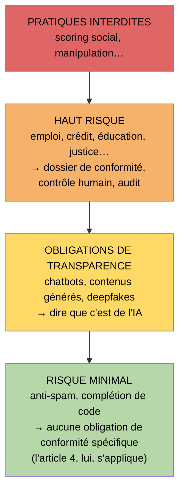
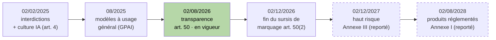
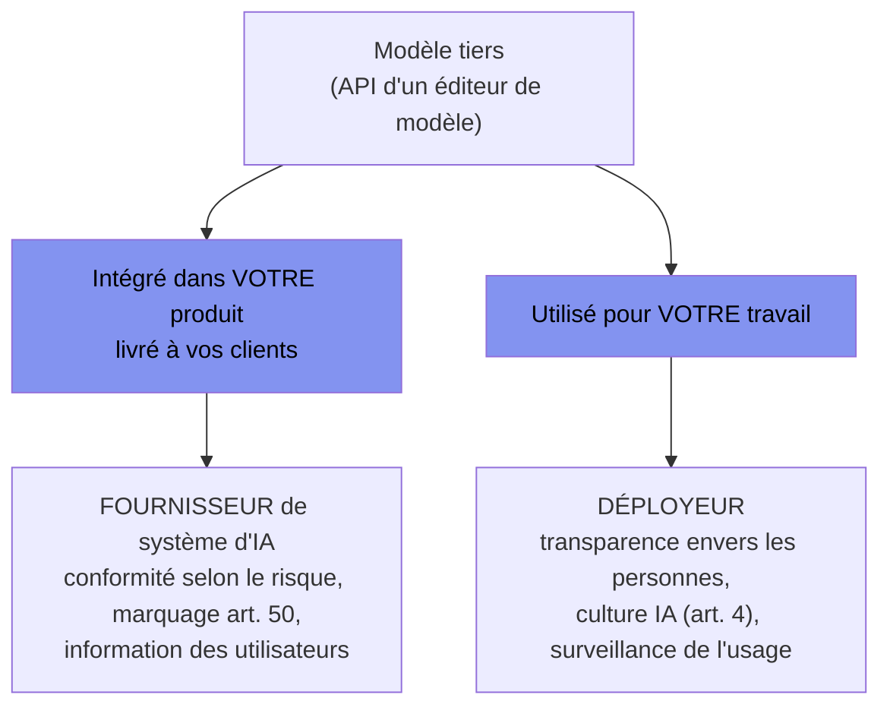

[← Chapitre précédent](08-conception-tests-doc.md) · [Sommaire](Readme.md) · [Chapitre suivant →](A-Glossaire-et-ressources.md)

# Chapitre 09 — Réglementation IA : AI Act, RGPD, licences, responsabilité

> **Dans ce chapitre**, vous apprendrez à :
> - **Situer** un usage de l'IA dans la pyramide des risques de l'AI Act et nommer l'article qui s'impose à lui ;
> - **Reconnaître** le moment où l'on passe de déployeur à fournisseur d'un système d'IA ;
> - **Minimiser** ce qui sort de sa machine : prompts, fixtures, réglages d'un outil gratuit ;
> - **Vérifier** la licence et l'origine d'un fragment généré avant de l'adopter ;
> - **Établir** sa diligence par des traces — revue, tests, CI, déclaration de la délégation.

**Accroche (sondage) :** « Quelle loi s'applique au code que vous avez généré ce matin ? »

---

Réponse, pour que le sondage ne traîne pas : **plusieurs**, et l'une d'elles vous concerne vous, pas seulement votre employeur. Ce chapitre ne fera pas de vous un juriste ; il vous rendra **reconnaissable** — qu'un texte vous tombe dessus en entretien ou en revue de code, vous saurez mettre le doigt dessus.

Avant-propos, parce que c'est le chapitre le plus daté du cours : les dates ci-dessous sont celles **en vigueur à la production de ce support**, après le « Digital Omnibus » (règlement 2026/1744 de l'**Union européenne (UE)**, juillet 2026) qui a **bougé les échéances** de l'AI Act. Le texte est paru au Journal officiel de l'Union européenne du 24 juillet 2026 et y est entré en vigueur le 27 juillet. Le présent chapitre est à jour de ce texte au 09 novembre 2026. Dans six mois elles auront peut-être bougé encore, et ce n'est pas un défaut du chapitre : c'est **sa première leçon**. La veille réglementaire fait partie du métier, au même titre que surveiller une dépendance.

## 9.1 L'AI Act en 10 min

L'**AI Act** — règlement (UE) 2024/1689 — est le **premier règlement au monde sur l'intelligence artificielle (IA)**. « Règlement », pas « directive » : il s'applique directement dans tous les États membres. Et il classe **par risques**, pas par technologies : on ne vous demande pas « quel modèle ? », mais « **quel dégât possible ?** ».



Bonne nouvelle : **l'essentiel de ce que vous faites tombe en bas de la pyramide.** Compléter une fonction, générer un test, résumer un README : risque minimal, aucun dossier à monter. Mais l'erreur symétrique — croire que tout est interdit — en est une aussi.

Ce qui vous touche vraiment tient en deux articles.

**Article 50 — dire que c'est de l'IA.** Applicable **depuis le 02 août 2026**. Il impose de **marquer les contenus générés ou manipulés par une IA** (texte, image, audio, vidéo) dans un format lisible par une machine, et d'**informer les personnes** mises en présence d'un système d'IA ou d'un contenu artificiel. Pour un dev : un chat qui répond aux usagers d'un service public doit le dire ; un article généré et publié doit être identifié comme tel. C'est l'obligation la plus proche de votre clavier.

**Article 4 — la « culture IA ».** Applicable **depuis le 02 février 2025**, dans une rédaction **réécrite par l'Omnibus, entrée en vigueur le 27 juillet 2026**. Il impose aux fournisseurs et aux déployeurs de **prendre des mesures pour développer la culture de l'IA** de leur personnel et des personnes qui manipulent l'outil pour leur compte : ce que l'outil fait, ce qu'il ne fait pas, où sont ses risques. Notez le glissement, il change votre façon de vous défendre : le règlement ne fixe plus de niveau à atteindre et ne vous demande pas de garantir celui de chacun — il demande des mesures, et donc des traces. Seul point qui n'a pas bougé : si vous déployez un système à haut risque, former votre personnel à la supervision humaine reste une obligation. En langage entreprise : **c'est une obligation de l'employeur**, pas une curiosité personnelle. C'est aussi l'ancrage officiel de ce cours, qui ne prépare aucun titre RNCP — vous ne venez pas « apprendre un outil », vous venez couvrir une obligation qui, au bout de la chaîne, est inscrite dans un règlement européen.

### La frise, après l'Omnibus



Le haut risque annoncé pour août 2026 a été **reporté à décembre 2027**, et celui des produits réglementés — qui devait courir depuis août 2027 — **à août 2028**, par un texte paru cet été. Personne ne vous reproche de l'avoir ignoré. **Ce qu'on peut vous reprocher, c'est de l'ignorer encore dans un an.** Un règlement dont les échéances bougent, c'est une dépendance dont la fin de support change : on ne s'en plaint pas, on s'abonne.

## 9.2 Fournisseur ou déployeur ?

L'AI Act ne distribue pas les obligations selon le organigramme, mais selon **ce que vous faites du modèle**.

- **Fournisseur** — vous mettez un modèle sur le marché **sous votre nom**, ou vous l'intégrez dans un produit que vous vendez comme son responsable. Vous portez les obligations du système.
- **Déployeur** — vous **utilisez** un système d'IA pour votre activité, sans le commercialiser. Obligations d'usage : transparence envers les personnes, personnel compétent, vigilance sur les sorties.



Ce qui surprend le plus d'équipes : **on change de rôle sans s'en rendre compte.** Un assistant interne branché sur l'API d'un autre, c'est de l'usage. Ce même assistant offert aux usagers sur le site de la collectivité, avec votre logo, devient un système que **vous** fournissez — les obligations ont changé de camp pendant que vous ne regardiez pas.

Reste la catégorie en amont : les **GPAI** (*general purpose AI* — modèles à usage général, les grands modèles « fourre-tout » sur lesquels tout le monde bâtit). Leurs obligations, applicables depuis **août 2025**, pèsent sur l'éditeur du modèle : documentation technique, informations transmises à ceux qui l'intègrent, politique de respect du droit d'auteur, et évaluation des risques pour les plus puissants. Un **code de bonnes pratiques GPAI** sert de référence pour y répondre. Votre intérêt est très concret : **cette documentation, vous êtes en droit de la réclamer** quand vous intégrez un modèle, parce qu'elle conditionne tout ce que vous pourrez prouver plus tard sur son comportement.

## 9.3 RGPD et prompts

Le **RGPD** (règlement général sur la protection des données) n'a pas attendu l'IA : il s'applique à un prompt comme à un fichier. Or un prompt est un **transfert** — ce que vous tapez part chez un éditeur, souvent hors de l'UE, et y est **traité** : enregistré, journalisé, parfois réutilisé.

Tout tient dans un mot : **minimisation**. On n'envoie que ce qui sert la tâche. Trois réflexes, dans l'ordre :

1. **Jamais de données clients en clair dans un prompt.** Ni nom, ni e-mail, ni téléphone, ni adresse, ni numéro de compte.
2. **On pseudonymise.** Un identifiant technique remplace la personne : `adhérent A-42`, pas `Mme Dupont, 14 rue…`. Le cours applique ça à ses propres sujets — au comptoir de prêt, les emprunteurs sont des identifiants anonymes **par construction**.
3. **On se méfie de ce qui semble technique.** Identifiant client, numéro de sécurité sociale, adresse IP, nom d'un fichier de sauvegarde : dès qu'on peut remonter à quelqu'un, c'est une donnée personnelle.

La **CNIL** (Commission nationale de l'informatique et des libertés) a publié un « questions-réponses » sur l'utilisation d'un système d'IA générative et des fiches pratiques pour les organismes qui en déploient. Sa ligne rejoint la nôtre : un service d'IA ne dispense d'aucune obligation RGPD, et il faut **écarter les données directement identifiantes**, en privilégiant l'anonymisation ou la pseudonymisation.

Le lien avec le **chapitre 04** est direct. Ce que vous décidez d'**exclure de l'établi** — le `.env`, les journaux de production, les correctifs clients, les dumps de base — n'est pas une question de propreté ni d'efficacité du contexte : **la fenêtre de contexte est une frontière juridique**. Tout ce qu'on y pose est communiqué à un tiers.

Et il reste un angle mort. Regardez ce fichier de test :

```ts
// tests/fixtures/adherents.ts — « j'ai pris un cas réel, c'est plus parlant »
export const casReel = {
  nom: "M. Bernard",
  email: "m.bernard@exemple.fr",
  cleApiPartenaire: "sk_live_9f3c…",   // récupérée sur la prod pour « reproduire le bug »
};
```

Le capteur secrets du cours l'attrape — la clé, pas le nom :

```bash
$ npx gitleaks detect
● Detecting secrets in repository…
  secret: cleApiPartenaire   rule: generic-api-key   file: tests/fixtures/adherents.ts
```

C'est la limite qu'il faut connaître : **gitleaks est réglé sur les secrets, pas sur les personnes.** Une donnée personnelle qui n'est pas une clé lui glisse sous la main. Pour la faire parler, il faut une règle dédiée (Semgrep, vu au chapitre 03, permet d'en écrire une) — et un humain qui se demande, avant de committer, *d'où vient ce fixture*. **Un capteur protège ce pour quoi on l'a réglé.**

### Cas pratique, tout de suite : les outils de cette classe

Machines personnelles, **zéro licence payante** : nous utilisons des offres gratuites — offres libres de Gemini, Groq, Mistral, OpenRouter, opencode, et Google Stitch pour le maquettage. Choix assumé. Mais une offre gratuite est un **modèle économique**, et celui-ci s'appelle souvent : **vos prompts servent à entraîner le modèle.**

Concrètement, le prompt collé ce matin — avec son extrait de code d'entreprise, son message d'erreur contenant un e-mail d'usager, son nom de client dans le chemin du fichier — peut se retrouver dans un jeu d'entraînement. Pas « en théorie » : c'est la clause acceptée, parfois par un réglage activé par défaut.

Les réglages à connaître avant d'ouvrir un outil à quoi que ce soit de sérieux :

| Ce qu'on cherche | Où | Ce qu'on en conclut |
|---|---|---|
| **Entraîne-t-il sur mes prompts ?** | Paramètres du compte — « améliorations du modèle », « données d'entraînement », « historique et activités » | À **désactiver**. Si l'option n'existe pas, c'est une réponse : rien de sensible dedans. |
| **Combien de temps c'est gardé ?** | Politique de conservation des journaux | Un historique sans limite est une surface de fuite qui grossit. |
| **Réversible, et pour qui ?** | Réglage individuel vs réglage d'organisation | Un opt-out par personne ne protège pas l'équipe : c'est une **décision d'employeur**. |
| **Un mode entreprise ?** | Offre payante ou accord de licence | C'est là que vivent en général la non-conservation et la non-réutilisation. |
| **Et Stitch ?** | Conditions de l'offre (produit en bêta, sans engagement de service) | Bêta + entraînement par défaut = **jamais de donnée personnelle**, et des captures de secours. |

Ce n'est pas de la paranoïa, c'est de l'hygiène : **on ne demande pas « est-ce que c'est grave ? », on demande « est-ce que ça sort de chez moi, et est-ce que je l'ai accepté ? »**.

## 9.4 Licences et propriété

Deux questions distinctes, qu'on mélange tout le temps.

**Le code généré est-il protégeable ?** Le droit d'auteur protège une **œuvre de l'esprit** : il faut un **auteur humain**. Un bloc sorti d'un modèle sans intervention créative humaine ne tombe pas évidence dans le patrimoine de celui qui l'a collé. Ce qui est protégeable, c'est **votre** contribution : l'architecture choisie, la spec écrite, la sélection et l'agencement, les modifications apportées. Traduction : vous ne pouvez pas interdire à un concurrent de recopier le bloc que vous avez laissé sortir de l'IA — ni vous prétendre l'auteur de celui que l'IA a recopié pour vous.

**D'où vient ce fragment ?** L'autre face, plus coûteuse. Un modèle a été entraîné sur du code existant et il lui arrive de **recopier** — un utilitaire, une implémentation, parfois un bloc entier avec ses commentaires. Si ce bloc venait d'un dépôt sous **licence copyleft** (GPL, AGPL), la licence suit le fragment et peut **contaminer** le projet qui l'accueille : redistribution du code source sous la même licence, sur un produit qui devait rester propriétaire. Ça ne se découvre pas en revue, ça se découvre dans un courrier d'avocat.

La troisième source est la plus tranquille et la plus bête : le modèle a beaucoup lu Stack Overflow et les tutoriels, et il vous ressort **cette réponse-là**, reformulée, avec ses hypothèses de 2014 et ses limites non dites. Ce n'est pas un vol, c'est une **citation revenue sous une autre forme** — le risque n'est pas juridique, il est technique : vous adoptez un avis sans savoir qu'il en est un.

Le réflexe est celui de la dépendance fantôme du **chapitre 01** : **on vérifie avant d'adopter.**

```bash
$ npm view license-checker          # on vérifie le paquet AVANT de s'en servir (ch. 01)
$ npx license-checker --summary
GPL-3.0      1 package
MIT        214 packages
Apache-2.0  38 packages
```

Une licence copyleft dans un produit fermé n'est pas un détail de conformité, c'est un risque de redistribution forcée. Ce scan est à la propriété ce que gitleaks est aux secrets : un capteur peu coûteux qui parle avant le contentieux.

## 9.5 Responsabilité : qui répond ?

Si le code de l'IA casse la paie de trente personnes, **qui répond ?** Pas le modèle, pas « l'IA » : **celui qui a intégré** — l'entreprise, l'équipe, et dans l'équipe la personne qui a validé le changement. Le modèle n'est pas une personne juridique : ni patrimoine, ni responsabilité. On ne poursuit pas un compilateur ; on ne poursuit pas une IA.

Ce qui vous protège n'est donc pas de trouver un coupable, mais d'établir **votre diligence** — ce qu'un professionnel raisonnable aurait fait à votre place. Et là, tout le cours vous revient sous un angle neuf — la **CI** (intégration continue : le pipeline qui teste à chaque modification, monté au chapitre 05) en tête.

> **La revue et la CI ne sont pas seulement des outils de qualité. Ce sont des preuves.**

Un historique de commits lisible, une revue documentée, des tests qui assertent vraiment, un pipeline rouge puis vert, une spec qui a tranché l'ambiguïté avant le code : voilà un dossier qui dit « nous avons vérifié, voici comment et quand ». Un merge direct d'un bloc généré à 17 h 42 sans trace : voilà un dossier qui dit « nous avons fait confiance ». Les capteurs du **chapitre 01** protègent le comportement du logiciel — ils protègent aussi la personne qui les a installés.

L'**ANSSI** (Agence nationale de la sécurité des systèmes d'information) publie des *recommandations de sécurité pour un système d'IA générative* : une trentaine de mesures sur tout le cycle, du choix du modèle à la production — cartographier ce qu'on utilise, cadrer les données qui entrent et sortent, maîtriser les dépendances, journaliser, prévoir l'humain là où le modèle ne répond pas. Pas besoin de les appliquer à la lettre demain ; besoin de savoir **qu'elles existent**, parce qu'un employeur sérieux les cite quand il vous demande comment vous comptez travailler.

## 9.6 En pratique au CFA et en entreprise

**Une charte d'usage existe — lisez-la.** De plus en plus d'organisations formalisent quels outils sont autorisés, sur quelles données, avec quels réglages, et ce qui doit être déclaré. Elle n'est pas là pour vous surveiller, mais pour que quelqu'un ait déjà répondu à « est-ce qu'on a le droit ». Neuf fois sur dix, l'incident redouté est un incident de charte, pas un incident de code.

**Déclarer l'usage de l'IA** — posé au **chapitre 07** : **déléguer n'est pas plagier**, à condition de le dire, en commit, en pull request ou en rapport. C'est ce qui rend un travail vérifiable, et ce qui vous distingue de quelqu'un qui fait passer la production d'une machine pour la sienne.

```
feat(comptoir): implémente le calcul de pénalité f1

Spécification : features/retards.feature (scénarios 1 à 4).
Implémentation proposée par opencode, revue ligne à ligne,
corrigée sur le cas limite week-end (scénario 4).
Tests : 4/4 verts en local et en CI.
```

Vérifier que ces mentions existent vraiment dans un dépôt, ça se commande :

```bash
$ git log --grep="opencode" --oneline
```

**Ce que les employeurs attendent d'un apprenti, là-dessus.** Pas un juriste de l'IA. Quelqu'un qui ne rougit pas quand on prononce « AI Act » en entretien ; qui sait dire *ce que son outil fait des données qu'on lui donne* ; qui déclare ce qu'il a délégué ; qui laisse des traces. C'est une compétence embauchable, et elle ne coûte que de l'attention.

---

### EX-09 — Reconnaître le problème (15 min)

*Prolongement : cet entraînement ne mord pas sur les 30 minutes de cours — il est à faire pour soi, la correction est juste en dessous.*

Cinq situations vécues. Pour chacune, **deux questions seulement** : *(1) quel texte ou quelle obligation est en jeu* — AI Act (article 4 ou 50), RGPD, licence, responsabilité ; *(2) qu'aurait-il fallu faire ?*

**Mémo (la frise du 9.1) :** 02/02/2025 interdictions et culture IA (art. 4) · 08/2025 obligations GPAI · 02/08/2026 transparence et marquage (art. 50), et début des contrôles · 02/12/2026 fin du sursis de marquage pour les systèmes déjà sur le marché · 02/12/2027 haut risque Annexe III · 02/08/2028 Annexe I.

**①** Léa met en ligne sur le site de la mairie un assistant qui répond aux demandes des usagers. Rien, nulle part, n'indique qu'une IA répond.

**②** Karim veut une meilleure réponse sur un bug de calcul de pénalité. Il colle dans le chat de l'IA gratuite un export CSV : noms, adresses et numéros de carte des emprunteurs.

**③** L'agent recopie, dans un module destiné à un produit fermé, un bloc de 40 lignes dont l'entête indique `SPDX-License-Identifier: GPL-3.0`.

**④** L'entreprise prend un abonnement d'équipe et active, sans en discuter, l'option « améliorer le modèle avec les saisies des utilisateurs ».

**⑤** Nadia envoie en production un correctif proposé par l'IA, sans le relire. Le calcul est faux. Sa défense : « c'est l'IA qui l'a écrit ».

🎯 **Avant de rendre, cochez :**
- [ ] Pour chaque situation, j'ai nommé **un** texte ou une obligation (pas trois).
- [ ] Je sais dire laquelle relève d'une décision **d'employeur** et non d'un réflexe individuel.
- [ ] Je peux expliquer pourquoi ⑤ n'est pas une réponse recevable.

<details>
<summary>Voir la correction</summary>

- **① AI Act, article 50 (transparence).** Une personne doit savoir qu'elle interagit avec un système d'IA, et les contenus générés doivent être identifiés comme tels. À noter : en mettant l'assistant **à son nom** au service du public, la mairie est passée de déployeur à fournisseur — les obligations ont changé de camp. Il fallait informer les usagers et marquer les sorties.
- **② RGPD — minimisation, données directement identifiantes.** Un prompt est un transfert vers un tiers ; noms, adresses et numéros de carte sont exactement ce qu'on n'y met pas en clair. Il fallait **pseudonymiser** : un identifiant technique par emprunteur, les montants et les dates — le bug ne demande pas qui. C'est aussi ce que le chapitre 04 exclut de l'établi, pour la même raison.
- **③ Licence — contamination copyleft.** Une licence GPL suit le fragment qu'elle couvre et peut imposer la redistribution du projet qui l'accueille sous la même licence. Il fallait écarter le bloc, le faire réécrire à partir de la spec, et passer le scan de licences du 9.4 avant adoption.
- **④ RGPD — et c'est une décision d'employeur.** Cette option décide que les prompts de toute l'équipe nourriront un modèle : elle engage des données que l'équipe n'est pas seule à pouvoir céder. Le réglage du 9.3 se tranche au niveau de l'organisation, pas compte par compte — et l'article 4 est justement ce qui rend ce choix éclairé.
- **⑤ Responsabilité.** Le modèle n'est pas une personne juridique : il ne répond de rien. Répond **celui qui a intégré**, au titre de son devoir de vigilance. « C'est l'IA » n'est pas une défense, c'est l'aveu d'une absence de contrôle. Ce qui aurait protégé Nadia : la revue, les tests qui assertent, la trace CI — des preuves de diligence, pas une excuse.

</details>

---

**Réponse à l'accroche.** Le **RGPD** si une donnée personne y est passée ; le **droit d'auteur et les licences** si un fragment protégé s'y trouve ; l'**AI Act** (article 50) si ce code produit du contenu destiné à des personnes ; l'**article 4** par votre employeur, qui doit vous avoir formé ; et le **droit de la responsabilité** dès qu'il casse, avec vous comme point de chute. Cinq réponses, un seul dénominateur : **les traces que vous laissez**. Un capteur qui dit non, une revue écrite, un commit qui déclare la délégation — ce sont les mêmes gestes qui font un bon code et un dossier solide.

Le quiz qui suit est un **entraînement**, pas une épreuve : passe-le avec l'IA ouverte. Il existe aussi en **QCM Moodle dédié**, remis par le formateur ; la note du cours se joue au QCM final **sans IA**.

---

## Vérifiez vos acquis

Six questions, non notées, à faire avec l'IA : elles servent à vous situer, pas à compter une note.

**1. Ce chapitre le dit sans détour : ce cours ne prépare aucun titre RNCP, il s'ancrit sur un article de l'AI Act applicable depuis le 02 février 2025. Lequel, et qu'impose-t-il ?**
- A. Article 4 : fournisseurs et déployeurs doivent prendre des mesures pour développer la culture de l'IA de leur personnel — une obligation de l'employeur.
- B. Article 50 : il impose depuis février 2025 de marquer tout code produit avec une IA — y compris la complétion locale — dans un format lisible par machine.
- C. Article 5 : les pratiques interdites couvrent l'usage d'un modèle tiers sans dossier de conformité — d'où l'obligation de déclarer chaque assistant de code.
- D. Les obligations GPAI d'août 2025 : quiconque intègre un modèle doit publier sa politique de respect du droit d'auteur et évaluer les risques du modèle.

**2. Un assistant interne branché sur l'API d'un éditeur de modèle sert d'abord vos équipes. Six mois plus tard, il répond aux usagers sur le site de la collectivité, avec votre logo. Que change ce glissement ?**
- A. Rien : l'éditeur du modèle porte les obligations de conformité depuis août 2025, vous restez déployeur vis-à-vis des usagers de la collectivité.
- B. Vous êtes devenu fournisseur d'un système d'IA : conformité selon le risque, marquage de l'article 50 et information des usagers ont changé de camp.
- C. Vous restez déployeur : le rôle ne bascule que si vous vendez le service, et un assistant gratuit sur le site d'une collectivité n'est pas une vente.
- D. Vous devenez fournisseur, mais seulement si le modèle a été hébergé chez vous ou ajusté sur vos données, sinon l'éditeur répond du système entier.

**3. Dans `tests/fixtures/adherents.ts` du comptoir de prêt, un « cas réel » contient un nom, un e-mail et une clé API de partenaire récupérée sur la prod. `npx gitleaks detect` ne signale que la clé. Qu'en conclure ?**
- A. Que gitleaks est mal réglé : un scan plus profond de l'historique, avec 2 ou 3 règles de plus, lui ferait voir le nom et l'e-mail dans le même fichier.
- B. Que le nom et l'e-mail ne sont pas des données personnelles (pas de numéro de sécurité sociale, pas d'adresse postale dans le fichier), donc rien à signaler côté RGPD.
- C. Qu'un capteur protège ce pour quoi on l'a réglé : il faut une règle dédiée (Semgrep, vu au chapitre 03) et un humain qui demande d'où vient le fixture.
- D. Que le fixture est sans conséquence puisqu'il ne vit que dans les tests : ni le dépôt ni la fenêtre de contexte ne sont une frontière juridique.

**4. L'équipe prend un abonnement d'équipe et active, sans en discuter, l'option « améliorer le modèle avec les saisies des utilisateurs ». Quelle lecture est juste ?**
- A. Rien de collectif : chacun reste responsable de ce qu'il tape, et il suffit que chaque membre désactive l'option « améliorations du modèle » sur son propre compte pour couvrir l'équipe.
- B. Uniquement les saisies faites après l'activation : le réglage est réversible et sans effet sur l'historique ni sur les offres gratuites déjà utilisées.
- C. Pas grand-chose : une offre d'équipe exclut en général la réutilisation des prompts, comme le fait déjà une offre gratuite sans option d'entraînement.
- D. Que les saisies de toute l'équipe nourriront un modèle : c'est une décision d'employeur, pas un réglage individuel, sur des données que l'équipe ne peut pas céder seule.

**5. Dans un module destiné à un produit fermé, l'agent recopie un bloc de 40 lignes dont l'en-tête porte `SPDX-License-Identifier: GPL-3.0`. Quel est le risque, et que fait-on ?**
- A. Aucun tant que le bloc est renommé et réécrit à la main : une licence ne suit que le code lié à l'exécution, jamais un fragment recopié dans un source.
- B. Le bloc n'est pas protégeable puisqu'un modèle l'a produit : personne ne peut revendiquer un droit d'auteur sur 40 lignes sorties d'une IA sans intervention humaine.
- C. La licence suit le fragment et peut contaminer le projet qui l'accueille, avec redistribution forcée sous la même licence : on écarte le bloc avant adoption.
- D. Détail de conformité mineur : le risque n'existe que si le dépôt d'origine est encore en ligne et si l'auteur du bloc décide de poursuivre le projet qui l'accueille.

**6. Nadia envoie en production un correctif proposé par l'IA, sans le relire : le calcul est faux et la paie de trente personnes est faussée. Sa défense, « c'est l'IA qui l'a écrit », est irrecevable. Pourquoi, et qu'aurait pu la protéger ?**
- A. Elle est irrecevable parce que l'éditeur du modèle assume contractuellement les défauts de sortie : c'est lui qu'il faut mettre en cause — pas l'équipe.
- B. Le modèle n'est pas une personne juridique : répond celui qui a intégré, et ce qui protège Nadia, ce sont des preuves de diligence — revue, tests, CI.
- C. Elle est irrecevable car la charge se partage à parts égales — devant le juge — entre l'auteur du prompt et le responsable de la CI du dépôt concerné.
- D. Elle serait recevable si la délégation avait été déclarée en commit ou en pull request : mentionner l'outil transfère la charge de la vérification.

<details>
<summary>Vérifier ses réponses</summary>

**1 — Réponse : A.** L'article 4 (réécrit par l'Omnibus, en vigueur depuis le 27 juillet 2026) porte sur les personnes qui utilisent l'outil, pas sur l'outil lui-même : « ce que l'outil fait, ce qu'il ne fait pas, où sont ses risques ». Il ne fixe plus de niveau à garantir : il demande des mesures, donc des traces. C'est une obligation de l'employeur, pas une curiosité personnelle — et c'est l'ancrage officiel de ce cours.

Pourquoi pas les autres : l'article 50 s'applique depuis le 02 août 2026 et vise les contenus générés ou manipulés présentés à des personnes, pas la complétion de fonction dans votre éditeur ; l'article 5 vise le scoring social et la manipulation ; les obligations GPAI d'août 2025 pèsent sur l'éditeur du modèle, pas sur celui qui l'intègre.

**2 — Réponse : B.** L'AI Act distribue les obligations selon ce que vous faites du modèle, pas selon l'organigramme : usage interne = déployeur, mais le même assistant offert au public sous votre nom = un système que vous fournissez. C'est ce qui surprend le plus d'équipes : on change de rôle pendant qu'on ne regarde pas.

Pourquoi pas les autres : les obligations GPAI de l'éditeur ne vous concernent pas, mais ne vous dispensent de rien ; la bascule ne passe ni par la facturation, ni par l'hébergement ou le fine-tuning — le critère est la mise à disposition sous votre nom.

**3 — Réponse : C.** Une donnée personnelle qui n'est pas une clé glisse sous la main du capteur : gitleaks est réglé sur les secrets, pas sur les personnes. Le réflexe est aussi celui du chapitre 04 — ce qu'on exclut de l'établi n'est pas une question de propreté, la fenêtre de contexte est une frontière juridique.

Pourquoi pas les autres : gitleaks a vu tout ce qu'on lui a demandé de voir, ce n'est pas un réglage à corriger ; un nom et un e-mail sont directement identifiants ; un fixture part chez l'éditeur dès qu'on le colle dans un prompt, et il a été copié depuis la production.

**4 — Réponse : D.** L'option décide que les prompts de toute l'équipe nourriront un modèle : elle engage des données que l'équipe n'est pas seule à pouvoir céder. La bonne question n'est pas « est-ce que c'est grave ? » mais « est-ce que ça sort de chez moi, et est-ce que je l'ai accepté ? » — et qui a accepté à ma place.

Pourquoi pas les autres : un opt-out par personne ne protège pas l'équipe ; la durée de conservation des journaux est un point à vérifier avant d'ouvrir l'outil à quoi que ce soit de sérieux ; la non-conservation et la non-réutilisation vivent en général dans le mode entreprise, pas dans une offre gratuite.

**5 — Réponse : C.** La licence suit le fragment qu'elle couvre et peut imposer la redistribution du projet qui l'accueille sous la même licence. Le réflexe est celui de la dépendance fantôme du chapitre 01 : on vérifie avant d'adopter — `npx license-checker --summary` est à la propriété ce que gitleaks est aux secrets.

Pourquoi pas les autres : renommer ne purge pas une licence ; le fragment recopié a un auteur humain quelque part, et sa licence court toujours ; le risque ne dépend pas d'une poursuite de l'auteur — il se découvre dans un courrier d'avocat, pas en revue.

**6 — Réponse : B.** Ni patrimoine ni responsabilité du côté du modèle : répond l'entreprise, l'équipe, et dans l'équipe la personne qui a validé. Ce qui établit la diligence d'un professionnel raisonnable : un historique de commits lisible, une revue documentée, des tests qui assertent vraiment, un pipeline rouge puis vert, une spec qui a tranché.

Pourquoi pas les autres : la responsabilité ne se déplace ni sur l'éditeur du modèle, ni sur une quote-part partagée devant le juge ; déclarer la délégation rend le travail vérifiable, mais déclarer n'est pas se décharger.

</details>

---

[← Chapitre précédent](08-conception-tests-doc.md) · [Sommaire](Readme.md) · [Chapitre suivant →](A-Glossaire-et-ressources.md)
